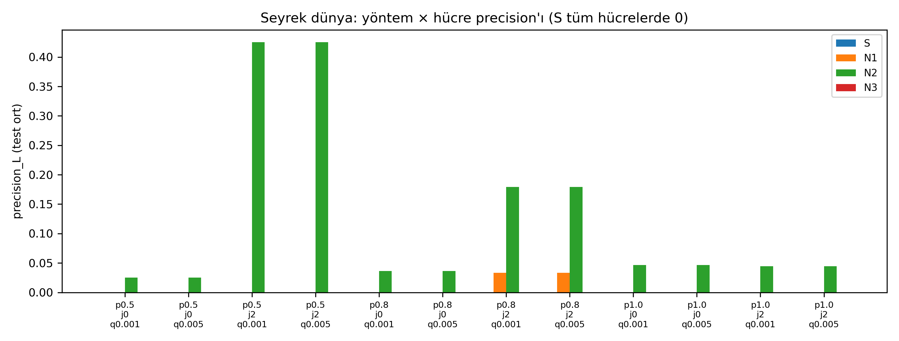
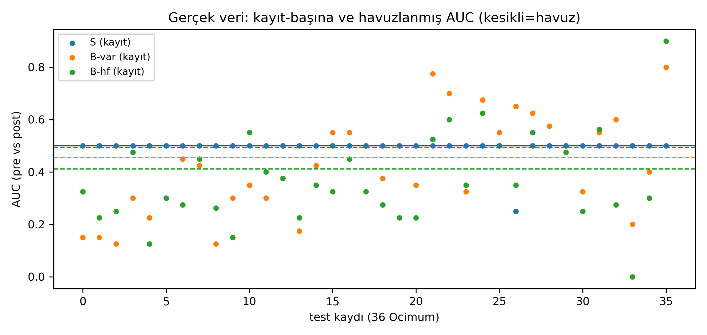

# Deneyler ve Analizler (Experiments & Analyses)

Bütün deneylerin listesi: soru, program, komut, girdi/çıktı, sonuç, sınır.
`[KOŞULDU 28 Eki]` = bu paketin kopyasında gerçekten çalıştırıldı;
`[BELGE]` = koşulmadı, kayıtlı belge + kod okumasına dayanır, sonuç sayıları
belgeden alıntıdır. Pikseller tek tek incelenmedi; grafik eşleşmeleri üretici
betik + girdi CSV ile doğrulandı.

Komut kalıpları: C++ `cd salep_core && g++ -std=c++17 -O2 -Isrc src/main_X.cpp
-o npu_X && ./npu_X` (çıktı çalışılan dizine); Python `cd salep_core &&
.venv/bin/python validate_X.py`. Güvenli koşma: [QUICKSTART.md](QUICKSTART.md) §0.

## A. Çekirdek nöron ve sinaps mekanizmaları

**A1. Tek nöron izi** — Soru: iki dallı nöron voltajı ve spike zamanları doğru
mu? Program `src/main.cpp` → `./npu_sim` [KOŞULDU 28 Eki]. Çıktı:
`neuron_trace.csv` ("500 tick, 6 ateşleme"; hash kanonikle aynı).
 (`plot_trace.py`).
Sınır: tek nöron, sentetik uyaran. [§6](salep_core/CLAUDE.md)

**A2. Olay nöronu** — `src/main_event.cpp` [BELGE]. Çıktı:
`neuron_trace_event.csv` (+ `.png`). Olay güdümlü varyantın izi.

**A3. Dal karşılaştırma S1–S3** — `src/main_branch.cpp`, `./npu_branch -all`
[BELGE]. Çıktı: `branch_s*.csv`, `branch_s*.png`, `branch_comparison.png`.
Üç senaryoda dal voltajları; erken karakterizasyon.

**A4. Çoklu nöron** — `src/main_multi.cpp` [BELGE]. Çıktı: `multi_*.csv`
(N0 hızlı / N1 yavaş / N2 dengeli). Parametre setleri sonraki deneylerde
yeniden kullanıldı (§9.3).

**A5. Kuadratik sinaps** — Soru: birlikte ateşleme büyütür, tavan durdurur,
akım taşınır mı? `src/main_synapse.cpp` [KOŞULDU 28 Eki]. Çıktı: 4 CSV.
Sonuç: büyüme OK; doygunluk sınırda (UYARI); kapalı-döngü 4/5; aktarım OK
(T2 N1=79).

Kanıtlamadığı: `S` teriminde zaman/eskime yok; Eylül bit-farkı. [§9–9.4]

**A6. Katman-1 ağı** — `src/main_network.cpp` [BELGE]. Çıktı:
`network_learning.csv` (kayıtlı PNG yok). Sonuç (belgeye göre): 3 sinaps
monoton, N3 erken→geç 1.71×, Dal-A multiplex 2.26×. Sınır: tavan erken
dolduğu için büyüme plato yaptı. [§9.5]

**A7. Kapı testleri** — `check_pattern_lobe.cpp`, `check_learning.cpp`,
`check_learn_baseline.cpp` [KOŞULDU 28 Eki]. Sonuç: 3 OZET OK
(determinizm, sınırlar, sızmasızlık). Doğruluk kapısı içermez.

## B. Faz seçiciliği

**B1. TDM demux** — `src/main_phase_group.cpp` [BELGE]. Çıktı:
`phase_group_learning.csv` (+ `.png`). Sonuç: bant-içi ≥%98,8, rakip ≥80×.

Sınır: ardışık pencere; simultane değil (bu sınır FDM'i doğurdu). [§9.6]

**B2. Simultane FDM** — Soru: tek teldeki iki ritim ayrılıp faz-kilitlenir mi?
`src/main_fdm.cpp` [KOŞULDU 28 Eki]. Çıktı: `fdm_*.csv` (3).

Sonuç: `A=A2=C=D=OK`; faz kayması ≤0.03 tick. Sınır: harmonik-faz takibi yok,
3. bant yok, tohum-duyarlılık, deterministik ızgara. [§9.8]

## C. Nedensellik ve öngörü dilimi

**C1. Nedensellik köprüsü** — `src/main_causality.cpp` [BELGE]. Çıktı:
`causality_learning.csv` (+ `.png`). Sonuç: F3 bonusu 2.11×, negatif kontrol
temiz. Sınır: Faz-3 pre-bazlı taşıma; oran-tabanlı öğrenme. [§9.7]

**C2. Q(Δt) taraması** — `plot_q_dt_curve.py` (9× `npu_causality` koşar)
[BELGE]. Çıktı: `q_dt_curve.csv` (+ `.png`). Sonuç: eğri ~düz; devre
hız-eşzamanlılığı yapıyor, alt-10-tick hassasiyeti yok. [§9.10]

**C3. Afferent + tek-adım öngörü** — `src/main_causal_afferent.cpp` [BELGE].
Çıktı: `causal_afferent_learning.csv` (+ `.png`). Sonuç: F3=37, P1 recall
0.933, lead 8.10. Sınır: precision bu yoğun dünyada ölçülemez; senaryo kablosu
öğrenilmez. [§9.18]

## D. Bitki koşullanma

**D1. Bitki NPU** — Soru: bant+sensör eşleşince sensörsüz yanıt oluşur mu?
`src/main_plant_npu.cpp` [KOŞULDU 28 Eki]. Çıktı: `plant_*.csv` (3).

Sonuç: 4/4 OK; CR 62/117/0. Sınır: 2 bant; Eylül bit-farkı; dual-rail kararı
tek-tel imkânsızlığından doğdu. [§9.11–9.12]

**D2. Bitki-sürücülü duyusal** — `src/main_sensory_plant.cpp` + TEST-B
sürücüleri [BELGE]. TEST B'nin motoru; sonuçlar F grubunda.

**D3. Kalibrasyon MC'leri** — `validate_plant_npu.py`, `validate_resonance.py`,
`validate_causality.py`, `validate_fdm.py`, `validate_plir.py` [BELGE]. Kod
öncesi parametre doğrulama (anayasa §0); `plir_decisions.csv` dahil.

## E. Duyusal lob

**E1. Lob v2 (batch/selforg/stress)** — `src/main_sensory_lobe.cpp`
(batch [KOŞULDU 28 Eki]; `--selforg/--stress` [BELGE]). Çıktı:
`sensory_lobe_learning.csv`, `sensory_selforg.csv`, `sensory_stress*.csv`.

Sonuç: taze derlemede `A=UYARI B=C=D=OK` (`A=OK` yalnız kayıtlı binary ile);
işe-alım sıralı yenilikte OK. Sınır: WTA yok; çift yenilik denenmedi;
yoğun-faz kilit kusursuz değil. [§9.14–9.16]

## F. TEST B zinciri (fizik → elektro → duyusal → afferent)

**F1. TEST B** — `validate_testb.py` → `npu_sensory_plant` [BELGE]. Çıktı:
`testb_{sensors,spikes,membrane,conditions,afferent}.csv`. Sonuç: B1–B4+B6
geçti; **B5 CR üretilemedi (CR_YOK)** → kapalı çevrime geçilmedi. Tek yörünge
(seed 1). [§9.59]

**F2. Süpürmeler** — `validate_electro_sweep.py`, `validate_condition_sweep.py`,
`validate_sensory_repr.py`, `validate_fdm_sweep.py`, `validate_aonly.py`
[BELGE]. Karakterizasyonlar: 20 koşulda 16 imza; LOO saflık 0.473; süpürme
eksenleri bit-eşit (kalıcılık katılmıyor); A-only seyrekte ateşlemez.

## G. İlişki, çıkarım ve tanı (hepsi [BELGE], tek-yörünge)

- **Assoc:** `validate_assoc.py` → 163/165; etiket döngüsel (temsilin kendi
  tutarlılığı), dünya-koşulu sınıflaması değil. [§9.62]
- **Çıkarım:** `validate_inference.py` (k=3) 0.554; k=5 0.412; pencere eğrisi
  k=3–5 zirveli. [§9.68–9.69, §9.67]
- **Kuadratik varyantlar:** 0.400 / MC 0.400 (std 0) / satır-norm 0.366 —
  tabanı geçemedi, kural donduruldu. [§9.71–9.72, §9.78–9.79]
- **Karşıt kanıt:** karıştırma 286→285 (zaman-duyarsız); oran-modeli 0.446'ya
  karşı 0.554 (+0.108 mimari); B-kapalıda P2=0. [§9.73]
- **Tanı:** synergy/hygiene/metric_limits/repr_ceiling (tavan 0.92)/
  retrieval/LTD ailesi (monoton değil, hepsi kontrol altı)/forensic/
  silence_mask. [§9.70, §9.75–9.77, §9.80–9.84]

## H. Örüntü lobu

**H1. Toplu koşu k4 kapalı/açık** — `src/main_pattern_lobe.cpp --aff
... --eta 0 --k4 0/1` (k4=0 [KOŞULDU 28 Eki]). Çıktı: `mem.csv`, `log.csv`
(kayıtlı PNG yok). Sonuç: `olay=300 mem=116`; snapshot ile bit-bit aynı.
Sınır: öğrenme donuk; doğruluk kapısı yok; hep aynı kablo. [§9.95–9.97]

**H2. K4 bağıntı** — `main_pattern_lobe_k4_rel.cpp` [BELGE]. K4 ilişki probu.

**H3. Lob doğrulamaları** — `validate_pattern_lobe.py`,
`validate_pattern_unit.py`, `validate_chain_lobe.py` [BELGE]. Determinizm +
sınırlar; doğruluk kapısı yok.

**H4. K4 bataryaları** — `k4_battery.py`, `k4_research.py`, `k4_research2.py`
[BELGE]. Dosyalarında "validated DEĞİL" yazar; karakterizasyon. [§9.92–9.94]

**H5. Örüntü deney ailesi** — `pattern/`: iden1–6, kbh, kbp, kpr1,
`family_test.py`, p0/p0b (`p0_dt_curve.png`), stres v3, faz marjinleri
[BELGE]. Karakterizasyon; büyük izler paylaşım dışı.

**H6. Bellekten çıkarım (olumsuz)** — `validate_infer_pattern*.py` [BELGE].
Sonuç: 0.310/0.356'ya karşı 0.554 (B10 "gözlenmedi"). Gizlenmedi.

## I. Canlı zincir ve kodlayıcı

**I1. Canlı zincir** — `sim/sensory_chain.py` + `validate_sensory_chain.py`
[BELGE]. Tesisat/determinizm testi; koşul-doğruluğu yok. [§9.96, §9.110]

**I2. Afferent kodlayıcı** — `encoder/test_afferent_encoder.py` (T1–T12)
[BELGE]. Donduruldu; faz adresleme kimlik-korur.

## J. Bağımsız değerlendirme [BELGE]

`bench/snapshot.sh` + `stage1–9.sh` + `run_all.sh`. Sonuçlar (`REPORT.md`):
determinizm GEÇTİ; demux D1/D2 KALDI (0.871<0.90; harmonik yakalanma);
gürültüde çökme yok; ablasyon sürprizleri; seyrek nedensellik 12/12 sessiz;
gerçek veride ayrım yok (S 0.493).

Sınır: ham `results/` paylaşım dışı (83 özet dahil); Aşama 7 tekrarlanamaz.

## K. Simülatör ve web kapıları [BELGE]

`sim/selftest.py` (G1–G39; G4/G6/G7/G8 emekli), `web/gates_web.py` (G19–G38),
`web/g24_parity.mjs` (node), `live_term.py --self-test`, senaryo assert'leri.
Bu denetimde koşulmadı; komutlar belgede yazdığı gibidir.

## L. Miras ve grafiksiz çıktılar

- `network_learning.csv`, pattern `mem/log`, `sensory_*.csv` → kayıtlı PNG yok.
- `sim/out/g4_shot.png`, `g6_drought.png` → **belirsiz (miras)**: üretici kodda
  yok, yorumlanmadı.
- `sim/models/tex/*.png` → deney grafiği değil (3B doku).
