# Salep Cybernetics — From Plant Electrophysiology to Temporal Neuromorphic Computation

*An experimental prototype and its documented development history.*

🇹🇷 **Türkçe:** the original Turkish version of this document is [README.md](README.md). A one-page English overview is in [SUMMARY.en.md](SUMMARY.en.md).

> **Status: research prototype (September–October 2026).** This repository is **not** a finished diagnostic tool or product. It records what a computational architecture can and cannot do on synthetic (simulated) plant data, and how we measured it, negative results included. There is **no** claim in it that has been validated with electrode recordings from a real plant.

*Translation note: this is a full English translation of the Turkish README. The research log ([salep_core/CLAUDE.md](salep_core/CLAUDE.md)) and most other documents in the repository remain in Turkish. References such as "(log §9.8)" point to section numbers in that log.*

---

## Abstract

Plants under stress (drought, salinity, temperature, waterlogging, wounding) alter their membrane potentials and emit slow, noisy, sparse electrical events. This work asks: *can a representation of the plant's condition be learned, without labels, from such slow and sparse temporal patterns?* Rather than with a conventional classifier, we investigate the question with a **spiking neural network core** written under hardware-portable constraints (Q16.16 fixed point, no dynamic memory, deterministic time steps). The core combines multi-compartment dendritic neurons, interval-selective resonance gates (PLIR), a quadratic spike-rate learning rule, a sensory lobe and a pattern lobe. To drive the core, we built a physics-based soil–plant–atmosphere simulator with a synthetic electrophysiology layer attached to it.

Main findings: (i) two rhythms superposed on a single wire were separated and phase-locked without sequential windows; (ii) conditioned responses (Pavlov-type pairing) were learned in controlled synthetic regimes; (iii) in a synthetic plant stream, different stress conditions produced distinguishable signatures (in a 250-day trajectory, the exact signatures of 6 conditions are all different from each other). On the other hand, (iv) retrieval from memory did not beat a simple nearest-neighbour baseline (0.310/0.356 vs 0.554), the quadratic rule was not shown to improve inference (0.400 < 0.554), and in an independent evaluation the system tied with or trailed simple methods, while on real plant recordings no method exceeded chance (pooled AUC ≈ 0.49). These negative results are not hidden; they are documented as decisions that shaped the architecture.

**Keywords:** neuromorphic computing, spiking neural networks, plant electrophysiology, dendritic computation, temporal pattern learning, fixed-point arithmetic, reproducibility.

---

## How to read this repository

This document is written so that a reader with no background in the topic can follow it from start to finish. You can choose one of three paths.

| Time | Path | What you get |
|---|---|---|
| **5 minutes** | [Abstract](#abstract) → [§8 Summary of findings](#8-summary-of-findings) → [§9 Limitations](#9-limitations-and-threats-to-validity) | What is claimed, what is **not** claimed, and the level of evidence |
| **20 minutes** | In addition: [§2 Problem](#2-problem-and-research-question) → [§4 Glossary](#4-glossary) → [§6 Architecture](#6-system-architecture) | What the system is and how it works |
| **Full read** | Start to finish; experimental details are in [§7](#7-development-process-and-experiments) | The reason for every decision; the question, result and limit of every experiment |

**One-command check:** `bash run_review.sh` (g++ and python3/numpy are enough, ~2 s; it runs in a temporary copy and does not touch recorded files). It compiles an experiment and compares the SHA-256 of its output and its summary lines with the recorded values. If you want to run things yourself: [§11 Reproducibility](#11-reproducibility-setup-and-verification) and [QUICKSTART.md](QUICKSTART.md). A short review tour (Turkish) is in [INCELEME_REHBERI.md](INCELEME_REHBERI.md).

**Evidence labels.** The documents in the repository mark the evidence level of a claim with these labels (kept in Turkish in the files): `[KOŞULDU]` (*RUN*) = run and verified from a fresh build on 28 October 2026; `[BELGE]` (*DOCUMENT*) = not run, based on recorded documents and code reading; `KANITLANDI / KISMEN / HİPOTEZ / TEST EDİLMEDİ / GÖZLENMEDİ` (*DEMONSTRATED / PARTIAL / HYPOTHESIS / NOT TESTED / NOT OBSERVED*) = the language of the evidence map in [salep_core/CONTRACT_EVIDENCE.md](salep_core/CONTRACT_EVIDENCE.md) (*not observed* means "tested, but the effect did not appear").

**About the log (`CLAUDE.md`).** `salep_core/CLAUDE.md` serves two purposes: its opening sections (§0–§8) are the standing architectural instructions given to the AI agent that writes code; the later sections (§9.x) are the development log. References in this document such as "(log §9.8)" point to the numbers in that log. Because the file is part of the working method, its name and location were deliberately left unchanged.

---

## Contents

1. [Origin of the research](#1-origin-of-the-research)
2. [Problem and research question](#2-problem-and-research-question)
3. [Background and related work](#3-background-and-related-work)
4. [Glossary](#4-glossary)
5. [Method and working principles](#5-method-and-working-principles)
6. [System architecture](#6-system-architecture)
7. [Development process and experiments](#7-development-process-and-experiments)
8. [Summary of findings](#8-summary-of-findings)
9. [Limitations and threats to validity](#9-limitations-and-threats-to-validity)
10. [Future work](#10-future-work)
11. [Reproducibility, setup and verification](#11-reproducibility-setup-and-verification)
12. [Repository map](#12-repository-map)
13. [AI use statement](#13-ai-use-statement)
14. [Licence, citation and data sources](#14-licence-citation-and-data-sources)

---
## 1. Origin of the research

> **Evidence note.** The part of this section describing 2022–2025 is my own account; the repository holds no records from that period. Recorded, dated and verifiable development begins in September 2026 ([log](salep_core/CLAUDE.md) §9.9, first dated entry: 8 September 2026). I have deliberately kept the two periods apart.

**Personal and intellectual background.** I carry out this project on my own, independently, outside any institutional laboratory. In 2022 I began reading machine learning papers out of pure curiosity; over time this curiosity led me to a more biologically realistic family of artificial neural networks, namely spiking neural networks and neuromorphic systems (event-driven systems that make time part of the computation). In the same year, with the help of AI tools, I developed a quadratic synaptic learning formula that depends on the firing *rates* of two neurons. Because I could not be sure whether the formula really worked, I shelved the idea; in 2026 I uploaded it to Zenodo as a working paper (Kılıç, 2026: [https://doi.org/10.5281/zenodo.22651379](https://doi.org/10.5281/zenodo.22651379)).

**Turning to plants.** In 2025 I started small-scale salep cultivation. *Salep* is the name of wild orchids (genera such as *Anacamptis* and *Orchis*) whose tubers are traditionally ground and consumed in Türkiye; "cybernetics" in this project refers to the idea of treating a living system through a *sensing–computation–feedback* loop. Cultivation raised a question for me: is it possible to monitor a plant's stress state continuously, cheaply and close to the hardware? In other words, can sensors and the plant's own electrical events be interpreted by an event-driven neural network that can run on low-power edge hardware (FPGA class)? In 2026 these two lines, the spiking learning idea and the question of plant signal monitoring, came together in the present project.

**The earlier prototype and the lesson I took from it.** Before September 2026 I developed first a browser prototype and then a Python version with a FastAPI/WebSocket backend: it contained leaky integrate-and-fire (LIF) dynamics, the quadratic learning rule, lateral inhibition and online K-means clustering. This prototype has a recorded weakness: numerical claims such as *"14 neurons read 36 phase fields with zero error"* had been built into the architecture without being tested in a real simulation. This experience set the method of the project: **I do not fix any unverified numerical claim into the code or the architecture**; every claim first goes through a small Monte Carlo trial ([log](salep_core/CLAUDE.md) §0).

**September 2026: a fresh start.** With this lesson, I rewrote the core in C++ from scratch under hardware constraints: multi-compartment dendritic neurons, fixed-point arithmetic, no dynamic memory, deterministic time steps. My goal was to be able to port the core later to a Zynq-class FPGA via high-level synthesis (HLS). I describe what came after step by step in [§7](#7-development-process-and-experiments).

## 2. Problem and research question

**Main question.** In slow, noisy and sparse plant signals, without labels and with time itself as the carrier of information, **can a representation of the plant's condition be learned from temporal patterns?**

The word "unlabelled" matters here. The classical approach is to train on recordings labelled "drought", "salt" and so on. In this work the model never sees a world-condition label at any stage; a "drought" representation, if one exists, has to emerge from the network's own dynamics (phase-selective resonance, spike timing, co-firing). Labels are used only *afterwards, during evaluation* (see [§5.5](#55-leakage-and-label-policy)).

**Sub-questions.**

| # | Sub-question | Where it is addressed |
|---|---|---|
| S1 | Can different rhythms on the same line be separated without disturbing each other? | §7 Phase 2 |
| S2 | When a frequency band is paired with a sensor, is a response learned that also appears without the sensor (conditioned response)? | §7 Phase 3 |
| S3 | In a physics-based synthetic plant stream, do different stress conditions produce distinguishable signatures? | §7 Phases 6–8 |
| S4 | Can these signatures be kept in memory and used later for inference? | §7 Phases 8–9 |
| S5 | Does the proposed quadratic learning rule gain anything over simple alternatives in terms of inference or memory? | §7 Phases 8–9 |
| S6 | Is the system reproducible, deterministic and suitable for hardware? | §5, §7 Phases 10–11 |

**Contributions (what is claimed).**

1. A **temporal SNN core** that fits hardware constraints: a multi-compartment dendritic neuron, a phase-locked interval resonator (PLIR), dual-rail (frequency/channel) addressing, a pattern lobe and a relational layer.
2. A **physics-based soil–plant–atmosphere simulator** that drives the core, a synthetic electrophysiology layer and a stochastic event engine.
3. **Methodology**: pre-registered hypotheses, frozen gates, bit-for-bit regression, a catalogue of negative results and an independent (blind) evaluation package.
4. **An open record of negative results.** Which design did not work, and why, is kept as the justification for architectural decisions.

**Out of scope (what is not claimed).** This repository does *not* provide a field diagnostic system, a model validated on real plant data, a closed-loop control system, concept formation, causal modelling or forecasting. The word "emergence" is used only in the sense of *"a candidate for observed, untargeted collective behaviour"*; it is not a proven claim.

## 3. Background and related work

This section gives a short grounding for a reader who does not know plant physiology or neuromorphic computing. It is not an in-depth literature review.

### 3.1 Electrical signals in plants

Plant cells also have membrane potentials and respond to environmental stimuli with electrical events. Two main types have been described: fast, threshold-dependent **action potentials**, and slow **variation potentials** of variable amplitude that arise from stimuli such as wounding (Fromm & Lautner, 2007; Volkov, 2006). Glutamate receptor-like channels and propagating Ca²⁺ waves have been shown to play a role in wound and defence signalling (Mousavi et al., 2013; Toyota et al., 2018); salt stress has also been reported to be transmitted by Ca²⁺ waves travelling from root to shoot (Choi et al., 2014). Compared with animal neurons these signals are **very slow** (seconds to minutes) and are generally sparse, noisy and variable depending on the stimulus. Electrode placement, plant species and response probability strongly affect recording quality: in an open plant electrophysiology dataset (Madariaga et al., 2024), only about 60% of the examined plants responded electrically to the stimulus (a response was detected in about 30% of the recordings), with a latency of ~3–6 s (in this repository: [bench/REAL_DATA_SEARCH.md](salep_core/bench/REAL_DATA_SEARCH.md)). This makes "ground truth" labels weak, and it is a **measurement limit**, not a verdict on the core.

### 3.2 Spiking neural networks

Spiking networks carry information not with continuous values but with the *timing* of discrete events (spikes); they have been described as the "third generation" of neural network models (Maass, 1997). The basic model is the leaky integrate-and-fire (LIF) neuron, whose membrane potential leaks over time and which emits a spike and resets when it crosses a threshold (Gerstner & Kistler, 2002; Gerstner et al., 2014). For richer behaviour, Hodgkin–Huxley (1952) or Izhikevich (2003) type models are used. The neuron in this project is derived from the LIF family, but instead of a single point it consists of **several compartments** (two branches + soma).

### 3.3 Dendritic computation

The dendrites of biological neurons are not just passive input collectors; they perform nonlinear processing at the branch level. Poirazi, Brannon and Mel (2003) showed that a pyramidal neuron can be modelled as a two-layer artificial neural network. This idea inspired the project's "two branches + soma, firing on two-branch coincidence" neuron design: Branch A receives the plant's phase/resonance stream, Branch B receives the sensor-derived spike code; the soma fires only if the two coincide within a time window.

### 3.4 Neuromorphic hardware

Neuromorphic engineering aims to carry the principles of the biological nervous system (event-driven, parallel, low-power) into electronic systems (Mead, 1990). TrueNorth (Merolla et al., 2014) and Loihi (Davies et al., 2018) are well-known chips in this field. The core in this project is not a chip; however, it is designed for **portability to such hardware** (fixed point, no memory allocation, look-up-table (LUT) based functions, deterministic time step). Hardware synthesis was not carried out in this work; costs were calculated on paper and by measurement (see [bench/REPORT.md](salep_core/bench/REPORT.md), Stage 8).

### 3.5 Synaptic plasticity

Hebb's (1949) principle, "cells that fire together wire together", underlies many learning rules. Spike-timing-dependent plasticity (STDP; Bi & Poo, 1998) and the rate-based BCM rule with a sliding threshold (Bienenstock et al., 1982) are well-known forms of it. Winner-take-all (WTA) competition has been studied in terms of computational power (Maass, 2000). The rule in this project is a rate-based, Hebb-like rule:

```
dw = eta · G(p,q) · Q(p,q) · S(w)
p = r_pre / RATE_WINDOW,  q = r_post / RATE_WINDOW      (spike counts in the last 30 ticks, 0..1)
G(p,q) = min(p,q)            jointly explained information; zero if either neuron did not fire
Q(p,q) = p² + q² + 2pq       second-order interaction; the signal does not collapse even at sparse firing
S(w)   = 1 − (w / W_MAX)²    soft ceiling; prevents unbounded growth (runaway)
```

The role of the rule in this work is that of an **object of research**: it is not presented as a method of proven superiority; on the contrary, the fact that it stays below a simple baseline in the inference task is recorded as a finding (§7 Phase 8). There is no claim of novelty either; no systematic comparison with BCM and similar rate rules has been made.

### 3.6 Position of this work

This work does not claim a new state-of-the-art result. Its contribution is (i) an honest and reproducible chain of experiments recording *what a hardware-friendly temporal SNN core can and cannot do*, (ii) the simulator and evaluation infrastructure, and (iii) a catalogue of negative results. The "competitors" used for comparison are deliberately simple methods (delay coincidence, autocorrelation, the Goertzel filter, the ISI histogram, variance/high-frequency energy, nearest neighbour) and an STDP variant.

## 4. Glossary

| Term | Meaning |
|---|---|
| **tick** | The discrete time step of the simulation. In the sensory lobe, 1 simulated day = 50 ticks; in live mode a tick ≈ 20 ms (50 ticks/s). |
| **Q16.16** | 32-bit fixed-point number format: the upper 16 bits are the integer part, the lower 16 bits the fraction. There is no `float/double` in the core. |
| **LUT** | Look-up table, precomputed; replaces expensive operations such as `exp()`. |
| **compartment / branch** | The sections of the neuron. Every neuron has **Branch A** (mixed/rhythm stream) and **Branch B** (sensor spike stream), plus a **soma** (cell body). |
| **soma** | The part of the neuron that makes the firing decision; it fires according to the temporal coincidence of the branches. |
| **τ (tau), `tau_resonance`** | The time constant that sets which rhythm (spike interval) a neuron is sensitive to. |
| **ISI** | Inter-spike interval; the time between two consecutive spikes. |
| **PLIR** | *Phase-Locked Interval Resonator.* A resonance gate whose ISI memory is updated only on an *accepted* spike; it rejects foreign rhythms. |
| **TDM / FDM** | Time-division / frequency-division multiplexing. TDM: rhythms arrive in consecutive windows. FDM: rhythms arrive on the same wire *at the same time* (superposed). |
| **population** | A small group of neurons with the same τ and slightly different leaks (8 members per band). |
| **WTA** | Winner-take-all; competition in which the winning neuron suppresses the others through lateral inhibition. |
| **P1 / P2** | The two layers of the sensory lobe: P1 = the layer that locks the plant spike onto a phase line; P2 = the condition bank (condition = frequency band + sensor pair). |
| **dual-rail (Rail-F / Rail-C)** | Two-rail addressing in which frequency identity is carried on a single wire (Rail-F) and sensor channel identity in separate counters (Rail-C). |
| **afferent** | The event stream from the sensory lobe to the pattern lobe; each event is a triple `(tick, post_id, tau_b)`. |
| **conditioned response (CR)** | Pavlov-type learning: after a stimulus (CS) has been presented together with a sensor, a response is produced *without* the sensor. |
| **K1–K4** | Branches of the pattern lobe: K1 = *what* (position/centre-ring), K2 = *when* (fast trace), K3 = *history* (slow trace), K4 = the relational, inter-unit coincidence layer. |
| **signature** | The set of events that appears over a day or a window (which posts, which lines, which A/B context). |
| **REV-LEARN, trace (T)** | A persistent *trace* added to the learning rule: repeated exposure leaves a lasting floor on the weight. |
| **LOO 1-NN** | Leave-one-out, one nearest neighbour: each sample is predicted, with itself left out, by the label of the most similar sample. |
| **AUC** | Area under the ROC curve; 0.5 is chance level, 1.0 perfect separation. |
| **bit-identical** | Two outputs being identical at the byte level; verified with a hash (SHA-256). |
| **gate** | A predefined automatic verification test that gives a pass/fail result. |
| **OZET** | The one-line summary each experiment program writes at the end (`OZET: A=OK ...`; *özet* = summary). |
| **TEST A / TEST B** | TEST A: heat axis; TEST B: a 250-day graded stress trajectory (normal → drought → severe+salt → interval → summer → irrigation → recovery → test). |
| **K6 / K7** | Leakage rules: K6 = ground-truth keys never go to the NPU; K7 = only a spike flag goes to the NPU. |
| **NPU** | In this project, the software core called a "neuromorphic processing unit"; it is not a real chip. |

## 5. Method and working principles

### 5.1 Working loop

Every mechanism was developed in the same order: **(1)** the claim is first tried with a small Python/NumPy **Monte Carlo** twin; **(2)** it is written into the C++ core; **(3)** the output is saved as CSV and inspected visually with matplotlib; **(4)** predefined gates are run; **(5)** the result is written to the log together with its limits. If the Monte Carlo twin and the C++ disagree, **the C++ number is authoritative**; the twin is only an approximate prediction.

### 5.2 Hardware constraints

In the core (`salep_core/src/*.h`) there is no `float/double`, `std::vector`, `new` or `std::map`; sizes are fixed; functions are side-effect free; time advances with a tick counter; events are carried in a ring buffer. These constraints were applied during development on the PC as well (the "write it in float first and convert later" approach was deliberately rejected). The cost of this was also measured: because of fixed-point rounding, a fresh build is not bit-identical to some CSVs recorded in September (see [§9](#9-limitations-and-threats-to-validity)).

### 5.3 Verification discipline

- **Determinism.** The output hashes (SHA-256) of two consecutive runs with the same seed must be equal. Randomness comes only from seeded generators (on the Python side, NumPy/hash-independent seeded streams; in the C++ test programs, an LCG with a fixed seed); the neural core itself contains no randomness.
- **Freezing and regression.** Verified components are frozen by their hash (e.g. log §9.51 for the simulator, §9.114 for the pattern lobe). Every later change must show that the old outputs of the frozen components remain *byte-for-byte identical*.
- **Gates.** Each mechanism has predefined pass/fail tests; if a gate breaks, it is first **reported**, not "fixed" by adjusting the threshold.

### 5.4 Pre-registration and the ban on post-hoc changes

In exploration and comparison experiments, hypotheses were written *before* the results were seen (e.g. log §9.45, perturbation battery H1–H8; §9.50, inference D1–D3; for the independent evaluation, the frozen [bench/TEST_PLAN.md](salep_core/bench/TEST_PLAN.md)). When a criterion was not met in the independent evaluation (e.g. the D2 latency bar), **the criterion was not relaxed**; it stayed as "FAILED". Where calibration was needed (e.g. the initial weight), this was documented separately as a distinct "calibration loop", without moving thresholds. Pre-registered hypotheses that turned out to be flawed are also on record; for example, one hypothesis as first written was corrected once it became clear that the twin had been set up incorrectly (an apples-to-oranges comparison), and this was noted explicitly (log §9.45). **One honest exception:** in the humidity-bucket experiment (log §9.47), the pre-registered bar for hypothesis H14 was 0.02; when the measured gain came out at +0.0148, the bar was lowered to 0.005 on the grounds that "the direction is solid, the magnitude is open". This is a *post-hoc* change, noted in the code and in the log, and the result of that hypothesis should therefore be read as weak evidence.

### 5.5 Leakage and label policy

- **K6.** The simulator's ground truth (`ground_truth`: root rot, salt burn, plant death...) never appears in the frames sent to the NPU; the schema prevents this structurally, and it is checked with an assert every day.
- **K7.** Only a *spike flag* goes from the electrophysiology layer to the NPU.
- **World labels.** Condition labels such as "dry" or "normal" never enter the input of any lobe; only evaluation scripts use them, when computing scores.
- **Circular-label warning.** Some labels (e.g. `true/decoy/mixed`) are derived from the representation itself and tested with the same representation. This is not leakage but a limit of the measurement design; the corresponding scores (e.g. 163/165) should therefore *not be read as world classification* (internal audit, [DENETIM_RAPORU_2026-10-14.md](salep_core/DENETIM_RAPORU_2026-10-14.md) §4).

### 5.6 Reporting format

Every experiment is described under these headings: **Question** (what we want to know), **Setup** (how), **Result** (what was measured), **Limit** (what it does *not* prove), **Decision** (what it did to the architecture). Numbers are given together with the corresponding log number.

---
## 6. System architecture

### 6.1 Overview

```
 weather data (Aydın Open-Meteo observations or synthetic)   stochastic event engine
        │                                                   (fertiliser, irrigation, cold, drainage failure, pathogen)
        ▼                                                          │
 ┌──────────────────────────────────────────────────────────────┐ │
 │ Soil–plant–atmosphere simulator  (salep_core/sim/)          │◄┘
 │  water balance · EC/salt mass · ET/VPD · stages · tuber     │
 └───────────────┬──────────────────────────────┬───────────────┘
                 │ 7 sensors (hs ts hn tn ph npk ec, 0–100)      │ membrane-potential derivative
                 ▼                                               ▼
        SensorMapper                              Electro layer (sim/electro.py)
                 │ SET (sensor values)                           │ line 0: stress-rate spikes
                 │                                               │ line 1: event bursts
                 └───────────────────┬───────────────────────────┘
                                     ▼
                 ┌──────────────────────────────────────────┐
                 │ Sensory lobe (C++, src/sensory_lobe.h)   │
                 │  P1: phase lines (PLIR-A lock)           │
                 │  P2: condition bank (Branch A ← P1, Branch B ← sensor)│
                 └────────────────────┬─────────────────────┘
                                      │ afferent events (tick, post_id, tau_b)
                                      ▼
                 ┌──────────────────────────────────────────┐
                 │ Pattern lobe (C++, src/pattern_lobe.h)   │
                 │  K1 (what) · K2 (when) · K3 (history)    │
                 │  K4 (relational) · soma · 29 units       │
                 │  REV-LEARN: G·Q·S + persistent trace T   │
                 └────────────────────┬─────────────────────┘
                                      │ mem/log, STATE
                                      ▼
        Evaluation layer: association, nearest-sequence inference, characterisation scripts
        Live: sim/serve.py → SensoryChain → web/ (WebSocket, 2D/3D view, signal panel)
```

One point to note: **world labels do not enter the lobes from anywhere in this flow** (§5.5). The CPU/harness layer only carries values and reads summaries; "making sense" has to emerge from the lobes' own dynamics.

### 6.2 Plant simulator (`salep_core/sim/`)

**Purpose.** To produce an internally consistent and reproducible "world" to drive the core. The founding principle is that nothing is a hand-written script; causal chains arise *by themselves* from the physics (e.g. drought → wilting → excess fertiliser → EC increase → root burn → death).

- **Physics (daily step).** Soil moisture (volumetric water content, VWC), a *mass-conserving* ledger for salinity (EC), evapotranspiration (ET), drainage, plant water uptake and plant stages (dormancy, sprouting, vegetative, flowering, senescence, death). The opt-in `fiziksel-v1` (*physical-v1*) preset refines the water model in 9 steps (capacity definitions θs/θFC/θWP, drainage, water ledger, plant uptake, sub-daily integration, sensor noise); the default (legacy) path is preserved bit for bit.
- **Weather.** Real Open-Meteo daily observations for Aydın (37.86°N 27.87°E, 108 m; 8 September 2025 – 8 September 2026, 366 days, no gaps) and a UV index can be read from a separate file; days outside the file are filled with synthetic weather. In addition, an intra-day temperature curve is reconstructed from the day's real min/max values for *display only*; it does not enter the physics.
- **Atmosphere chain.** Saturation vapour pressure (Tetens) → vapour pressure deficit (VPD) → ET and uptake multiplier; a closed microclimate humidity bucket.
- **Stochastic event engine (`events.py`).** Fertiliser, irrigation, cold (frost), excessive rain and drainage failure, pathogen load, drawn from seeded hazards; hidden states (failure counter, decaying pathogen load). Cascades are not coded separately; they arise from the physics.
- **Multiple cycles (`cycles.py`).** With hierarchical seeds `master → cycle → {climate, event, plant, soil}`, each plant lives a different "year type". New seed on death; endless running (death → bare soil → replanting).
- **Observation boundary.** The sensor layer can add optional seeded noise that does not feed back into the states.

**Honest limits.** Physiological parameters are a *modelling choice*, not field measurements (most are marked `TODO: DOĞRULANMADI`, *not verified*). Light and wind are not in the chain; pH and pathogen/frost severities are uncalibrated; there is no root recovery; plant salt uptake is not modelled (the only exit is leaching); the `hn/ph/npk` sensor derivations have not been validated.

### 6.3 Synthetic electrophysiology layer (`sim/electro.py`)

It derives a **membrane potential** from the plant's state (temperature, rain, irrigation, water balance, leaf/root health, stage): resting level −120 mV; drought, damage and heat shift it in the depolarising direction. Two spike lines are produced from it: **line 0** (rate-coded spikes proportional to the stress level) and **line 1** (bursts at events such as the onset of rain or irrigation). A dormant plant goes quiet (×0.25), a dead plant falls silent. Randomness is fixed by seed + day + line (it does not touch the physics stream). **This layer is an imitation**; it has not been compared with electrode recordings from a real plant.

### 6.4 Neural core (`salep_core/src/`)

- **Neuron.** Two branches + soma; each compartment has leak, a gating state (`gating_state`, NMDA-like short-term memory) and diffusion. The soma fires on the coincidence of the two branches within a time window.
- **Synapse.** Weight, target compartment, source identity, resonance time constant; learning with `dw = η·G·Q·S` (§3.5), from shared read-only tables (LUTs for G, Q, S).
- **PLIR gate.** Branch A's input gate works in two modes: the classical ISI gate (sequential window) and the opt-in PLIR; in PLIR, the ISI memory is updated *only on an accepted* spike, and a foreign spike is rejected. This makes it possible for two rhythms to ride superposed on the same wire (§7 Phase 2).
- **Cost (measured).** One neuron struct is 516 bytes (mostly `double` parameters and padding; the actual state ≈ 50 B), one synapse 24 B, the two-band FDM network with 8 members each 21.7 KB, the G/Q tables 3844 + 3844 B. Since no synthesis tool was available, the hardware numbers are on paper / measured in software.

### 6.5 Sensory lobe (`src/sensory_lobe.h`)

- **P1 (phase lines).** The layer that locks the plant spike with PLIR-A (τ ∈ {4, 12}, bw = 1).
- **P2 (condition bank).** Each P2 neuron represents a *condition*: Branch A ← P1 (plant phase), Branch B ← sensor phase line. The sensor value is encoded as a phase delay (`τ(v) = 4 + v·56/100`). The default bank has 10 active neurons (7 basic conditions + 1 replica + 2 decoys); at most 64 slots.
- **Dual-rail.** Superposing seven sensor channels on one wire as seven separate frequency bands was found to be impossible because of PLIR's honest limits; instead, frequency identity is carried on Rail-F (only the {4, 12} bands) and channel identity in Rail-C counters.
- **Self-organising bank.** An unlabelled pool listens to the shared path; identity comes from resonance, the label is taken from measurement, and when a new rhythm appears a neuron is recruited from a spare slot.

### 6.6 Afferent cable (`encoder/`, `src/causal_afferent.h`)

P2 firings are converted into events `(tick, post_id ∈ 0..63, tau_b ∈ 4..60)`. The encoding is integer-only and preserves identity (`phi_id = post·3000`, `phi_tau = ((tau−4)·36000)//57`, 12 slots). This layer is frozen.

### 6.7 Pattern lobe (`src/pattern_lobe.h`)

It aims to turn the afferent stream into a reusable temporal/spatial representation. There are 29 units, each equipped with three main branches (K1–K3) and one relational branch (K4):

| Branch | Meaning | Method (summary) |
|---|---|---|
| **K1** | *what* | Centre slot + neighbouring ring (±1, 0.2×) |
| **K2** | *when* | Branch-wide, slot-blind **fast trace** (leak 0.10) |
| **K3** | *history* | Branch-wide, slot-blind **slow trace** (leak 0.02) |
| **K4** | *relation* | Inter-unit coincidence: quantised signature, gate, similarity `r(t)`, max/argmax selection, spike-gated version; joins the soma in parallel as a real compartment |

The soma works in two stages: first the frozen F1 (K1–K3) decision, then the K4 contribution (`S4 = min(0.25; 0.125·(Vg_A+Vg_B))`). **REV-LEARN** adds a *persistent trace* to the core rule (`G·Q·S`): repeated strong exposure leaves a trace (T); when not in use, the weight relaxes not by classical decay but to a **floor** set by the trace. Re-access to the same pattern takes far fewer repetitions (§7 Phase 9).

The lobe's architecture is **frozen** (log §9.109 and §9.114); the SHA-256 values of the frozen inventory are in the log.

### 6.8 Evaluation layer

On top of the lobes there are two *learning-free* references: **association** with weighted Jaccard similarity over day signatures (`sim/assoc.py`), and order-preserving nearest-neighbour **inference** (`validate_inference.py`). They were deliberately chosen to be *dumb*, to measure "how much information" the representation produced by the lobes carries.

### 6.9 Live chain and web interface

`sim/serve.py` runs the simulation as a publisher; `sim/sensory_chain.py` passes the sensor values to a persistent sensory-lobe process every simulated day and feeds the resulting P2 events into a living pattern-lobe process. Feeding is *threshold-free* (measurement: all of the latency was in the threshold; transmission was free). The learned state (`w`, `T`, `r`; 17,668 bytes in total) can be saved and loaded in a **checkpoint** format with CRC32 (`PLST`). The `web/` package (Starlette + WebSocket, 5 Hz frames) offers a 2D terrarium view, an optional 3D tab, sensor/intervention panels and a **signal propagation panel** tied to real events. The interface is experimental; plots of internal NPU states may be incomplete or unreliable. For conclusions, the telemetry lines and the recorded CSV/OZET outputs should be relied on.

---
## 7. Development process and experiments

This section tells the story of the project **chronologically**, together with *why* each step was taken. The main line is: first the single neuron and synapse were verified (Phase 1); the problem of separating mixed rhythms on the same line was solved (Phase 2); conditioned learning and the sensory lobe were built (Phase 3); a world to drive these mechanisms was built and then deliberately *tried to be broken* (Phases 4–6); the system was made plant-driven and tested (Phase 7); what the representation carries was measured rigorously and learning rules were compared (Phase 8); the pattern lobe was built and frozen (Phase 9); it was connected to the live chain (Phase 10); and finally an independent, blind evaluation was performed (Phase 11). In every phase, the **limit** and the **decision** are given right after the result. Dates are taken from the log entries (September–October 2026).

The detailed list of experiments (commands, input/output files) is in [DENEYLER_VE_ANALIZLER.md](DENEYLER_VE_ANALIZLER.md) (Turkish); a short summary of the history is in [RESEARCH_HISTORY.md](RESEARCH_HISTORY.md).

---

### Phase 1 — Core mechanism: single neuron, synapse, small network (early September)

**Question.** Does a two-branch neuron with a quadratic synapse grow under co-firing, stop at the ceiling, and does the learned weight really carry current?

**Setup.** First a single neuron (500 ticks, 6 firings; the output SHA-256 matches the canonical value). Then a two-neuron synapse test (N0 fast rhythm, N1 slow rhythm): 20 cycles × 500 ticks of co-firing, with the weight written to CSV every tick. Four sub-tests: **L0** open-loop learning, **L1** closed loop (synaptic current fed back), **T1** transmission at low weight, **T2** transmission at the learned weight.

**Result.**
- Growth: the weight increased monotonically from 0.050 to 1.764 (88.2% of W_MAX = 2.0). After warm-up, |Δw| became about 4× smaller: the soft ceiling works.
- Closed loop: N1 firing 289 → 360 (+25%), weight 1.909; all five of the five stability checks (C1–C5) passed.
- Transmission: at low weight (0.05) N1 did not fire at all (0); at the learned weight (1.909) N1 fired 78 times. *(A fresh build gives 79, and the saturation check reports "WARNING"; see §9.)*
- **Layer-1 network.** Three synapses reached the ceiling independently and monotonically in cycle 6; N3 firing was 140 in the early window and 240 in the late window (1.71×; the expected ≥3× was not met); the multi-input effect of Branch A was 2.26× (N1 alone: 28.2% response; N0+N1 together: 63.8%).

**Limit.** `S(w)` is only a ceiling; it has no time/ageing term. Because the weight saturates early, learning in the network stops after cycle 6 (1.71× instead of the expected 3×).

**Decision.** The rule entered the core; the next step was the problem of separating different rhythms on the same line.

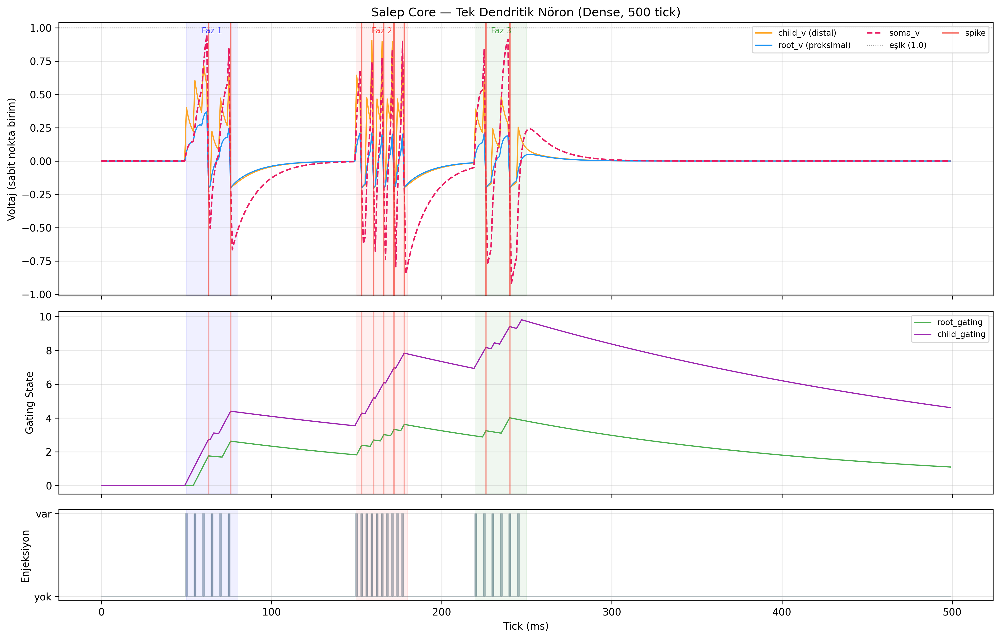
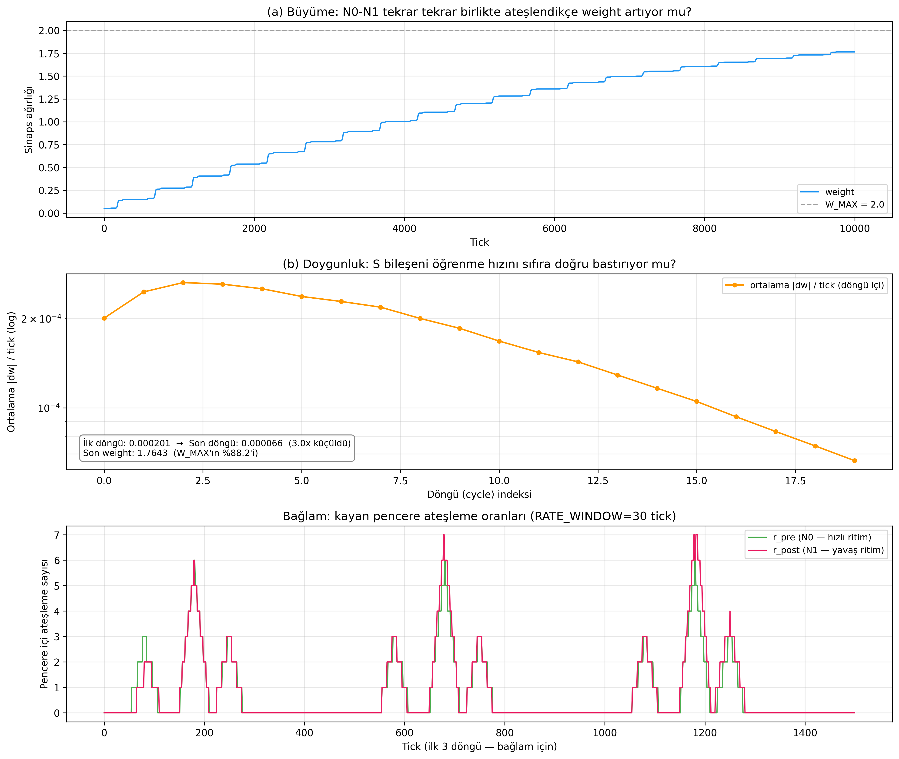

*Figure 1. Single-neuron membrane trace (top) and growth/saturation of the synaptic weight over time (bottom).*

---

### Phase 2 — Phase selectivity: two rhythms on the same wire (September)

**Question.** Can different rhythms arriving on the same wire be processed by separate neuron populations without disturbing each other?

**2a. TDM (time-division separation).** Four τ-tuned neurons (τ = 4/8/12/16) and one combining neuron. Correct in-band firing rate ≥ 98.8%, competing-band ratio ≥ 80×. **Limit:** this is *sequential-window* separation and does not prove that rhythms arriving simultaneously are separated; the record stated this limit directly.

**2b. Causality bridge.** Two rhythms and one target neuron: Phase 1 (period-4 rhythm → Branch A), Phase 2 (period-12 rhythm → Branch B), Phase 3 (both simultaneously). Target firing F3/(F1+F2) = 2.11×; the negative control for unused bands was clean (weight constant, bit-identical). **Limit:** in Phase 3 the rhythms are carried not on the same wire but each on its own line.

**2c. Q(Δt) sweep.** The period-12 rhythm was shifted by 9 different delays. With pre-registered classification thresholds (fixed before seeing the data), the curve came out **approximately flat** (dw_total spread 4.3%; amplification spread 5.5%); no bell-shaped window and no 4-period oscillation; the 12-period repetition is bit-identical. Interpretation: because learning uses 30-tick rate counters, the circuit behaves like a *rate-coincidence* detector and has no sub-10-tick spike-timing sensitivity. The log states explicitly: *"This is not a failure; it is the real transfer characteristic of the circuit."*

**2d. Root cause and PLIR/FDM.** Because the sequential-window result did not prove simultaneous separation, two rhythms (4+12) were tried on the same wire, and a flaw in the old ISI gate was found: the gate was refreshed by **every** spike that hit the wire, so the τ = 12 neuron kept seeing the period-4 spikes and was continuously damped (Monte Carlo: band-12 firing 1 with the old ISI gate, 100+ with PLIR). As the fix, **PLIR**, in which the ISI memory is updated only on an *accepted* spike, and a population of 8 members per band were added.

*Result (same SHA-256 in two runs):* lock quality R1 coverage (0.98; 0.98), absolute phase centre within ≤ 0.01 tick of the Monte Carlo prediction, phase-shift error ≤ 0.03 tick; slow-band firing 1600 with PLIR versus 8 with the old ISI gate (counter-condition R9).

*Calibration lesson.* The first C++ run did not agree with the Monte Carlo in phase. The culprit was not the core but the Monte Carlo twin, which had written the diffusion *sequentially* (the C++ uses live-c + instantaneous neighbours; an empty Branch B root behaves like an absorber). Once the twin was matched tick by tick, the single-neuron probe gave the same firing sequence ([13, 39]). No threshold was moved; the metric was derived from the twin.

**Limits (five items in the log).** (i) No slow-band phase tracking for a harmonic pair (first-spike anchor, an information-theoretic limit); (ii) sub-harmonic drift under sparse foreign spikes; (iii) with three bands the τ = 16 anchor does not hold, and there is no 3rd band in the C++; (iv) the {4, 9} slow-band lock is seed-sensitive; (v) the test grid is deterministic (bw = 1 condition).

**Decision.** PLIR/FDM became the core mechanism.

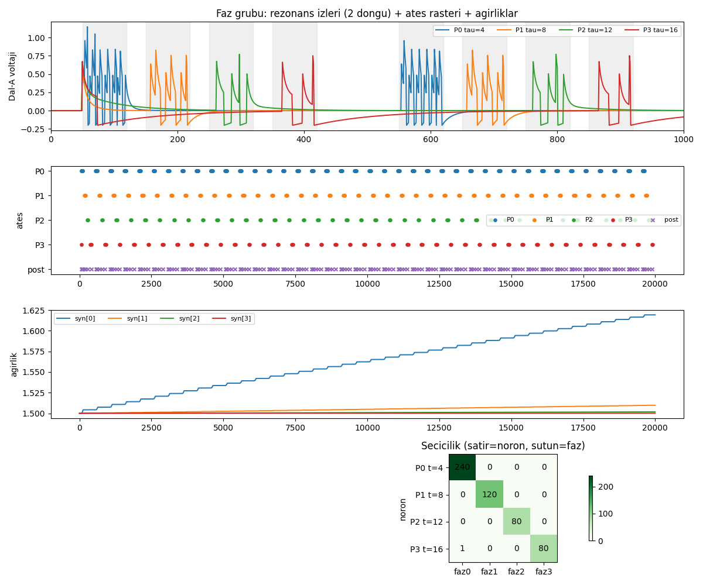
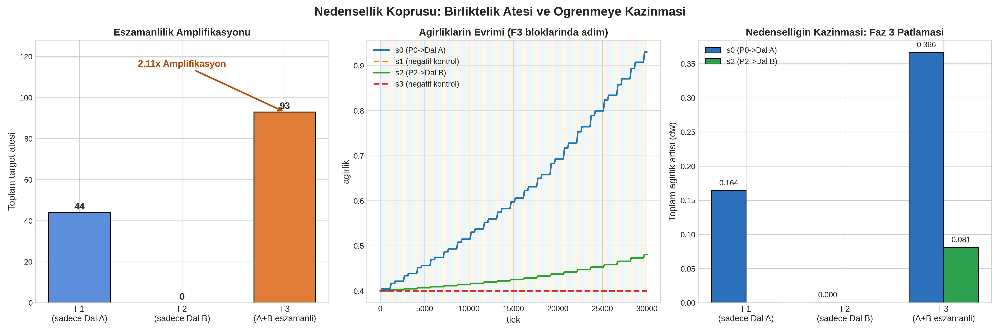
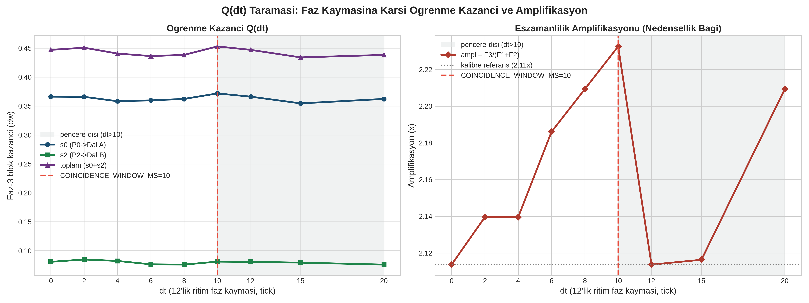
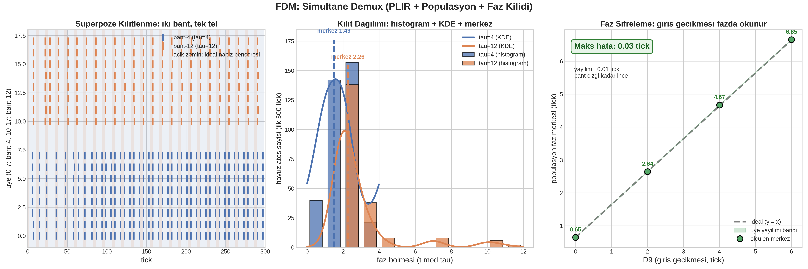

*Figure 2. In order: TDM selectivity; causality bridge (gain and negative control); Q(Δt) sweep (approximately flat); simultaneous FDM lock and phase map. These experiments do not show that any number of signals can be separated, or that a diagnosis can be made in the field.*

---

### Phase 3 — Conditioned learning and the sensory lobe (September)

**Question.** When a frequency band is paired with a sensor, does a response (CR) form even without the sensor? How does this scale to several sensors and channels?

**3a. Plant NPU (Pavlov-type learning).** Condition = a (frequency band, sensor) pair. There was a *negative control* (EC channel: same band, sensor off). Calibration was first done in Monte Carlo (24 runs); choice: `S_b = 1.0; w0 = 0.2; η = 0.2`. C++ result (`OZET: KILIT=OK KAZANIM=OK NEGATIF=OK CR=OK`, i.e. LOCK, GAIN, NEGATIVE, CR all OK): lock coverage 0.83/0.84; weight gain MOISTURE +1.54, TEMPERATURE +1.80; sensor-free test response MOISTURE 62, TEMPERATURE 117; for the EC negative control 0 and |Δw| ≈ 0. Note on the initial weight: with w0 ≥ 0.3, Branch A fires on its own and spoils the "CS alone" probe; this is why 0.2 was chosen. *The Monte Carlo prediction was approximate* (conditioning firing 415/0/993 vs 415/0/1020); the C++ number was taken as authoritative.

**3b. Architectural break: dual-rail.** Superposing seven sensor channels on one wire as seven separate frequency bands was tried, and it ran into the limits of Phase 2: each band's PLIR lock is continuously disturbed by the other bands' foreign spikes, and the coverage threshold (≥ 0.40) cannot be met. The decision was **dual-rail**: frequency identity on Rail-F (only {4, 12}), channel identity in Rail-C counters. The bank was extended to 9 posts (7 basic + 2 cross); the silenced (dw = 0) channels, and the fact that only two of the cross posts (HN←τ4, HS←τ12) learned, were honestly recorded.

**3c. Sensory lobe v2 (P1 phase lines + P2 condition bank).** Gate: `A=B=C=D=OK`. Selectivity: the acceptance rate of decoy neurons is about 0.33 of the true ones (the cost of re-locking; the same physics as the sub-harmonic limit in Phase 2). At this stage two values written in advance were **refuted** by Monte Carlo: the proposed "burst 2" increased decoys by 50% without helping the true neurons (decision: burst 1), and τ+1 was used instead of the proposed decoy τ. The literal "decoy acceptance = 0" gate was found to be *impossible* because of re-locking and was replaced with a ratio gate; this change was recorded.

**3d. Self-organising bank and stress.** Hand-assigned addressing was ended: an unlabelled pool listens to the shared path, identity comes from resonance, the label is taken from measurement, and novelty is *recruited* from a spare slot. In a 12-slot pool, when one tone and one band were added, recruitment happened for τ = 37 (tick 1813, lock 0.98) and τ = 45 (tick 3870, lock 0.92). **A bug was caught in the stress experiment:** with five simultaneous tones, the unowned spike differences clustered around ~75, and the harmonic check (75/3 = 25) recruited a **τ = 25 "ghost"** that was not on the bus. Root cause: the candidate test looked at a multiple-explanation but not at whether the candidate itself had been observed directly. The fix (a "direct evidence requirement": ≥ 2 of the six differences must lie within ±3 of the candidate) was added in two places in the code, and it was proven that the previously verified output remained bit-identical. **Capture by the wrong rhythm** was also found: the B-PLIR lock is not a blindness but a resonance state; when the lock drops on a busy path, a foreign tone's pulse misses the slot. For this reason the lock rate was not gated in the busy phase; the lock proof was given in a sparse probe, and the decision proof by order + window. Stress gates T1–T4 passed; the pool grew from 12 to 16.

**3e. Afferent cable and one-step prediction.** P2 events were connected to the pattern layer with a cable; because the event is slow (τ12–60) and the pres are fast (τ4–16), each event was converted into a short burst. In one-step prediction, "the next P2 cluster" was predicted. Result (deterministic ×2): target gain larger than a single channel, negative control zero, overflow 0, P1 prediction recall 210/225 (0.933), P3 lead time 8.10 ticks. **Limit:** in this densely periodic world, precision cannot be measured; the Monte Carlo twin behaves *more strictly* than the core in target suppression, so ratio/contrast gates were used rather than exact zeros.

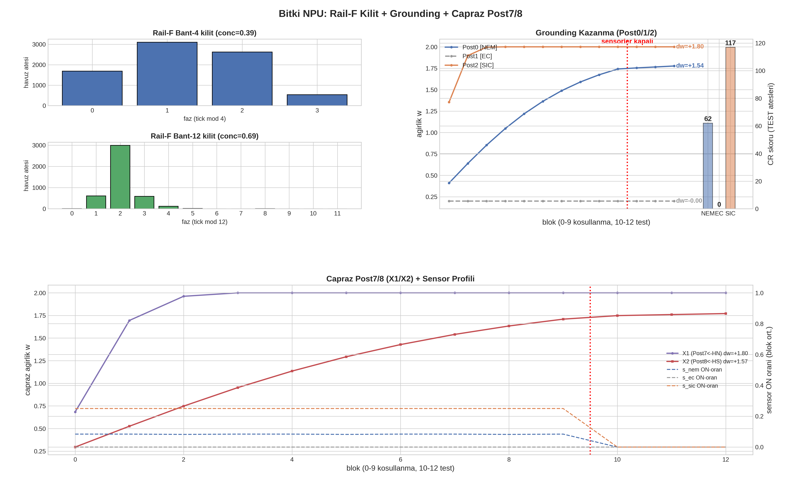
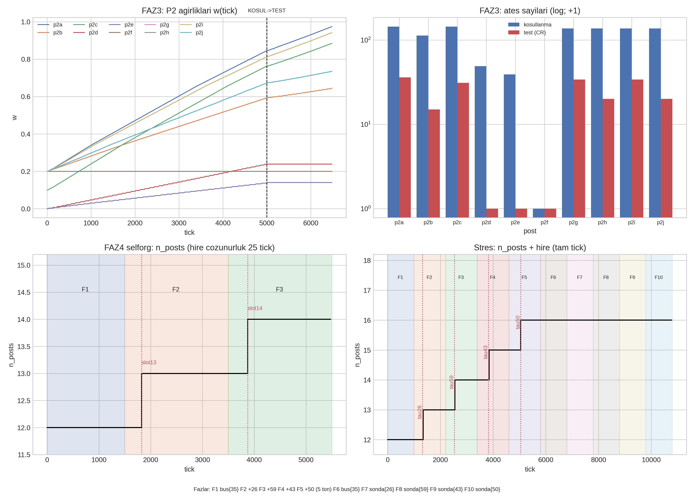
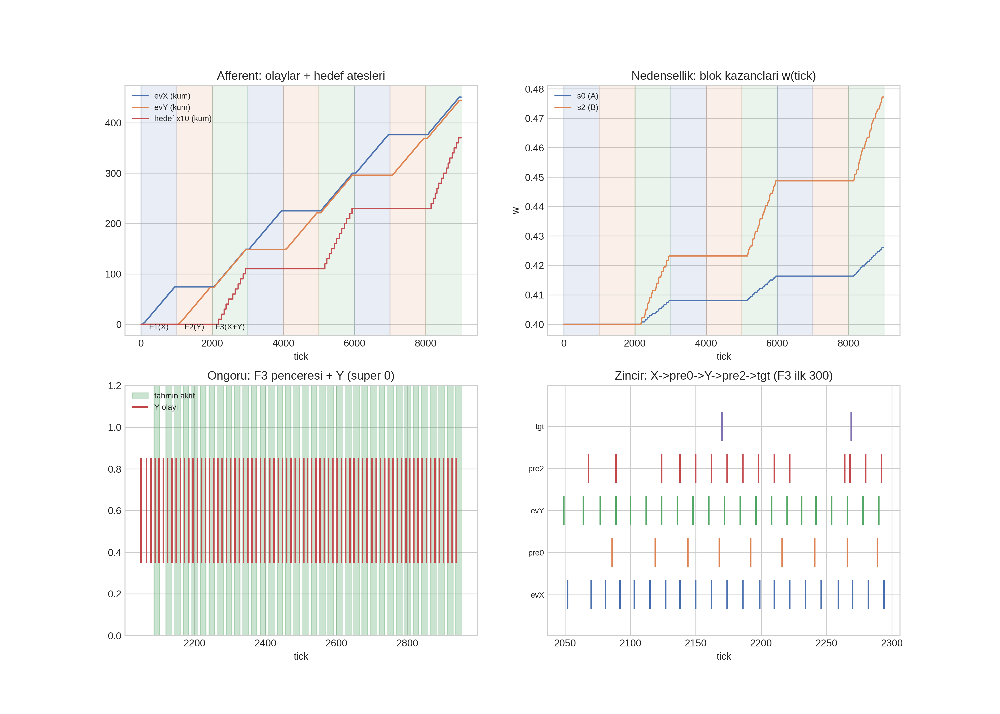

*Figure 3. In order: lock/gain/CR panels of conditioning; the sensory lobe (PHASE3 weights, self-organisation steps, stress recruitments); the afferent cable and one-step prediction.*

---
### Phase 4 — Building the world: simulator and web layer (mid-September)

**Question.** Can a reproducible plant world be built that drives the core and produces causal chains *by itself*?

**Process and decisions.**
- **Restructuring (a user-approved change to the project "constitution", log §9.19).** Earlier visualisation paths (Godot, Qt, Streamlit) were retired; the simulation was moved from the `twin/` package to the `sim/` package; **the NPU root was deliberately left untouched**. Then a standalone 365-day runner without the NPU (`sim/run.py`) was written, and a leakage assert was added for every day (K6). The frame schema **v2** was frozen and locked.
- **Web layer (log §9.21).** A Starlette/WebSocket server; it connects to the simulation and NPU subprocesses only through *data* (no code imports; checked with an AST lint). New gates: zero CDN, LAN access, the WebSocket contract + "newest wins", full operation without the NPU, isolated runs, geometry parity between the 2D silhouette and the 3D mesh. The NPU handshake was deliberately kept *manual*: opening the page does not start the NPU.
- **Endless running (log §9.22).** Complaint: the plant would die on a certain day and get stuck there. The measured root cause had two layers: root health only ever decreased and death was an absorbing state; when the population run skipped a dead plant, the day grid had holes. Without touching the live physics numbers, a natural re-sprouting gate was opened for the dead plant. Result (seed 42, 3000 days): 3 deaths + 3 rebirths (days 1050/1705/2442), longest continuous dead period 170 days.
- **Real observed weather (log §9.26).** The Aydın Open-Meteo file that I found (366 days, no NaN/gaps) was validated and connected to the physics as temperature/precipitation; a UV index was added from a second file, and a stem-elongation effect (2× rate on overcast days, morphological; it does not enter the yield calculation) was defined. For this, the frame schema was moved from v1 to **v2**, following a written procedure (lock triple + clause).
- **Hourly display (log §9.30).** The physics runs on a daily-average step; so the plant "does not see 36° or 41°". When I wanted to see instantaneous values on screen, a cosine curve fitted to the day's real min/max values was built *for display only* (a reconstruction, not an observation; it does not enter the physics). In the process, 18° appearing on screen in August was taken for a bug; on inspection, the night of 29 August 2026 really was 18.3° in the file (the code was not changed).
- **Death discipline (log §9.31).** Measured flaw: in a run without rain the leaves ran out around day 78, the plant stayed scorched for 36 days, then died of salt burn on day 136. Fix: drying out → going into **dormancy**; DEAD only for real death (root rot, salt burn, starvation without reserves). Verified with a three-regime gate (drought / waterlogging / salt).
- **Closing the cycle and start time.** New seed and replanting on death (in the live layer); the live broadcast starts the plant dormant on 1 October, the planting season (the core stayed frozen).

**Honest corrections (examples).** In the first version the season boundary was astronomical, and when 13 December was shown as "Autumn" I caught it, so meteorological boundaries (1 Mar / 1 Jun / 1 Sep / 1 Dec) were used. Two separate bugs were found in the sun's arc on screen (an azimuth sign value of `0` pinning the night x to the edge; linear interpolation) and fixed in the visual layer. These were display bugs, not physics bugs.

**Limit.** The world is a **model**: the physiological parameters are not field measurements (§6.2).

---

### Phase 5 — Refining the water physics in nine steps (mid-September)

**Question.** Can soil water be modelled as a physical budget rather than just a counter in mm (capacity, drainage, plant uptake, sub-daily integration)?

I approved a nine-step sequence, and each step changed *only one thing*; the default (legacy) path was preserved bit for bit, and the new physics lived in the opt-in `fiziksel-v1` preset.

| Step | Content | Evidence (summary) |
|---|---|---|
| 1 | The pending-intervention queue was made "newest wins" (`+=` → `=`) | The bug was measured first (5×10 mm presses accumulated 50 mm), then fixed |
| 2 | mm → volumetric water content (VWC) conversion | 10 mm → +4.39 (hand calculation +4.4); legacy path unchanged |
| 3 | Capacity definitions θs/θFC/θWP (48/34/18, *NOT VERIFIED*) | Inconsistent definitions raise an error (no silent fallback) |
| 4 | Drainage referenced to θFC + overflow outlet | Under 12×60 mm irrigation, legacy is pinned at 100 on day 1, while v1 settles at 45.48 |
| 5 | Water ledger (in − out − stored) | Worst residual ≈ 1e-14 (closed) |
| 6 | Plant uptake + threshold alignment | Uptake limited down to θWP; the waterlogging threshold moved to a relative value (82 → 42.4) |
| 7 | Sub-daily (24 sub-steps) integration | Deterministic; ledger closed |
| 8 | Sensor noise (observation layer only) | Seeded; internal states bit-identical to a clean run |
| 9 | Preparing the SNN interface | **No code change**; the closed loop was *not connected* |

**Honest notes.** In step two, when a new field was inserted in the *middle* of the parameter list, the random-number order shifted and the canonical output broke; the field was moved to the end, and a "new fields always go last" rule was written into the code. In step four, the loss of linearity (a 40 mm increase gives +15.75, not 4×10 mm = +17.56) was recorded as an expected saturation curve. In step nine, sim → lobe feedback was deliberately not connected: this is a step that requires my explicit approval.

---

### Phase 6 — Trying to break the model: perturbation battery, event engine, inference and freezing (mid-September)

**Doctrine (log §9.45).** The infrastructure was working; but the plant model's fidelity to reality had *not been verified*. So the next job was not a new feature but **trying to break the model**: hypotheses are written in advance, results are read afterwards, and post-hoc threshold changes are forbidden.

**6a. Perturbation battery.** 11 controlled conditions (control, heat, deep irrigation, drought, rescue, sandy/clay soil, large irrigation…) and 8 pre-registered hypotheses (H1–H8); 8/8 passed. One hypothesis (H6) *failed* when first written; the cause was not the model but an apples-to-oranges setup of the comparison twin, and the fix is noted in the code. Gaps the battery explicitly recorded: relative humidity/VPD, CO₂, light and a separate root zone were not in the model; a "humidity knob" test is recorded as a **gap (GEP)**, not invented.

**6b. Adding the atmosphere and salinity chains.** In the rounds that followed the battery's gaps: the relative humidity/VPD chain (H9–H11, 11/11 passed), a closed microclimate humidity bucket (H12–H15; in this round H14's pre-registered bar was lowered post hoc, see §5.4), salinity mass conservation (H16–H19, 19/19; no plant salt uptake, an open debt).

**6c. Stochastic event engine.** Seeded hazard draws and hidden states; the event set is closed (no "aliens"); cascades arise from the physics (H20–H24, 24/24). The same fertiliser produced four different "fates": stress was highest in the dry-hot run (0.118), and the soil was wettest with excessive rain + poor drainage (moisture 49.7).

**6d. Inference Phase 1: 10,000 trajectories.** The question was not "how many variables" but "which information comes back out". Three exploratory hypotheses (D1–D3) were written in advance. Result: D1 (EC × VPD interaction) **+0.262**, 95% confidence interval [+0.25; +0.27]; stress rose monotonically from the humid to the dry regime (0.27 → 0.66); D2 and D3 also passed the exploration threshold (+15.6 and +3.3). *The honest story:* in the first 10,000 runs D1 had come out **null** (+0.0056); the cause was not the model but a baseline climate bug (the temperature function produced January cold, and the VPD spread was compressed). It was fixed, the old null was declared void, and the reasons were written down. This is not a *causal* claim; the output is an input for a future inference engine.

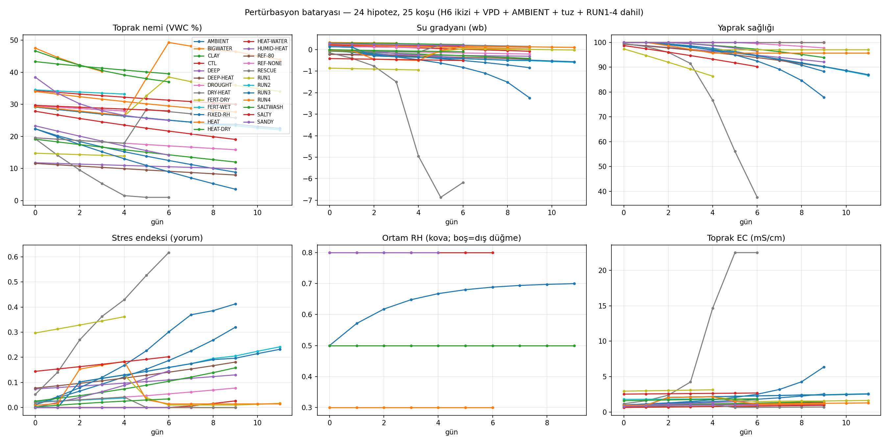
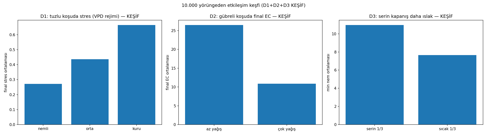

*Figure 4. Perturbation battery (moisture, EC, leaf health… per condition) and the Inference Phase 1 interaction plot.*

**6e. Verification and freezing (log §9.51).** *No new physics, no model manipulation.* 10 classes + adversarial scenarios + a recovery test (13 gates, thresholds in the code in advance). 13/13 passed; the four gates that failed on the first pass were all **scenario/test code bugs**, not physics. One test (TEST9b) locked in a known limit: because there is no precipitation sink, the EC < 50 bar breaks under extreme salt such as EC = 130. Then 8 source files were **frozen** with SHA-256 (full list at the end of log §9.51). Ensemble of 10,000 trajectories: 2871 schedules, 963 deaths, 901 healthy; death is reachable, and the "paradise" scenario is healthy.

**6f. Multi-cycle realisation (log §9.53).** "Let every plant live a new life, with its climate realised differently": hierarchical seeds, Aegean year types, successive generations. Three additional gates (TEST11–13) and G39 passed.

**Debt register (log §9.52).** Open debts recorded with my classification: the absence of a precipitation sink is kept as a known limit; stratified sampling for rare events is postponed; pH/light/wind were deliberately not added (to avoid an endless expansion loop). In the maturity table, deterministic physics, weather/VPD, water/ET, EC, the event engine, the ensemble and the 10k infrastructure are 🟢; pathogen, frost and pH are 🟡/🔴; light, wind and **field calibration are 🔴**.

---
### Phase 7 — Plant-driven lobe and TEST B (late September)

**Question.** Can the physics → electro → sensory → afferent chain represent a 250-day stress trajectory?

**7a. Electro layer and plant-driven harness (log §9.57).** The sensory lobe's P1 input was switched from a fixed synthetic train to the simulator's membrane-potential-derived spikes; Branch B was fed from the sensors with the same phase rule. Result, independent of the gain sweep: **5 different condition labels** were produced, but there was **no** conditioned response (test firing 0). Reasons: the plant driver is sparse (531 spikes in 6500 ticks; ~2167 with the fixed train), and in drought the moisture sensor falls below threshold and silences Branch B; the weights did not move. Gain sweeps (0.7/4 → 2/4 → 4/8) did not change the totals.

**7b. Characterising the electro layer (§9.58).** "Let us first know how rich the layer is": 20 conditions × 29 days of settling + measurement on day 30. **16 distinct signatures across 20 conditions**; the state space is largely represented. Four documented blind spots: no distinction between leaf and root damage, rain intensity is not encoded (only its onset), "pressure/flood" are identical, silent below the 30 °C threshold.

**7c. TEST B (§9.59).** A 250-day graded arc (normal → drought → severe + salt → interval → summer → irrigation → recovery → test; 22+3 blocks). Predefined gates: B1 (drive > 1500) with 1981 spikes, B2 (severe > 8× normal) **14×**, B3 (recovery drop), B4 (afferent > 200) with 293 firings / 7 conditions, B6 (Δw > 0.02) with p2f/p2g +0.055 **passed**. **B5 (sensor-free conditioned response) did not pass: `CR_YOK`** (*no CR*), firing 0 in the test phase. Chain diagnosis showed that the loss is at two gates: the PLIR-A lock eliminates most sparse spikes (severe phase: 625 plant spikes → 78 P1 firings ≈ 12%; test: 202 → 37 ≈ 18%), and the surviving spikes cannot be summed in the leaky layer (even at w = 0.45, A cannot fire alone). The lobe is **B-driven and A-gated**.

**Decision (mine).** No move to a closed loop; B is not inflated. An A-alone conditioned response is not expected; the closed loop will first be built from the association (context) layer.

**7d. The A-only contract (§9.60).** With dense drive + w0 = 0.5, the A path gives a proof of capacity (conditioning firing 700, test firing 165: a CR **exists**); but under *sparse* drive there is no firing at any weight (0), and dense drive at the bank weight does not trigger firing either ("chicken and egg": no firing, no Δw; B is needed for the first firings). Verdict: **the A→soma path is architecturally correct, but temporal persistence is insufficient.**

**7e. Association (§9.61–9.62).** The afferent record was written with the context of every firing (300 records: B context 291, pure-B 191, A history 103). With weighted Jaccard similarity over day signatures (0.5/0.3/0.2) + LOO 1-NN: **163/165 (98.8%)**: true 105/106, decoy 4/4, mixed 54/55. **Warning:** because the label and the similarity come from the same representation, this measures the *internal consistency* of the representation; it is not world classification (§5.5, §9).

**7f. Evidence on persistence (§9.63–9.64).** FDM sweep: on **all** axes, leak constant (1…320), coincidence window (4…80) and gating memory (4…800), the output was bit-identical; i.e. the persistence machinery does not take part in the result in this regime, and firing is same-tick combinational. PLIR characterisation: of 1981 spikes, 812 were accepted (line 0: 624 fresh + 171 resonant) and 1113 rejected; 303 of the accepted ones turn into firings (**A-capture 15.3%**); the only reason for rejection is period mismatch (no refractoriness). The loss is in two stages: period filter (58%) + soma integration (63%). Cross-check: 0 mismatches in acceptance against the real C++ engine.

**7g. Condition sweep (§9.65).** With the same PLIR-A, each condition produced a separate signature in normal/drought/severe/irrigation/recovery/summer windows (P1 0…78; P2 17…74; labels 2…6; severe/normal P1 ratio ~10×). Drought was represented without P1 (19 of 19 events pure-B). Dual drive was verified (A-supported 117 + pure-B 131).

**Limit.** All on a single trajectory (seed 1) and a single plant; heat shock did not occur in this seed (stochastic).

---

### Phase 8 — What does the representation carry? Inference and learning-rule comparisons (late September)

This is the phase from which the project learned the most scientifically: the representation was measured rigorously by *only reading* frozen artefacts (without running the engine), and then simple inference methods and learning rules were compared under the same protocol.

**8a. Characterising the representation (§9.66).** A raw record of 12,500 ticks was converted into day signatures: **67 distinct exact signatures over 165 firing days** and 7 afferent labels. The *exact* signatures of the six conditions are 6/6 distinct; within-region similarity 0.520, between-region 0.277. Finding: coarse four-way statistics do not separate irrigation from recovery (both are a wet post-irrigation regime), but the temporal representation does. However, **a single day** overlaps (single-day LOO purity 0.473): condition identity lies in the window as a whole.

**8b. Temporal window test (§9.67).** A single day or a short sequence? LOO accuracy for window lengths k ∈ {1, 3, 5, 10, 20} days: **0.473 → 0.542 → 0.516 → 0.474 → 0.105**. Peak at k = 3–5; the collapse at k = 20 has two causes: short classes have no suitable neighbour left (structural), and there is real saturation (everything is pulled towards the summer class, the richest bag). Conclusion: order-insensitive union *destroys* information over long windows; the inference input must be order-preserving.

**8c. Inference reference (Baseline-1, §9.68–9.69).** Learning-free, parameter-free *nearest sequence* (k = 3): **97/175 = 0.554**. Critical finding: **drought → normal 28/28**; drought is never recognised as itself and is absorbed into normal without exception. The same method drops to 68/165 = 0.412 at k = 5. The suspicion of "dilution by quiet days" was tested in a separate probe and **refuted** (0.560; drought → normal still 28/28).

**8d. Learning-rule comparisons (§9.71–9.80).** Question: "does quadratic learning make better use of the information in the representation?" Same protocol, same 175 windows:

| Method | LOO accuracy | Note |
|---|---|---|
| Baseline-1 (learning-free, k = 3) | **0.554** | reference |
| Rate proxy (line counts only) | 0.446 | temporal representation better by +0.108 |
| Quadratic online learning | 0.400 | **did not beat** the reference; std = 0 over 5 seeds → not order luck but a fixed point |
| Quadratic + row normalisation | 0.366 | worse; the degeneration is not in the weight distribution but in the binary bigram representation |
| Quadratic + LTD family (weak/medium/strong) | 0.326 / 0.337 / 0.371 | not monotonic; all below the control |
| Shuffle null hypothesis | 0.531 | timing changes label diversity (7→9), but drought → normal 28/28 persists |

Mechanism: unsupervised potentiation strengthens frequent bigrams that are *shared* across conditions; the rare, discriminative transitions are drowned out. LTD breaks the fixed point (order dependence appears) but does not lead to better separation. *"The story (no LTD claim): pure quadratic potentiation drops to 0.400 on this representation."* The log also puts this result as: "our own subset hypothesis also collapsed under experiment; the result is more scientific."

**8e. Hygiene correction (§9.77).** The decision rule was rewritten with tie checking. *Critical correction:* the **"drought absorption" in earlier log entries is not a mechanism but tie-and-order bias**. 51 queries in the reference and 88 in the quadratic method involved ties (78 of them six-way). If ties are broken in alphabetical order, drought moves from 0/28 to 24/28 and normal from 24/25 to 8/25. In other words, the representation **cannot distinguish** drought from normal, and whichever decision is found first wins. The research line turned from the subset hypothesis to the question of *indistinguishability + bias*.

**8f. Diagnostic arms.**
- **Representation ceiling (§9.81).** 123 distinct sequence signatures in 175 windows; 118 of them pure; weighted purity **0.920**; the best fixed metric 0.554 (exact match 0.578, only on 64 windows). Most of the gap is an inference/metric bottleneck; but 34 windows *share exactly the same signature* between normal and drought: this is a hard indistinguishability limit, independent of the metric.
- **Recall (§9.82).** Using rare-pure signatures without majority pull did not raise accuracy to 0.70–0.80: a priority-neutral rule is identical to the frozen rule (0.554), rarity weighting 0.537 (errors move around, the total stays the same), balanced weighting 0.046 (scale mismatch). The bottleneck is not pure priority imbalance.
- **Metric limit (§9.83).** Six geometries (Hamming, uniform, rotation-max, count-cosine…) fall in the 0.503–0.554 band; phase alignment and magnitude information changed nothing. The problem is in *how the representation is organised*: the same set components are shared across classes.
- **Forensic trace (§9.84).** Three normal/drought pairs were traced stage by stage: the electrical signals differ, but PLIR passes different subsets and reduces P1 to an equivalent silence; the A/B context is exactly the same; P2 is the same. The compression is distributed; the mechanism was documented, **not fixed**.
- **Synergy (§9.75).** At a coarse level there is redundancy (I(A;Y|post) = 0.216 < I(A;Y) = 0.397; permutation p = 1.000); at a fine level both channels are needed (−0.112 when post is removed, −0.041 when A is removed). The sentence *"post changes the meaning of A"* depends on resolution.
- **Anatomy of the +0.108 (§9.74).** Channel ablation: post only 0.520, B lines only 0.457, A only 0.303, post + A best at 0.560. Most of the advantage comes from *post identity* (+0.074), the rest from A continuity (+0.034); the B lines are neutral.
- **Emergence probes (§9.73).** Shuffle null, rate proxy and B-off condition: the 3–5-day signature behaviour **does not emerge without B** (P2 record 0); the A path is timing-insensitive (P1a firing 286 → 285). In our terminology these are "*candidates* for collective behaviour", not evidence.

**Verdict (Phase 8).** The representation is ~92% pure at the signature level; but no existing fixed metric can extract a reliable ordering between classes (bandwidth ~0.05). Quadratic learning did not improve inference in this regime. The indistinguishability (drought ≈ normal) is a structural property of the representation; the explanation "the metric is a bit poor" is not enough. These findings shaped the next architecture (the pattern lobe, Phase 9).

---
### Phase 9 — The pattern lobe (mid-September – 23 September)

**Motivation.** Phase 8 showed that the output of the sensory lobe (i.e. the information "when, under which condition, in which order it fired") is rich enough but poorly used in a *classification* task. So a second structure was designed: a **pattern lobe** that takes the afferent event stream (`post`, `tau`, time) and holds in its own internal state **which pattern came when, and in which relation**. The aim of this lobe is not to produce labelled accuracy but to build and characterise a *representation mechanism*; so most tests are determinism, limit and behaviour characterisation (there is no accuracy gate; the audit report states this explicitly).

**9a. Architecture versions (§9.86–9.91).** The lobe progressed not in one step but through successive versions (v3d → v3e → v4c). The same discipline was applied in each: first a pre-registered specification (`PATTERN_V3_STRESS_SPEC.md`, `PATTERN_V4_PLAN.md`, `STIMULUS_SNR_SPEC.md`), then a stress battery of 12 groups / 39 cases, determinism (bit-identical repetition) and a crash test. Lessons measured:

- **v3d (12/12 passed).** Recall 0.122 → 0.230 (G1), 0.161 → 0.438 (G2); but the "cold-world silence" persisted, and a drought family could not be formed.
- **Memory readout (§9.87).** All *eight* of the eight voltage columns in memory turned out to be a write-time artefact (written after firing, the voltages are at `V_RESET`); the only information carrier was `eff_g` (gating accumulation). The new readout gate did not pass the 40% threshold with any readout → the verdict "A could not be demonstrated" was written.
- **Stimulus ladder (§9.88).** The question of "how much signal enters the input" was also measured: severe drought raises the cable count from 76 to 169; but in the 5-class family, accuracy 0.797 (target 0.90) **did not pass**; part of the separation may come from life-history structure (written as an honest limit).
- **v3e (§9.89).** The full task matrix (K1–K3 + soma). Plasticity effectively closed (baseline wkdev 0.0032; 0.104 in v3d) and G8 robustness dropped from 0.817 to 0.615: this is a deliberately written *regression record*; the version was still found to "work" and was used as the carrier.
- **v4c / REV3 (§9.90–9.91).** K4 per branch, 58 nodes; the full 41-run battery crash-free and deterministic. After conditional acceptance, 17 files from old versions were deleted (the v3e body was embedded *verbatim* into v4c, 345/345 code lines diff-zero). An open tension was recorded: energy is broad (common mode 0.024; matrix 71% full), and weak pattern support could not be separated from general excitability in the pilot.

**9b. A four-question structure (K1–K4).** The lobe carries four compartments: K1 *what* arrived, K2 *when*, K3 *what was there in the past* (history), K4 *relational* (which two inputs arrived together); 29 units in total, a two-stage soma (F1 frozen core + K4 contribution, capped at `S4max = 0.25`). Here "K4" is not a classifier but a *parallel compartment that integrates coincidence into its own electrical state*.

**9c. REV4: a real K4 and proof of the relational path (§9.95–9.97).** In REV4, a quantised signature (q[3], −3…+3), a graded gate and spike-gated max selection were implemented; K4 firing can reach the soma on its own. In the TEST-B pilot, gates B/J/R/P/D/M/N/S all passed. **Important finding:** in the pilot, K4 spikes were 0 (all 92 firings came from local K4 integration); it was recorded explicitly that the relational path "never operated in TEST-B". I then decided: first **a single controlled experiment** ("relational pathway proof"), with twin-wired A/B units and a C unit with a different signature. Result: r_AB = 0.875 (fixed-point ceiling), r_AC = 0.06, mutual argmax 1.00/1.00, 1925 K4 spikes, r 0.875 → 0.0001 in silence; i.e. **the chain works mechanically** (coincidence → similarity → r → argmax → rel → K4 → soma). After a full battery of 99 scenarios × 4 conditions (`fails=yok`, *none*; double-run SHA determinism passed), REV4 was accepted as the "final pattern lobe" (§9.97); the findings also include unexpectedly high binding at an 11-tick shift in the C-offset sweep (suspected adapter time shift; code not changed, recorded as a research note).

**9d. Observation probes (§9.99–9.105): "what does the structure do?" — no tuning, no score.** Observation discipline: architecture/parameters do not change, no new score is invented, an unexpected result is not counted as an error. Findings:

- In the plant regime, K4 spikes are **zero** (in 9 scenarios); the relational path is silent, and the soma is fed only from the sub-threshold K4 floor.
- The set of bindable pairs is **exactly the same** in 8 scenarios (Jaccard 1.0; 1176 pairs): a structural skeleton; the drive changes only the *intensity* (0.068–0.222).
- Density ladder (§9.100): spikes do not switch on at any step; amplitude suppresses K4 (F1 becomes tonic and performs coupled resets). Temporal distribution (§9.101): relational intensity depends not on *volume* but on *timing* (in a 2× compressed arrangement the mean goes from 0.110 to 0.328).
- Alphabet map (§9.105): set = composition (AB = BA, the same 21 units), emphasis = order; regime order *silent → relational → S4-soma → spike → F1-tonic*; natural sparse drive never switches on K4 spikes.
- **A 40,000-day run (§9.103).** 2 million ticks, 55,341 events: after a 42-day opening transient, **39,958 days in a single dynamic regime** (weekly Jaccard median 0.926). Interpretation: with frozen weights the lobe does not *generate* its own long-scale state; it follows the driver. This is a record in which the claim "new behaviour emerges by itself" is *refuted*.
- Natural FP comparison (§9.104): in weeks of equal volume but different concentration, the number of firings and units changes (e.g. 3 → 11 firings), but the regime does not (J ≥ 0.877); one comparison was declared invalid and removed because of a slicer artefact.

**9e. REV-LEARN: trace and accessibility (§9.106–9.109).** Keeping the core of the learning rule (dw = η·G·Q·S) unchanged, two mechanisms were added: (i) a **persistent trace** `T` on potentiation (T ← T + μ(1−T); μ = 1/8) and w ← w + dw(1+T); (ii) an unused synapse relaxes to the floor `T·W_MAX` (no classical weakening). The frozen architecture (§9.102) was opened for this work *on my instruction*, and this is written explicitly in the log. Characterisation (A–D): a strong first step (0.90) is ~53× larger than a weak step (0.017); trace depth follows *the number of exposures* (T = 1−(1−μ)ⁿ, verified); relearning the same pattern takes 37–61 ticks instead of 91, and this saving is independent of the gap (1000 = 10000, bit-identical) → it comes from the trace. `k4plastic` (K4 on + η = 0.30) was frozen as a baseline (§9.108): A→erase→A 78% immediate return, A→B→A trace 102/102, **no proliferation** (27 = 27 units), plateau in a 20k-tick run (mean T 0.58). Open record: the memory ceiling of 4096, and that the plateau was measured for a single pattern family. On 21 September the **final architectural baseline** was declared (§9.109); on 23 September four files were sealed with SHA-256 (§9.114).

---

### Phase 10 — Live chain and persistence (21 September – 28 September)

**Goal.** To connect all the parts as a single "chain" running live at the same time: simulator → sensory lobe → conditioned afferent events → pattern lobe → web panel.

**10a. The chain (§9.110).** The publisher (`sim/serve.py`) gives the seven sensors to a persistent sensory-lobe process every simulated day; P2 bits are converted into afferent events `(tick, post, tau)`; the pattern lobe is fed with these events. The core `*.h` files were not changed and the frames (schema v2) were not touched; if the binary is missing, the chain shuts off and the publisher keeps running. Verification: 13/13 OK; on the canonical 300-event stream, `mem = 231`, `k4_kfires = 146`.

**10b. Persistent lobe (E-1, §9.111).** In the first version every window started without weights (written down as an honest limit); with the `--stream` mode the lobe is started **once**, and the weight/trace/relation matrices (`w`, `T`, `r`) live for the whole process. Verification: J-bit-identical (canonical hash, W = 522), stream ≡ batch byte for byte, T monotonic, the trace is preserved in an A–B–A sequence, and a WebSocket disconnect does not affect the processes.

**10c. Separating transport from reporting (§9.112).** Measurement: the sensory lobe produces 0.20 events/s; filling a 300-event window takes ~1472 s, processing it 0.01 s. So all of the latency was *in the threshold*; feeding was made threshold-free (each line goes into the lobe immediately), and the threshold remained only as the reporting cadence. This change is in a single Python file; the C++ side stayed as it was.

**10d. Checkpoint (PLST, §9.113).** Only the *learned state* (w[522], T[522], r[58][58]; 17,668 bytes in total) is saved, in a fixed-width, CRC32-protected, versioned format (no JSON/pickle/double); a corrupt file is rejected and falls back to a clean start (no silent loading). Tests: LOAD/STATE bit-identical; after restart T is monotonic and there are 88 firings in phase A2; the loaded lobe fires 26 times, a fresh lobe 16 times. Honest limits: the production chain runs with η = 0 (weight learning frozen, relational learning of r active); on resuming, the dynamic state (voltage/gating) starts from zero and the trajectory deviates by < 1%.

**10e. Freezing and the panel (§9.114–9.116).** On 23 September the four files of the pattern lobe were sealed with SHA-256: whatever calls the lobe (harness, carrier, report) may change; the lobe does not. In the web panel (`signal.js`), the signal diagram was connected to the live event stream; on 28 September, following my report, it was found that the plant path did not appear in the panel. The root cause had two layers (the chain was dropping the `p1` bits; the P1→P2 drive was not drawn); *only the telemetry/drawing* was faulty, not the engine or the lobe; the fix was made without touching the frozen files, and a new gate (G38) was added. Honest limit: because the T line is sampled every 25 ticks, the panel does not show the pulses in between.

---

### Phase 11 — Independent evaluation and internal audit (October 2026)

In the earlier phases of the project it was possible to produce "consistent results", but **validating ourselves with tests we developed ourselves** is not enough. For this reason, two separate evaluations were carried out in October.

**11a. Independent evaluation package (`salep_core/bench/`, 15 October).** The criteria were written before running and frozen (`TEST_PLAN.md`); thresholds were derived only from separate calibration seeds (1000–1009); the core (`src/`) was **not changed at all** (9/9 regression). Comparison: the system's score **S** against four simple reference methods (delay coincidence, autocorrelation, Goertzel, ISI histogram) on the same data. The five main findings, as they are:

1. **In demultiplexing, S ties with or trails the simple methods.** Clean world, tau4: S 0.942 / references 1.000; tau12: S 0.799 / 0.800–1.000. The difference was measured: because of 4|12 sub-harmonic acceptance, S cannot distinguish 12-only from 4-only (subset AUC 0.505 ≈ chance).
2. **S is completely silent on sparse causality.** Precision = recall = 0 in 12/12 cells; since fidelity was verified in the periodic-template world, this is *not a porting bug but a consequence of sparsity*.
3. **PLIR is not useful everywhere.** With PLIR switched off, the tau4 AUC *rose* from 0.942 to 1.000; population size (8 → 1) did not change the result; the coincidence bonus had no effect, bit for bit, in this task.
4. **Generalisation is surprisingly good; noise helps tau4.** On 9 uncalibrated taus, untuned AUC ≈ 1.0; extra spike noise raised S-tau4 from 0.942 to 0.999 (hypothesis: noise disrupts the FRESH capture of slow foreign rhythms; not tested).
5. **On real data, nobody could separate anything.** 36 *Ocimum* recordings from the Madariaga et al. (2024) dataset (n = 483 windows), with weak pre/post labels: pooled AUC S 0.493, variance 0.455, HF energy 0.412 → chance level. This is not a verdict against the core but **a record of a measurement limit** (the labels are noisy: response rate in the literature ~60%, latency 3–6 s).

Some of the predefined gates **did not pass** (D1, D2, C1) and remained *as they are* in the report; a flaw in D2's yardstick was acknowledged, but the criterion was not relaxed afterwards. Hardware cost was measured (actual neuron state ~50 B; FDM 2×8 network ~21.7 KB; ~177 multiplications/tick); since there was no synthesis tool, all hardware numbers are labelled "on paper".

**11b. Internal audit report (`DENETIM_RAPORU_2026-10-14.md`).** Every link of the chain was traced through the code; the results:

- **No hidden label leakage was found** (world labels do not enter the simulator input or the NPU); however, **circular labels exist**: the 163/165 result is a label derived from the representation being tested with the same representation (internal consistency of the representation).
- **Same-trajectory leakage is structural:** all accuracy tests are LOO on a single TEST B trajectory (seed 1, one plant, 250 days); training and testing are not independent.
- **Risk of scenario memorisation is HIGH:** a single script, fixed fertiliser/irrigation days; validity outside the scenario has not been tested.
- **There is NO independent end-to-end test.** The existing chain tests are plumbing and determinism tests (they do not measure condition accuracy). What is missing: an unseen plant trajectory (different seed/scenario/year) → the whole chain → prediction of the world condition, with a pre-registered metric.
- The pattern lobe's contribution to world-condition accuracy **has not been measured** (only determinism).

**Project status (28 October 2026).** The mechanisms (phase-selective locking, FDM, quadratic learning + trace, relational K4, persistence, the live chain) *work at the engineering level and are deterministic*; at the scientific level, however, **no** claim of functional superiority **has been demonstrated**. The next step is the pre-registered, multi-seed, held-out-scenario experiment recommended by the audit report (§10).

---
## 8. Summary of findings

This section gathers the phases of §7 into tables. Each row is labelled with the evidence vocabulary of §5.6: **DEMONSTRATED** (with its own defined gate and a test that was run), **PARTIAL** (under conditions / limited scope), **HYPOTHESIS** (plausible but not measured), **NOT TESTED**, **NOT OBSERVED** (tried, no effect seen).

### 8.1 Mechanism level (on synthetic signals)

| # | Finding | Quantitative statement | Status |
|---|---|---|---|
| M1 | The fixed-point core is deterministic and reproducible | Canonical output SHA-256 fixed; bit-identical repetition | DEMONSTRATED (synthetic) |
| M2 | The phase-locked interval resonator (PLIR) separates two rhythms on the same wire | FDM lock/phase error ≤ 0.03 tick | DEMONSTRATED (synthetic) |
| M3 | The quadratic rule distinguishes causal order | Q(Δt) curve and causality tests | DEMONSTRATED (synthetic) |
| M4 | A conditioned-reflex (CR) mechanism can be built | Under dense drive, conditioning 700 / test 165 firings | PARTIAL (dense drive only; 0 under sparse drive) |
| M5 | Persistent trace + floor relaxation speeds up relearning | 91 → 37–61 ticks; independent of the gap | DEMONSTRATED (synthetic) |
| M6 | The relational K4 path works mechanically | r_AB 0.875; 1925 K4 spikes | DEMONSTRATED (controlled experiment) |
| M7 | The w/T/r checkpoint is carried over bit for bit | 17,668 B; LOAD ↔ STATE bit-identical | DEMONSTRATED |

### 8.2 Representation and inference level (TEST B trajectory)

| # | Finding | Quantitative statement | Status |
|---|---|---|---|
| T1 | Six conditions produce six distinct exact signatures | 6/6 distinct; 67 signatures in 165 days | DEMONSTRATED (same trajectory) |
| T2 | The association layer classifies signatures with internal consistency | 163/165 (98.8%) | PARTIAL (circular labels) |
| T3 | Order-preserving inference reference | 97/175 = 0.554 (k = 3) | PARTIAL (chance ≈ 1/6; drought → normal 28/28) |
| T4 | Quadratic learning improves inference | 0.400 (below the reference) | **NOT OBSERVED** |
| T5 | LTD and row normalisation fix it | 0.326–0.371 | **NOT OBSERVED** |
| T6 | Drought and normal can be distinguished | 34 windows with exactly the same signature | **Indistinguishable** (structural) |
| T7 | Sensor-free conditioned response (B5) | Test-phase firing 0 | **FAILED** (no CR) |
| T8 | The temporal representation beats the rate proxy | 0.554 vs 0.446 (+0.108) | DEMONSTRATED (same trajectory) |

### 8.3 Independent evaluation

| # | Finding | Quantitative statement | Status |
|---|---|---|---|
| B1 | S beats the simple methods in demultiplexing | tau4 0.942 vs 1.000; tau12 0.799 vs 0.800–1.000 | **NOT OBSERVED** (S equal/behind) |
| B2 | S works on sparse causality | Precision = recall = 0 in 12/12 cells | **FAILED** |
| B3 | Separation on real plant data | Pooled AUC: S 0.493; n = 483 | **NOT OBSERVED** (chance level) |
| B4 | Generalisation to uncalibrated taus | Untuned AUC ≈ 1.0 | DEMONSTRATED (synthetic world) |
| B5 | Independent end-to-end test | — | **NOT TESTED** |

**Overall verdict.** What the project shows is that *certain mechanisms work as a hardware-friendly computational model*, and that *a research discipline that catalogues its own failures in detail* is possible. What the project does not show is that this system recognises plant stress on real data, independently, better than simple methods.

---

## 9. Limitations and threats to validity

This section corresponds to the "threats to validity" section of a referee report. Each limit is tied to the records of the experiments above.

1. **One trajectory, one seed.** The accuracy numbers (163/165, 0.554, 0.400…) are on a single TEST B trajectory (seed 1, one plant, 250 days). Seed sensitivity has not been measured.
2. **No train–test independence.** All inference tests are leave-one-out within the same trajectory; the weight trajectory is shared across all folds (structural leakage).
3. **Circular labels.** 163/165 is the bank label (true/decoy/mixed) being derived from the representation and tested with the same representation; it does not measure the world condition.
4. **The risk of scenario memorisation is high.** A single script, fixed fertiliser/irrigation days; validity outside the scenario is unknown.
5. **There is no independent end-to-end test.** The chain tests are plumbing/determinism tests.
6. **Synthetic electrophysiology.** The electrical layer is an imitation (resting −120 mV, rate coding, burst rules). There is no comparison with electrode recordings from a real plant; some physiological parameters are modelling choices (some marked `TODO: DOĞRULANMADI` in the code).
7. **Limits of the real data.** Only *Ocimum* recordings from the Madariaga et al. (2024) dataset; weak labels; a different plant species (not salep).
8. **Weather data.** The real Aydın Open-Meteo observations are used only in the live web chain and in certain gates; the TEST B chain runs with a synthetic world driver.
9. **Silence.** 85 of the 250 days are silent, and the 30 days of the test phase are outside the score; in real use, "silence" must also be a decision.
10. **Sparsity.** When the plant driver is sparse, the A path does not fire (A-capture 15.3%); the persistence machinery (FDM) does not take part in the result in this regime (bit-identical).
11. **Hardware claims are on paper.** There was no synthesis tool; bit-width suggestions were derived from a single workload.
12. **No closed loop.** NPU → simulator feedback is not connected (it requires explicit approval).
13. **AI co-authorship.** Development was largely AI-assisted (see §13); independent reproduction of the results by running the code from outside is important.
14. **Limit of the discipline.** The pre-registration discipline relies on records I kept myself; there is no independent, time-stamped pre-registration (e.g. OSF). The only disclosed post-hoc exception is H14 (§5.4).

---

## 10. Future work

A prioritised roadmap, derived from the audit report's recommendations and the limits in §9:

1. **Multi-seed replication (priority 1).** Run the same TEST B protocol on ≥ 5 different seeds and report the distribution of association and inference scores. *The acceptance criterion will be written in advance.*
2. **Held-out scenario.** Evaluate the whole chain on a previously unseen scenario with shifted fertiliser/irrigation days; measure the drop in score.
3. **Bringing silent days into the score.** "Not deciding" should also be measured as an output, with a separate metric.
4. **The drought ≈ normal indistinguishability.** Add drought-specific information from the sensor/P1 channel (e.g. a structure in which the moisture-sensor path does not silence Branch B), and test in a pre-registered way whether this changes the separation.
5. **A labelled experiment on real data.** A plant electrophysiology dataset with clearer labels, or my own recording setup; comparing S with the simple references under the same protocol.
6. **The hardware path.** Real resource and latency measurement with a synthesis tool (e.g. an open-source HLS/FPGA toolchain).
7. **An integrated inference engine, causality and forecasting.** Today's system does not contain these as a single whole: the inference and causality experiments are in separate scripts and at an early characterisation level (§7 Phases 7–8, §9). My goal is to build a system-level *inference engine* on top of the existing temporal representations (pattern lobe, afferent records):
   - **Inference:** infer the plant's state (normal, drought, salt stress, etc.) on an unseen trajectory from the temporal representation, with a pre-registered success criterion (together with items 1–2).
   - **Causality:** test which environmental event produces which electrical response, with controlled interventions in the simulator (add/remove the event) and a separate counterfactual control.
   - **Forecasting:** predict the next event or state from the representation, compared against simple references (last value, moving average).
8. **Closed loop.** Only after 1–2 and 7 are completed, with explicit approval.
9. **Independent time-stamped pre-registration.** On OSF/Zenodo, for the experiments above.

---

## 11. Reproducibility, setup and verification

**Quick check (recommended first step).** At the repository root, `bash run_review.sh`: in a temporary copy it compiles the single-neuron experiment and the pattern lobe, compares the outputs with the recorded SHA-256 values and summary lines, and then runs the association and inference checks (163/165; determinism; no leakage). Expected result: `7 geçti, 0 kaldı` (*7 passed, 0 failed*).

**Requirements.** `g++` (C++17), Python 3.10, `pip` and `salep_core/requirements.txt` (pinned versions: numpy, pandas, matplotlib, starlette, uvicorn, websockets, rich). One gate of the web interface needs `node`. Detailed steps are in [QUICKSTART.md](QUICKSTART.md) and [INCELEME_REHBERI.md](INCELEME_REHBERI.md); each command carries a `[KOŞULDU]` / `[KODDAN]` / `[KOŞULMADI]` label (*run* / *from code* / *not run*).

**Important warning.** The experiments write their outputs into the working directory and can overwrite recorded result files. So work on a *copy* of the repository:

```bash
cp -a plant-neuromorphic-computing /tmp/review && cd /tmp/review/salep_core
```

**First experiment (single neuron).**

```bash
mkdir -p /tmp/first_run && cd /tmp/first_run
g++ -std=c++17 -O2 -I<PACKAGE>/salep_core/src <PACKAGE>/salep_core/src/main.cpp -o npu_sim
./npu_sim        # Expected (printed in Turkish): "Simülasyon tamamlandı: 500 tick, 6 ateşleme" (simulation complete: 500 ticks, 6 firings)
sha256sum neuron_trace.csv
# 8e91337c32f7a60e848651fe9def6b35ee86db137ceb1f61fe56da3256ba62d5
```

**Determinism.** The sources of randomness on the Python side are seeded (simulator, electro layer, sensor noise); no random number generator that determines the behaviour of the C++ core is used; results are bit-identical under the same seed. Many verification scripts (`validate_*.py`, 40 of them) check this bit-identity and the recorded SHA-256 values.

**Running the independent evaluation package.** `bash salep_core/bench/run_all.sh` (estimated time ~2 hours; the stages were run one by one, and a clean full run from scratch has not been done — see `bench/REPORT.md`).

**Web interface.** `python -m web.server --port 8001 --pub-port 41793` (details in QUICKSTART §3).

---

## 12. Repository map

```text
plant-neuromorphic-computing/
├── README.md                    ← the original document, in Turkish (academic narrative)
├── README.en.md                 ← this document (full English translation)
├── SUMMARY.en.md                ← one-page English overview
├── QUICKSTART.md                ← step-by-step setup and first experiment
├── INCELEME_REHBERI.md          ← 10–15 minute review tour (Turkish)
├── DENEYLER_VE_ANALIZLER.md     ← experiment catalogue and evidence labels (Turkish)
├── RESEARCH_HISTORY.md          ← chronological research history
├── DOSYA_LISTESI.txt            ← file inventory
├── LICENSE, LICENSE-DOCS.md     ← licence for code (PolyForm Noncommercial) and for documents/data (CC BY-NC 4.0)
├── CITATION.cff                 ← citation information
├── run_review.sh                ← one-command reproduction check
├── (for reading the code: salep_core/README.md, "Kod okuma rehberi" / code reading guide)
└── salep_core/
    ├── CLAUDE.md                ← THE MAIN RESEARCH LOG and "constitution" (§0–§9.116): rules, architecture, every experiment (Turkish)
    ├── DENETIM_RAPORU_2026-10-14.md ← internal audit (Turkish)
    ├── LEARN_BASELINE.md, LEARN_CHAR.md ← learning-rule baseline/characterisation
    ├── src/                     ← C++17 fixed-point core (*.h) and experiment programs (main_*.cpp)
    ├── encoder/                 ← afferent encoding
    ├── sim/                     ← Python plant simulator, electro layer, live chain
    ├── web/                     ← Starlette web server, panel (JS), gate tests
    ├── pattern/                 ← pattern-lobe analysis/readout scripts
    ├── bench/                   ← independent evaluation (TEST_PLAN, REPORT, raw results)
    ├── weather_v3/              ← Aydın weather data (Open-Meteo)
    ├── stress_out*, f0_baseline ← stress battery and regression outputs
    ├── validate_*.py            ← verification scripts (40 of them)
    └── *.csv, *.png             ← experiment outputs and figures
```

**About CLAUDE.md.** This file contains the standing rules given to the AI assistant during development and a chronological record of all experiments (≈ 3,000 lines). Its name is a convention the tool expects; for an academic reader this file is the *lab notebook*, and every reference in §7 (`§9.xx`) corresponds to the numbers in this notebook.

---

## 13. AI use statement

This project was developed largely with the help of an AI coding assistant (Anthropic Claude). I set the research questions, the architectural decisions, the approval of every gate and freeze, and the direction of the experiments; a significant part of the code and documents was produced together with the AI. The harness, generator, analysis and figure code of the independent evaluation package (`bench/`) were also written with AI help; the core (`src/`) was not changed in this package. This README (and this translation) was also drafted with AI help; I reviewed and published its content. This statement is deliberately kept explicit, to comply with the rules of institutions and journals that require disclosure of AI use in academic work. What should be trusted for the correctness of the numerical results is not the AI's narrative but deterministic reproduction (§11).

---

## 14. Licence, citation and data sources

**Licence.** The source code is under [PolyForm Noncommercial 1.0.0](LICENSE): research, education, review and personal use are free; **commercial use requires separate permission from me**. The documents and the data outputs we produced (CSV, figures) are under CC BY-NC 4.0. Third-party data are used under their own licences (details in [LICENSE-DOCS.md](LICENSE-DOCS.md)). This arrangement is not *open source* but *source-available*.

**Citation.** To cite this work, see [CITATION.cff](CITATION.cff):

> Kılıç, M. C. (2026). *Salep Sibernetiği: Bitki elektrofizyolojisinden zamansal nöromorfik hesaplamaya* [Salep Cybernetics: From plant electrophysiology to temporal neuromorphic computation]. GitHub: coauple/plant-neuromorphic-computing.
>
> Related working paper (Zenodo): [https://doi.org/10.5281/zenodo.22651379](https://doi.org/10.5281/zenodo.22651379)

**Third-party data.**

- Weather data: Open-Meteo (Zippenfenig, 2023), CC BY 4.0, daily temperature, precipitation and UV for Aydın.
- Real plant electrophysiology: Madariaga et al. (2024), "A library of electrophysiological responses in plants", figshare, DOI 10.6084/m9.figshare.25425920.v2, CC BY 4.0. These data are *not* redistributed in this repository; the download address is in `bench/REAL_DATA_SEARCH.md`.
