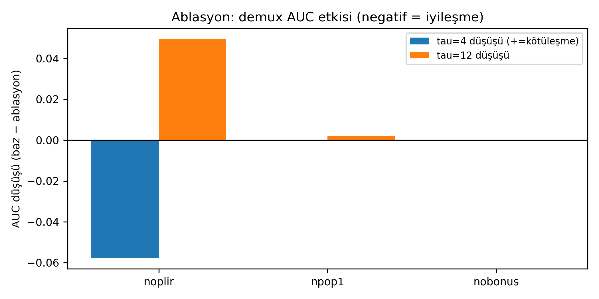

# Salep Sibernetiği — Zamansal Nöromorfik Hesaplama Araştırma Prototipi

*Salep Cybernetics — a temporal neuromorphic computing research prototype.*

Yavaş, gürültülü ve seyrek bitki elektrofizyolojisi sinyallerinde zamanın
sinyalin içine gömüldüğü bir duyusal mimari neyi, hangi sınırlarla temsil
edebilir? Bu depo, o soruyu araştıran deneysel bir prototip sunar: çok bölmeli
dendritik nöronlardan oluşan C++ çekirdek + Python bitki simülatörü + web
arayüzü.

Bu, genel amaçlı bir SNN sınıflandırıcısı **değildir**. Klasik
zorunlu-etiketli sınıflandırma yerine burada araştırılan yaklaşım **zamansal
hesaplamadır**: faz seçici rezonansla ritim ayıklama, spike zamanlamasıyla
örüntü ayrıştırma ve birlikte-ateşlemeyle koşul temsili öğrenme. Etiketler
modele fısıldanmaz; temsil, ağ dinamiğinin ürünüdür (ya da değildir — olumsuz
sonuçlar da raporlanır).

## Gerçekte geliştirilen mekanizmalar

- Faz seçici rezonans ve çift-ritim ayrıştırma (PLIR + popülasyon, FDM)
- Kuadratik spike-oran sinaps kuralı (`dw = eta·G·Q·S`) ve akım aktarımı
- Koşul bankası (P1/P2 duyusal lob) ve örüntü lobu (K1/K2/K3 + K4)
- Bitki fizik/elektro simülatörü, canlı zincir ve web izleme arayüzü

## Henüz geliştirilmemiş hedefler

Öğrenilmiş koşul temsillerinden kavram oluşturma ve türetme, kavramsal
çıkarım, nedensel modelleme ve öngörü **bütünleşik ve doğrulanmış biçimde
geliştirilmedi**. Sistem tamamlanmış bir stres-tanılama veya çıkarım sistemi
olarak tanıtılmaz; tarla verisiyle doğrulanmamıştır.

## Mimari (özet)

```
[Bitki fizik + elektro simülatörü (Python)] ── 7 sensör ──> [P1 faz hatları]
        (dünya saati, hava, su/tuz dengesi)                  (PLIR kilit)
                                                                    │
[Canlı zincir] <── afferent kablo <── [P2 koşul bankası] <── bitki darbesi
      │                    (koşul temsilleri: p2a(p2c)...)
      v
[Örüntü lobu] ── pencere özetleri ──> [Web: kare + telemetri + sinyal paneli]
(29 birim, K4 ilişkisel)                  (yalnız izleme; geri besleme YOK)
```

CPU/NPU sınırı: anlamlandırma NPU dinamiğinden beklenir; CPU etiket vermez,
geri besleme yapmaz. Ayrıntı: [ARCHITECTURE.md](salep_core/ARCHITECTURE.md).

## Öne çıkan deney grafikleri

Kayıtlı çıktılardır (pikseller değil, üretici betik + CSV ile doğrulandı).
Tümü: [EXPERIMENT_GALLERY.md](EXPERIMENT_GALLERY.md).

| Çift-ritim ayrıştırma (FDM) | Sinaps öğrenmesi (büyüme + tavan) |
|---|---|
|  |  |


*Bağımsız değerlendirme, ablasyon kolu: PLIR kapalıyken skorun yükselmesi gibi
beklenmedik sonuçlar yumuşatılmadan raporlandı (bkz. `bench/REPORT.md`).*

## İncelemeye başla

- [INCELEME_REHBERI.md](INCELEME_REHBERI.md) — 10–15 dakikalık ilk teknik tur
- [QUICKSTART.md](QUICKSTART.md) — sıfırdan kurulum ve ilk deney
- [EXPERIMENT_GALLERY.md](EXPERIMENT_GALLERY.md) — deney galerisi
- [RESEARCH_HISTORY.md](RESEARCH_HISTORY.md) — araştırma geçmişi
- [ARCHITECTURE.md](salep_core/ARCHITECTURE.md) — mimari ve tasarım kısıtları
- [CONTRACT_EVIDENCE.md](salep_core/CONTRACT_EVIDENCE.md) — iddia/kanıt tablosu
- [bench/REPORT.md](salep_core/bench/REPORT.md) — bağımsız değerlendirme
- [YENIDEN_URETIM_KONTROLU.md](YENIDEN_URETIM_KONTROLU.md) — yeniden-üretim denetimi

---

## Yöntem notu: skorlar neyi ölçer, neyi ölçmez?

`bench/REPORT.md` içindeki klasik sınıflandırma skorları (AUC, doğruluk)
mimarinin bütün amaçlarını ölçmez:

- **Faz seçiciliği:** TDM'de bant-içi ≥%98,8 ayrım; simultane çift-ritimde
  kilit/kapsama ölçüldü; harmonik yakalanma sınır olarak belgelendi.
- **Kabul/ret:** PLIR kabul/ret sayımları karakterize edildi; ablasyon
  sürprizi yoruma açık bırakıldı.
- **Kapsama:** cov değerleri raporlandı; tohum-duyarlı conc bilgi değeridir.
- **Sessizlik:** CR_YOK bulgu olarak kaydedildi; karar olarak kullanımı
  **doğrulanmadı**.
- **Koşul temsilleri:** sentetik koşullanma gösterildi; örüntü çıkarımı tabanı
  geçemedi (0.310/0.356'ya karşı 0.554).

Faz seçiciliği testleri ile sınıflandırma testleri farklı şeyleri ölçer;
başarısızlıklar gizlenmemiştir. "Ölçüldü" denenler betik + CSV ile izlenebilir.

## Web arayüzü notu (deneyseldir)

Arayüz izleme kolaylığıdır, ölçüm aracı değildir. NPU iç durumlarının grafikleri
**eksik veya güvenilir değildir**. Esas: kaynak kod, telemetri satırları
(`T ...` / `K ...`), kayıtlı CSV + OZET çıktıları.

## Üretim notu

Kodlar yapay zekâ araçlarıyla yoğun destekle yazıldı; sorular, deneyler ve
kararlar kullanıcı tarafından yönlendirildi. Bağımsız doğrulama sürüyor.

## Klasörler

| Yol | Görev |
|---|---|
| `salep_core/src/` | C++ NPU (`*.h` çekirdek, `main_*.cpp` deney programları) |
| `salep_core/sim/` | Bitki simülatörü (fizik, elektro, yayıncı, canlı zincir) |
| `salep_core/web/` | Web sunucusu + tarayıcı arayüzü |
| `salep_core/bench/` | Değerlendirme (plan, rapor, betikler, anlık görüntü) |
| `salep_core/encoder/`, `salep_core/pattern/` | Kodlayıcı ve örüntü deneyleri |
| `salep_core/validate_*.py`, `plot_*.py` | Deney ve grafik betikleri |

## Çalıştırma (özet; ayrıntı QUICKSTART'ta)

```bash
cd salep_core
python3 -m venv .venv && .venv/bin/pip install -r requirements.txt
g++ -std=c++17 -O2 -Isrc src/main_plant_npu.cpp -o npu_plant_npu  # + diğer main'ler
.venv/bin/python -m web.server --port 8001 --pub-port 41793
```

> **ÜZERİNE-YAZMA UYARISI:** testler kayıtlı sonuçların üzerine yazar
> (`validate_testb.py` → `testb_*.csv`; `bench/snapshot.sh` → anlık görüntü;
> `plot_*.py` → `*.png`). Önce paketin kopyasında çalışın.

## Doğruluk durumu (özet)

- **Tam üretim:** örüntü `mem/log`, `neuron_trace.csv` (bit-bit aynı).
- **Kısmi:** bitki NPU özet 4/4 OK, CSV bit-farklı.
- **Üretilemeyen:** duyusal lob `A=OK` → taze derlemede `A=UYARI`.
- Ayrıntı: [YENIDEN_URETIM_KONTROLU.md](YENIDEN_URETIM_KONTROLU.md).

## Dışarıda bırakılanlar

Gerçek-veri arşivi + `unrar` aracı (izin doğrulanmadı, yerel arşivde),
`bench/results` ham verileri, `pattern/p0_out` izleri, `.venv`, derlenmiş
programlar. Gizli bilgi taraması temiz.
