# Salep Sibernetiği — Bitki Elektrofizyolojisinden Zamansal Nöromorfik Hesaplamaya

*Salep Cybernetics — temporal neuromorphic computation for plant electrophysiology: an experimental prototype and its documented development history.*

> **Durum: araştırma prototipi (Eylül–Ekim 2026).** Bu depo tamamlanmış bir tanı ya da ürün **değildir**. Sentetik (simüle edilmiş) bitki verisi üzerinde bir hesaplama mimarisinin ne yapabildiğini, ne yapamadığını ve bunu nasıl ölçtüğümüzü, olumsuz sonuçlar dahil, kayıt altına alır. Gerçek bir bitkiden alınmış elektrot kaydıyla doğrulanmış hiçbir iddia **yoktur**.

---

## Özet

Bitkiler stres altında (kuraklık, tuz, sıcaklık, su basması, yaralanma) zar potansiyellerini değiştirir ve yavaş, gürültülü, seyrek elektriksel olaylar üretir. Bu çalışma şu soruyu sorar: *Bu tür yavaş ve seyrek zamansal örüntülerden, etiket verilmeden, bitkinin içinde bulunduğu koşulun bir temsili öğrenilebilir mi?* Soruyu klasik bir sınıflandırıcıyla değil, donanıma taşınabilir kısıtlarla (Q16.16 sabit nokta, dinamik bellek yok, deterministik zaman adımı) yazılmış bir **spiking (ani-darbeli) sinir ağı çekirdeğiyle** araştırıyoruz. Çekirdek; çok bölmeli dendritik nöronlar, zaman aralığına duyarlı rezonans kapıları (PLIR), kuadratik bir spike-oranı öğrenme kuralı, bir duyusal lob ve bir örüntü lobundan oluşur. Çekirdeği beslemek için fizik tabanlı bir toprak–bitki–atmosfer simülatörü ve ona bağlı bir sentetik elektrofizyoloji katmanı geliştirilmiştir.

Başlıca bulgular: (i) tek bir telde süperpoze edilmiş iki ritim, ardışık pencere gerektirmeden ayrıştırılıp faz-kilitlenebilmiştir; (ii) koşullu yanıt (Pavlov tipi eşleşme) kontrollü sentetik rejimlerde öğrenilmiştir; (iii) sentetik bitki akışında farklı stres koşulları ayırt edilebilir imzalar üretmiştir (250 günlük bir yörüngede 6 koşulun tam imzaları birbirinden farklıdır); (iv) buna karşılık, bellekten çıkarım basit bir en-yakın-komşu tabanını geçememiştir (0,310/0,356 karşı 0,554), kuadratik kuralın çıkarımı iyileştirdiği gösterilememiştir (0,400 < 0,554) ve bağımsız bir değerlendirmede sistem basit yöntemlerle başabaş ya da geride kalmış, gerçek bitki kayıtlarında ise hiçbir yöntem şansın üzerine çıkamamıştır (havuzlanmış AUC ≈ 0,49). Bu olumsuz sonuçlar gizlenmemiş, mimariyi şekillendiren kararlar olarak belgelenmiştir.

**Anahtar sözcükler:** nöromorfik hesaplama, spiking sinir ağları, bitki elektrofizyolojisi, dendritik hesaplama, zamansal örüntü öğrenme, sabit nokta aritmetiği, tekrarlanabilirlik.

## Abstract

Plants under stress (drought, salinity, temperature, waterlogging, wounding) alter their membrane potentials and emit slow, noisy, sparse electrical events. This work asks whether a *representation of the plant's condition can be learned, without labels, from such slow and sparse temporal patterns*. Rather than a conventional classifier, we investigate the question with a **spiking neural network core** written under hardware-portable constraints (Q16.16 fixed point, no dynamic memory, deterministic ticks). The core combines multi-compartment dendritic neurons, interval-selective resonance gates (PLIR), a quadratic spike-rate learning rule, a sensory lobe and a pattern lobe. To drive it we built a physics-based soil–plant–atmosphere simulator with a synthetic electrophysiology layer.

Main findings: (i) two rhythms superposed on a single wire were separated and phase-locked without sequential windows; (ii) conditioned responses (Pavlov-type pairing) were learned in controlled synthetic regimes; (iii) in a synthetic 250-day plant trajectory, six stress conditions produced six distinct exact signatures. Negative results are equally important: retrieval from memory did not beat a nearest-neighbour baseline (0.310/0.356 vs 0.554), the quadratic rule was not shown to improve inference (0.400 < 0.554), and in an independent evaluation the system tied with or trailed simple methods, while on real plant recordings no method exceeded chance (pooled AUC ≈ 0.49). Negative results are reported, not hidden, and are documented as design decisions. **No claim in this repository has been validated on real plant electrode data.**

**Keywords:** neuromorphic computing, spiking neural networks, plant electrophysiology, dendritic computation, temporal pattern learning, fixed-point arithmetic, reproducibility.

---

## Bu depo nasıl okunur?

Bu belge, konuya hiç aşina olmayan bir okuyucunun baştan sona izleyebilmesi için yazılmıştır. Aşağıdaki üç yoldan birini seçebilirsiniz.

| Süre | Yol | Ne kazanırsınız |
|---|---|---|
| **5 dakika** | [Özet](#özet) → [§8 Bulguların toplu değerlendirmesi](#8-bulguların-toplu-değerlendirmesi) → [§9 Sınırlar](#9-sınırlar-ve-geçerlilik-tehditleri) | Ne iddia edildiği, ne iddia **edilmediği** ve kanıtın düzeyi |
| **20 dakika** | Yukarıdakine ek olarak [§2 Problem](#2-problem-ve-araştırma-sorusu) → [§4 Terimler](#4-terimler-sözlüğü) → [§6 Mimari](#6-sistem-mimarisi) | Sistemin ne olduğu ve nasıl çalıştığı |
| **Tam okuma** | Baştan sona; deneylerin ayrıntısı [§7](#7-geliştirme-süreci-ve-deneyler)'de | Her kararın nedeni, her deneyin sorusu, sonucu ve sınırı |

Çalıştırmak isterseniz: [§11 Tekrarlanabilirlik](#11-tekrarlanabilirlik-kurulum-ve-doğrulama) ve [QUICKSTART.md](QUICKSTART.md). Kısa bir inceleme turu için [INCELEME_REHBERI.md](INCELEME_REHBERI.md).

**Kanıt etiketleri.** Depodaki belgelerde bir iddianın kanıt düzeyi şu etiketlerle belirtilir: `[KOŞULDU]` = 28 Ekim 2026'da taze derlemeden çalıştırılıp doğrulandı; `[BELGE]` = çalıştırılmadı, kayıtlı belge ve kod okumasına dayanır; `KANITLANDI / KISMEN / HİPOTEZ / TEST EDİLMEDİ / GÖZLENMEDİ` = [salep_core/CONTRACT_EVIDENCE.md](salep_core/CONTRACT_EVIDENCE.md) içindeki kanıt haritası dili (*gözlenmedi*, "test edildi ama çıkmadı" demektir).

**Günlük (`CLAUDE.md`) hakkında.** `salep_core/CLAUDE.md` iki işi birlikte görür: baştaki bölümler (§0–§8) kod yazan yapay zekâ ajanına verilen kalıcı mimari yönergedir; sonraki bölümler (§9.x) geliştirme günlüğüdür. Bu belgede "(günlük §9.8)" gibi göndermeler bu günlüğün numaralarına işaret eder. Dosya, çalışma yönteminin bir parçası olduğu için adı ve yeri bilerek değiştirilmemiştir.

---

## İçindekiler

1. [Araştırmanın doğuşu](#1-araştırmanın-doğuşu)
2. [Problem ve araştırma sorusu](#2-problem-ve-araştırma-sorusu)
3. [Arka plan ve ilgili çalışmalar](#3-arka-plan-ve-ilgili-çalışmalar)
4. [Terimler sözlüğü](#4-terimler-sözlüğü)
5. [Yöntem ve çalışma ilkeleri](#5-yöntem-ve-çalışma-ilkeleri)
6. [Sistem mimarisi](#6-sistem-mimarisi)
7. [Geliştirme süreci ve deneyler](#7-geliştirme-süreci-ve-deneyler)
8. [Bulguların toplu değerlendirmesi](#8-bulguların-toplu-değerlendirmesi)
9. [Sınırlar ve geçerlilik tehditleri](#9-sınırlar-ve-geçerlilik-tehditleri)
10. [Gelecek çalışmalar](#10-gelecek-çalışmalar)
11. [Tekrarlanabilirlik, kurulum ve doğrulama](#11-tekrarlanabilirlik-kurulum-ve-doğrulama)
12. [Depo haritası](#12-depo-haritası)
13. [Yapay zekâ kullanımı beyanı](#13-yapay-zekâ-kullanımı-beyanı)
14. [Lisans, atıf ve veri kaynakları](#14-lisans-atıf-ve-veri-kaynakları)
15. [Kaynakça](#15-kaynakça)

---
## 1. Araştırmanın doğuşu

> **Kanıt notu.** Bu bölümün 2022–2025 dönemini anlatan kısmı yazarın kendi anlatımıdır; depoda bu döneme ait kayıt yoktur. Kayıtlı, tarihli ve doğrulanabilir geliştirme Eylül 2026'da başlar ([günlük](salep_core/CLAUDE.md) §9.9 ilk tarihli kayıt: 8 Eylül 2026). İki dönem bilerek ayrı tutulmuştur.

**Kişisel ve entelektüel arka plan.** Proje tek bir yazar tarafından, kurumsal bir laboratuvar dışında, bağımsız olarak yürütülmektedir. Yazar 2022'de makine öğrenmesi makalelerini saf merakla okumaya başlamış; bu merak zamanla yapay sinir ağlarının biyolojik olarak daha gerçekçi bir ailesine, spiking sinir ağlarına ve nöromorfik sistemlere (olay güdümlü, zamanı hesabın bir parçası yapan sistemler) yönelmiştir. Aynı yıl, yapay zekâ araçlarının yardımıyla, iki nöronun ateşleme *oranlarına* bağlı kuadratik bir sinaptik öğrenme formülü geliştirilmiştir. Formülün gerçekten çalışıp çalışmadığından emin olunamadığı için bu fikir rafa kaldırılmış, 2026'da çalışma taslağı olarak Zenodo'ya yüklenmiştir ([kaynakça](#15-kaynakça), Kılıç, 2026).

**Bitkiye yönelme.** 2025'te yazar, küçük ölçekli salep yetiştiriciliğine başlamıştır. *Salep*, Türkiye'de geleneksel olarak yumruları öğütülerek tüketilen yabani orkidelerin (*Anacamptis*, *Orchis* gibi cinsler) adıdır; "sibernetik" ise bu projede bir canlı sistemi *algılama–hesaplama–geri bildirim* döngüsüyle ele alma fikrini anlatır. Yetiştiricilik, bitkinin stres durumunu sürekli, ucuz ve donanıma yakın bir yolla izleme sorusunu doğurmuştur: sensörler ve bitkinin kendi elektriksel olayları, düşük güçlü bir kenar donanımında (FPGA sınıfı) çalışabilen bir olay güdümlü sinir ağıyla yorumlanabilir mi? 2026'da bu iki hat, yani spiking öğrenme fikri ve bitki sinyali izleme sorusu, bugünkü projede birleşmiştir.

**Önceki prototip ve ondan alınan ders.** Eylül 2026'dan önce bir tarayıcı prototipi, ardından FastAPI/WebSocket arka uçlu bir Python sürümü geliştirilmiştir: sızıntılı entegre-ve-ateşle (LIF) dinamikleri, kuadratik öğrenme kuralı, yanal engelleme ve çevrimiçi K-means kümeleme içeriyordu. Bu prototipin kaydedilmiş bir zayıflığı vardır: *"14 nöron 36 faz alanını sıfır hatayla okur"* türü sayısal iddialar, gerçek bir simülasyonla sınanmadan mimariye gömülmüştü. Bu deneyim projenin yöntemini belirlemiştir: **doğrulanmamış hiçbir sayısal iddia koda ya da mimariye sabitlenmez**; her iddia önce küçük bir Monte Carlo denemesinden geçer (günlük §0, [ARCHITECTURE.md](salep_core/ARCHITECTURE.md) §0).

**Eylül 2026: yeniden başlangıç.** Bu dersle çekirdek C++'ta, baştan donanım kısıtlarıyla yeniden yazılmıştır: çok bölmeli dendritik nöronlar, sabit nokta aritmetiği, dinamik bellek yok, deterministik zaman adımı. Hedef, ileride bir Zynq sınıfı FPGA'ya yüksek seviyeli sentez (HLS) yoluyla taşınabilecek bir çekirdekti. Bundan sonrası [§7](#7-geliştirme-süreci-ve-deneyler)'de adım adım anlatılmıştır.

## 2. Problem ve araştırma sorusu

**Ana soru.** Yavaş, gürültülü ve seyrek bitki sinyallerinde, etiket verilmeden ve zamanın kendisi bilgi taşıyıcıyken, **zamansal örüntülerden bitki koşulunun bir temsili öğrenilebilir mi?**

Burada "etiketsiz" ifadesi önemlidir. Klasik yaklaşım, kayıtları "kuraklık", "tuz" gibi etiketlerle eğitmektir. Bu çalışmada model hiçbir aşamada dünya koşulu etiketi görmez; bir "kuraklık" temsili, varsa, ağın kendi dinamiğinden (faz seçici rezonans, spike zamanlaması, birlikte-ateşleme) doğmalıdır. Etiketler yalnızca *sonradan, değerlendirme sırasında* kullanılır (bkz. [§5.5](#55-sızıntı-ve-etiket-politikası)).

**Alt sorular.**

| # | Alt soru | Nerede ele alındı |
|---|---|---|
| S1 | Aynı hattaki farklı ritimler birbirini bozmadan ayrıştırılabilir mi? | §7 Evre 2 |
| S2 | Bir frekans bandı ile bir sensör eşleştirildiğinde, sensör olmadan da yanıt (koşullu yanıt) öğrenilir mi? | §7 Evre 3 |
| S3 | Fizik tabanlı sentetik bir bitki akışında farklı stres koşulları ayırt edilebilir imzalar üretir mi? | §7 Evre 6–8 |
| S4 | Bu imzalar bellekte korunup sonradan çıkarım için kullanılabilir mi? | §7 Evre 8–9 |
| S5 | Önerilen kuadratik öğrenme kuralı, çıkarım veya hafıza açısından basit alternatiflere göre bir şey kazandırır mı? | §7 Evre 8–9 |
| S6 | Sistem tekrarlanabilir, deterministik ve donanıma uygun mu? | §5, §7 Evre 10–11 |

**Katkılar (iddia edilenler).**

1. Donanım kısıtlarına uygun bir **zamansal SNN çekirdeği**: çok bölmeli dendritik nöron, faz-kilitli aralık rezonatörü (PLIR), iki raylı (frekans/kanal) adresleme, örüntü lobu ve ilişkisel katman.
2. Çekirdeği besleyen, **fizik tabanlı toprak–bitki–atmosfer simülatörü**, sentetik elektrofizyoloji katmanı ve stokastik olay motoru.
3. **Metodoloji**: ön-kayıtlı hipotezler, dondurulmuş kapılar, bit-bit regresyon, olumsuz sonuçların kataloglanması ve bağımsız (kör) bir değerlendirme paketi.
4. **Olumsuz sonuçların açık kaydı.** Hangi tasarımın neden çalışmadığı, mimari kararların gerekçesi olarak saklanmıştır.

**Kapsam dışı (iddia edilmeyenler).** Bu depo; bir tarla tanı sistemi, gerçek bitki verisinde doğrulanmış bir model, kapalı çevrimli bir kontrol sistemi, kavram oluşturma, nedensel modelleme ya da öngörü *sunmaz*. "Emergence" (kendiliğinden ortaya çıkma) sözcüğü yalnızca *"gözlenen, hedeflenmemiş kolektif davranış adayı"* anlamında kullanılır; kanıtlanmış bir iddia değildir.

## 3. Arka plan ve ilgili çalışmalar

Bu bölüm, bitki fizyolojisi ya da nöromorfik hesaplama bilmeyen bir okuyucu için kısa bir zemin sağlar. Derin bir literatür taraması değildir.

### 3.1 Bitkilerde elektriksel sinyaller

Bitki hücreleri de zar potansiyeline sahiptir ve çevresel uyaranlara elektriksel olaylarla yanıt verir. İki ana tür tanımlanmıştır: hızlı ve eşiğe bağlı **aksiyon potansiyelleri** ve yaralanma gibi uyaranlarla oluşan, yavaş ve değişken genlikli **varyasyon potansiyelleri** (Fromm & Lautner, 2007; Volkov, 2006). Yaralanma ve savunma sinyalinde glutamat reseptörü benzeri kanallar ile yayılan Ca²⁺ dalgalarının rol oynadığı gösterilmiştir (Mousavi vd., 2013; Toyota vd., 2018); tuz stresinin de kökten sürgüne ilerleyen Ca²⁺ dalgalarıyla iletildiği bildirilmiştir (Choi vd., 2014). Bu sinyaller hayvan nöronlarına göre **çok yavaştır** (saniyeler–dakikalar) ve genelde seyrek, gürültülü, uyarana göre değişkendir. Elektrot yerleşimi, bitki türü ve yanıt olasılığı kayıt kalitesini belirgin etkiler: açık bir bitki elektrofizyolojisi veri kümesinde (DesRosiers vd., 2024) kayıtların yalnızca yaklaşık %60'ında yanıt beklenmektedir (bu depoda [bench/REAL_DATA_SEARCH.md](salep_core/bench/REAL_DATA_SEARCH.md)). Bu, "zemin gerçeği" etiketlerini zayıf kılar ve bir çekirdek hükmü değil, bir **ölçüm sınırıdır**.

### 3.2 Spiking sinir ağları

Spiking (ani-darbeli) ağlar bilgiyi sürekli değerlerle değil, ayrık olayların (darbelerin) *zamanıyla* taşır; sinir ağı modellerinin "üçüncü nesli" olarak tanımlanmıştır (Maass, 1997). Temel model, membran potansiyelini zamanla sızdıran ve bir eşiği aştığında darbe üretip sıfırlanan sızıntılı entegre-ve-ateşle (LIF) nörondur (Gerstner & Kistler, 2002; Gerstner vd., 2014). Daha zengin davranış için Hodgkin–Huxley (1952) ya da Izhikevich (2003) tipi modeller kullanılır. Bu projedeki nöron, LIF ailesinden türemiştir; ancak tek bir nokta yerine **birden fazla bölmeden** (iki dal + soma) oluşur.

### 3.3 Dendritik hesaplama

Biyolojik nöronların dendritleri yalnızca pasif girdi toplayıcı değildir; dal bazında doğrusal olmayan işlem yaparlar. Poirazi, Brannon ve Mel (2003), bir piramidal nöronun iki katmanlı bir yapay sinir ağı gibi modellenebileceğini göstermiştir. Bu fikir, projenin "iki dal + soma, çift-dal çakışmasıyla ateş" nöron tasarımının ilham kaynağıdır: Dal A bitkinin faz/rezonans akışını, Dal B sensör türevli spike kodunu alır; soma ancak ikisi zaman penceresi içinde çakışırsa ateşler.

### 3.4 Nöromorfik donanım

Nöromorfik mühendislik, biyolojik sinir sisteminin ilkelerini (olay güdümlü, paralel, düşük güçlü) elektronik sistemlere taşımayı amaçlar (Mead, 1990). TrueNorth (Merolla vd., 2014) ve Loihi (Davies vd., 2018) bu alanın iyi bilinen çiplerindendir. Bu projedeki çekirdek bir çip değildir; ancak **bu tür bir donanıma taşınabilirlik** için tasarlanmıştır (sabit nokta, bellek ayırma yok, tablo (LUT) tabanlı fonksiyonlar, deterministik zaman adımı). Donanım sentezi bu çalışmada yapılmamıştır; maliyetler kağıt üstünde ve ölçümle hesaplanmıştır (bkz. [bench/REPORT.md](salep_core/bench/REPORT.md) Aşama 8).

### 3.5 Sinaptik plastisite

Hebb'in (1949) "birlikte ateşleyen birlikte bağlanır" ilkesi, çok sayıda öğrenme kuralının temelidir. Darbe zamanlamasına dayalı STDP (Bi & Poo, 1998) ve oran tabanlı, kayan eşikli BCM (Bienenstock vd., 1982) bunun iyi bilinen biçimleridir. Kazanan-hepsini-alır (WTA) rekabeti ise hesaplama gücü açısından incelenmiştir (Maass, 2000). Bu projedeki kural, oran tabanlı bir Hebb benzeridir:

```
dw = eta · G(p,q) · Q(p,q) · S(w)
p = r_pre / RATE_WINDOW,  q = r_post / RATE_WINDOW      (son 30 tick'teki darbe sayıları, 0..1)
G(p,q) = min(p,q)            ortak açıklanan bilgi; biri hiç ateşlemediyse sıfır
Q(p,q) = p² + q² + 2pq       ikinci dereceden etkileşim; seyrek ateşlemede bile sinyal çökmez
S(w)   = 1 − (w / W_MAX)²    yumuşak tavan; sınırsız büyümeyi (runaway) önler
```

Kuralın bu çalışmadaki rolü **araştırma nesnesidir**: üstünlüğü kanıtlanmış bir yöntem olarak sunulmaz; aksine, çıkarım görevinde basit bir tabanın altında kalması bulgu olarak kaydedilmiştir (§7 Evre 8). Rastgele bir yenilik iddiası da yoktur; BCM ve benzeri oran kurallarıyla ilişkisinin sistematik karşılaştırması yapılmamıştır.

### 3.6 Bu çalışmanın konumu

Bu çalışma yeni bir en-iyi sonuç ileri sürmez. Katkısı, (i) donanıma uygun bir zamansal SNN çekirdeğinin *neyi yapıp neyi yapamadığının* dürüst ve tekrarlanabilir bir deney zinciriyle kaydı, (ii) simülatör ve değerlendirme altyapısı ve (iii) olumsuz sonuçlar kataloğudur. Karşılaştırma yapılan "rakipler" bilinçli olarak basit yöntemlerdir (gecikme-çakışma, otokorelasyon, Goertzel filtresi, ISI histogramı, varyans/yüksek frekans enerjisi, en-yakın-komşu) ve bir STDP varyantıdır.

## 4. Terimler sözlüğü

| Terim | Anlamı |
|---|---|
| **tick** | Simülasyonun ayrık zaman adımı. Duyusal lobda 1 sim-günü = 50 tick'tir; canlı modda tick ≈ 20 ms (50 tick/sn). |
| **Q16.16** | 32 bitlik sabit nokta sayı biçimi: üst 16 bit tam kısım, alt 16 bit kesir. Çekirdekte `float/double` yoktur. |
| **LUT** | Önceden hesaplanmış tablo; `exp()` gibi pahalı işlemlerin yerini alır. |
| **kompartıman / dal** | Nöronun bölmeleri. Her nöronda **Dal A** (karışık/ritim akışı) ve **Dal B** (sensör spike akışı) ile bir **soma** (hücre gövdesi) vardır. |
| **soma** | Nöronun ateşleme kararını veren bölümü; dalların zamansal çakışmasına göre ateşler. |
| **τ (tau), `tau_resonance`** | Bir nöronun hangi ritme (darbe aralığına) duyarlı olduğunu belirleyen zaman sabiti. |
| **ISI** | Inter-spike interval; iki ardışık darbe arasındaki süre. |
| **PLIR** | *Phase-Locked Interval Resonator.* ISI hafızası yalnızca *kabul edilen* darbede güncellenen rezonans kapısı; yabancı ritmi reddeder. |
| **TDM / FDM** | Zaman bölmeli / frekans bölmeli çoğullama. TDM: ritimler ardışık pencerelerde. FDM: ritimler aynı telde *aynı anda* (süperpoze). |
| **popülasyon** | Aynı τ'ya sahip, hafifçe farklı sızıntılı küçük nöron grubu (bant başına 8 üye). |
| **WTA** | Winner-take-all; yanal engellemeyle kazanan nöronun diğerlerini bastırdığı rekabet. |
| **P1 / P2** | Duyusal lobun iki katmanı: P1 = bitki darbesini faz hattında kilitleyen katman, P2 = koşul bankası (koşul = frekans bandı + sensör çifti). |
| **dual-rail (Rail-F / Rail-C)** | Frekans kimliğinin tek bir telde (Rail-F), sensör kanal kimliğinin ayrı sayaçlarda (Rail-C) taşındığı iki raylı adresleme. |
| **afferent** | Duyusal lobdan örüntü lobuna giden olay akışı; her olay `(tick, post_id, tau_b)` üçlüsüdür. |
| **koşullu yanıt (CR)** | Pavlov tipi öğrenme: bir uyaran (CS) bir sensörle birlikte sunulduktan sonra, sensör *olmadan* da yanıt üretilmesi. |
| **K1–K4** | Örüntü lobunun dalları: K1 = *ne* (konum/merkez-halka), K2 = *ne zaman* (hızlı iz), K3 = *geçmiş* (yavaş iz), K4 = ilişkisel, birimler arası eşzamanlılık katmanı. |
| **imza (signature)** | Bir gün ya da pencere boyunca ortaya çıkan olay kümesi (hangi post'lar, hangi hatlar, hangi A/B bağlamı). |
| **REV-LEARN, iz (T)** | Öğrenme kuralına eklenen kalıcı *iz*: tekrarlanan maruziyetin ağırlığa kalıcı bir taban bırakması. |
| **LOO 1-NN** | Leave-one-out, bir en-yakın-komşu: her örnek, kendisi dışarıda bırakılarak, en benzer örneğin etiketiyle tahmin edilir. |
| **AUC** | ROC eğrisi altında kalan alan; 0,5 şans düzeyi, 1,0 mükemmel ayrım. |
| **bit-bit aynı (bit-identical)** | İki çıktının bayt düzeyinde özdeş olması; hash (SHA-256) ile doğrulanır. |
| **kapı (gate)** | Önceden tanımlanmış, geçti/kaldı sonucu veren otomatik doğrulama testi. |
| **OZET** | Her deney programının sonunda yazdığı tek satırlık özet (`OZET: A=OK ...`). |
| **TEST A / TEST B** | TEST A: ısı ekseni; TEST B: 250 günlük kademeli stres yörüngesi (normal → kuraklık → şiddetli+tuz → ara → yaz → sulama → toparlanma → test). |
| **K6 / K7** | Sızıntı kuralları: K6 = gerçek-durum (ground truth) anahtarları NPU'ya gitmez; K7 = NPU'ya yalnızca darbe bayrağı gider. |
| **NPU** | Bu projede "nöromorfik işlem birimi" yazılımsal çekirdeği; gerçek bir çip değildir. |

## 5. Yöntem ve çalışma ilkeleri

### 5.1 Çalışma döngüsü

Her mekanizma aynı sırayla geliştirilmiştir: **(1)** iddia önce küçük bir Python/NumPy **Monte Carlo** ikiziyle denenir; **(2)** C++ çekirdeğe yazılır; **(3)** çıktı CSV olarak kaydedilir ve matplotlib ile görselleştirilerek gözle denetlenir; **(4)** önceden tanımlanmış kapılar çalıştırılır; **(5)** sonuç, sınırlarıyla birlikte günlüğe yazılır. Monte Carlo ikizi ile C++ arasında fark çıkarsa **C++ sayısı esastır**; ikiz yalnızca yaklaşık öngörüdür.

### 5.2 Donanım kısıtları

Çekirdekte (`salep_core/src/*.h`) `float/double`, `std::vector`, `new`, `std::map` yoktur; boyutlar sabittir; fonksiyonlar yan etkisizdir; zaman tick sayacıyla ilerler; olaylar halka tamponla taşınır. Bu kısıtlar PC'deki geliştirme aşamasında da uygulanmıştır ("önce float yazıp sonra çevirelim" yaklaşımı bilerek reddedilmiştir). Bunun bedeli de ölçülmüştür: sabit nokta yuvarlaması nedeniyle taze derleme, Eylül'de kaydedilmiş bazı CSV'lerle bit-bit aynı değildir (bkz. [§9](#9-sınırlar-ve-geçerlilik-tehditleri)).

### 5.3 Doğrulama disiplini

- **Determinizm.** Aynı tohumla art arda iki koşunun çıktı hash'leri (SHA-256) eşit olmalıdır. Rastgelelik yalnızca tohumlu üreteçlerden gelir (Python tarafında NumPy/hash-bağımsız tohumlu akışlar; C++ test programlarında sabit tohumlu LCG); sinir çekirdeğinin kendisi rastgelelik içermez.
- **Dondurma ve regresyon.** Doğrulanmış bileşenler hash'iyle dondurulur (örn. simülatör için günlük §9.51, örüntü lobu için §9.114). Sonradan yapılan her değişiklik, dondurulmuş bileşenlerin eski çıktılarının *bayt-bayt aynı* kaldığını göstermek zorundadır.
- **Kapılar.** Mekanizma başına önceden tanımlı geçti/kaldı testleri vardır; bir kapı kırılırsa önce **raporlanır**, eşik oynatılarak "düzeltilmez".

### 5.4 Ön-kayıt ve post-hoc yasağı

Keşif ve karşılaştırma deneylerinde hipotezler, sonuçlar görülmeden *önce* yazılmıştır (örn. günlük §9.45 pertürbasyon bataryası H1–H8, §9.50 çıkarım D1–D3; bağımsız değerlendirme için dondurulmuş [bench/TEST_PLAN.md](salep_core/bench/TEST_PLAN.md)). Bağımsız değerlendirmede bir ölçüt tutmadığında (örn. D2 gecikme barı) **ölçüt gevşetilmemiş**, "KALDI" olarak kalmıştır. Kalibrasyon gereken yerlerde (örn. başlangıç ağırlığı) bu, ayrı bir "kalibrasyon döngüsü" olarak, eşik oynatmadan ayrıca belgelenmiştir. Hatalı çıkan ön-kayıtlı hipotezler de kayıtlıdır; örneğin ilk yazılan bir hipotez, ikizin hatalı kurulduğu (elma–armut karşılaştırması) anlaşılınca düzeltilmiş ve bu açıkça not edilmiştir (günlük §9.45). **Dürüst bir istisna:** nem kovası deneyinde (günlük §9.47) H14 hipotezinin ön-kayıtlı barı 0,02 idi; ölçülen kazanç +0,0148 çıkınca bar, "yön sağlam, şiddet açık" gerekçesiyle 0,005'e çekilmiştir. Bu, kodda ve günlükte notlu bir *post-hoc* değişikliktir ve o hipotezin sonucu bu nedenle zayıf kanıt olarak okunmalıdır.

### 5.5 Sızıntı ve etiket politikası

- **K6.** Simülatörün gerçek durumu (`ground_truth`: kök çürümesi, tuz yanığı, bitki ölümü...) hiçbir zaman NPU'ya giden karelerde yer almaz; şema bunu yapısal olarak engeller ve her günde assert ile denetlenir.
- **K7.** Elektrofizyoloji katmanından NPU'ya yalnızca bir *darbe bayrağı* gider.
- **Dünya etiketi.** "Kurak", "normal" gibi koşul etiketleri hiçbir lobun girdisine karışmaz; yalnızca değerlendirme betikleri bunları, skor hesaplanırken kullanır.
- **Döngüsel etiket uyarısı.** Bazı etiketler (örn. `true/decoy/mixed`) temsilin kendisinden türetilir ve aynı temsille sınanır. Bu bir sızıntı değil, ölçüm tasarımı sınırıdır; bu yüzden ilgili skorlar (örn. 163/165) *dünya sınıflaması olarak okunmamalıdır* (iç denetim, [DENETIM_RAPORU_2026-10-14.md](salep_core/DENETIM_RAPORU_2026-10-14.md) §4).

### 5.6 Raporlama biçimi

Her deney şu başlıklarla anlatılır: **Soru** (neyi merak ediyoruz), **Kurulum** (nasıl), **Sonuç** (ölçülen), **Sınır** (neyi *kanıtlamıyor*), **Karar** (mimariye ne yaptı). Sayılar, ilgili günlük numarasıyla birlikte verilir.

---
## 6. Sistem mimarisi

### 6.1 Genel şema

```
 hava verisi (Aydın Open-Meteo gözlemi ya da sentetik)     stokastik olay motoru
        │                                                   (gübre, sulama, soğuk, drenaj arızası, patojen)
        ▼                                                          │
 ┌──────────────────────────────────────────────────────────────┐ │
 │ Toprak–bitki–atmosfer simülatörü  (salep_core/sim/)         │◄┘
 │  su dengesi · EC/tuz kütlesi · ET/VPD · evreler · yumru     │
 └───────────────┬──────────────────────────────┬───────────────┘
                 │ 7 sensör (hs ts hn tn ph npk ec, 0–100)       │ zar potansiyeli türevi
                 ▼                                               ▼
        SensorMapper                              Elektro katman (sim/electro.py)
                 │ SET (sensör değerleri)                        │ hat0: stres-oran darbesi
                 │                                               │ hat1: olay patlaması
                 └───────────────────┬───────────────────────────┘
                                     ▼
                 ┌──────────────────────────────────────────┐
                 │ Duyusal lob (C++, src/sensory_lobe.h)    │
                 │  P1: faz hatları (PLIR-A kilidi)         │
                 │  P2: koşul bankası (Dal A ← P1, Dal B ← sensör)│
                 └────────────────────┬─────────────────────┘
                                      │ afferent olaylar (tick, post_id, tau_b)
                                      ▼
                 ┌──────────────────────────────────────────┐
                 │ Örüntü lobu (C++, src/pattern_lobe.h)    │
                 │  K1 (ne) · K2 (ne zaman) · K3 (geçmiş)   │
                 │  K4 (ilişkisel) · soma · 29 birim        │
                 │  REV-LEARN: G·Q·S + kalıcı iz T          │
                 └────────────────────┬─────────────────────┘
                                      │ mem/log, STATE
                                      ▼
        Değerlendirme katmanı: association, en-yakın-sıra çıkarımı, karakterizasyon betikleri
        Canlı: sim/serve.py → SensoryChain → web/ (WebSocket, 2B/3B görünüm, sinyal paneli)
```

Dikkat edilmesi gereken bir nokta: **dünya etiketleri bu akışın hiçbir yerinden lobun içine girmez** (§5.5). CPU/harness katmanı yalnızca değerleri taşır ve özet okur; "anlamlandırma" lobların kendi dinamiğinden doğmalıdır.

### 6.2 Bitki simülatörü (`salep_core/sim/`)

**Amaç.** Çekirdeği besleyecek, kendi içinde tutarlı ve tekrarlanabilir bir "dünya" üretmek. Sistemin kuruluş ilkesi, her şeyin elle yazılmış bir senaryo olmaması, nedensel zincirlerin fizikten *kendiliğinden* doğmasıdır (örn. kuraklık → solma → gübre fazlalığı → EC artışı → kök yanığı → ölüm).

- **Fizik (günlük adım).** Toprak nemi (hacimsel su içeriği, VWC), tuzluluk (EC) için *kütle korunumlu* bir defter, buharlaşma–terleme (ET), drenaj, bitki su alımı ve bitki evreleri (uyku, filizlenme, vejetatif, çiçeklenme, sararma, ölüm). Opt-in `fiziksel-v1` ön ayarı su modelini 9 adımda inceltir (kapasite tanımları θs/θFC/θWP, drenaj, su defteri, bitki alımı, saat-altı bütünleme, sensör gürültüsü); varsayılan (legacy) yol bit-bit korunmuştur.
- **Hava.** Aydın (37,86°K 27,87°D, 108 m) için gerçek Open-Meteo günlük gözlemi (8 Eylül 2025 – 8 Eylül 2026, 366 gün, boşluksuz) ve UV endeksi ayrı bir dosyadan okunabilir; dosya dışındaki günler sentetik hava ile doldurulur. Ayrıca, bir gün-içi sıcaklık eğrisi yalnızca *gösterim* için günün gerçek min/maks değerlerinden yeniden kurulur; fiziğe girmez.
- **Atmosfer zinciri.** Doygun buhar basıncı (Tetens) → buhar basıncı açığı (VPD) → ET ve alım çarpanı; kapalı bir mikroklima nem kovası.
- **Stokastik olay motoru (`events.py`).** Tohumlu tehlike çekişleriyle gübre, sulama, soğuk (don), aşırı yağış ve drenaj arızası, patojen yükü; gizli durumlar (arıza sayacı, sönen patojen yükü). Kaskadlar ayrıca kodlanmaz, fizikten doğar.
- **Çoklu döngü (`cycles.py`).** `master → döngü → {iklim, olay, bitki, toprak}` hiyerarşik tohumlarıyla, her bitkinin farklı bir "yıl tipi" yaşaması. Ölümde yeni tohum; sonsuz koşu (ölüm → çıplak toprak → yeniden ekim).
- **Gözlem sınırı.** Sensör katmanı, hallere geri beslenmeyen, isteğe bağlı tohumlu bir gürültü ekleyebilir.

**Dürüst sınırlar.** Fizyoloji parametreleri bir *model seçimidir*, tarla ölçümü değildir (çoğu `TODO: DOĞRULANMADI` işaretlidir). Işık ve rüzgâr zincire girmemiştir; pH ve patojen/don şiddetleri kalibresizdir; kök iyileşmesi yoktur; bitki tuz alımı modellenmemiştir (çıkış yalnızca yıkanmadır); `hn/ph/npk` sensör türevleri doğrulanmamıştır.

### 6.3 Sentetik elektrofizyoloji katmanı (`sim/electro.py`)

Bitkinin durumundan (sıcaklık, yağış, sulama, su dengesi, yaprak/kök sağlığı, evre) bir **zar potansiyeli** türetir: dinlenim düzeyi −120 mV; kuraklık, hasar ve sıcaklık depolarizasyon yönünde kayma yaratır. Bundan iki darbe hattı üretilir: **hat 0** (stres düzeyiyle orantılı oran kodlu darbeler) ve **hat 1** (yağmur ve sulama başlangıcı gibi olaylarda patlama). Uykudaki bitki sessizleşir (×0,25), ölü bitki susar. Rastgelelik tohum + gün + hat ile kararlıdır (fizik akışına dokunmaz). **Bu katman bir taklittir**; gerçek bir bitkiden alınmış elektrot kaydıyla karşılaştırılmamıştır.

### 6.4 Sinir çekirdeği (`salep_core/src/`)

- **Nöron.** İki dal + soma; her kompartımanda sızıntı, kapılama durumu (`gating_state`, NMDA benzeri kısa vadeli hafıza) ve difüzyon vardır. Soma, iki dalın zaman penceresi içindeki çakışmasıyla ateşler.
- **Sinaps.** Ağırlık, hedef kompartıman, kaynak kimliği, rezonans zaman sabiti; öğrenme `dw = η·G·Q·S` ile (§3.5), ortak salt-okunur tablolardan (G, Q, S için LUT).
- **PLIR kapısı.** Dal A'nın giriş kapısı iki kipte çalışır: klasik ISI kapısı (ardışık pencere) ve opt-in PLIR; PLIR'de ISI hafızası *yalnızca kabul edilen* darbede güncellenir, yabancı darbe reddedilir. Bu, iki ritmin aynı tele süperpoze binmesini mümkün kılar (§7 Evre 2).
- **Maliyet (ölçülen).** Bir nöron yapısı 516 bayt (çoğu `double` parametre ve dolgu; gerçek durum ≈ 50 B), bir sinaps 24 B, iki bantlı 8'er üyeli FDM ağı 21,7 KB, G/Q tabloları 3844+3844 B. Sentez aracı bulunmadığından donanım sayıları kağıt üstü/ölçümseldir.

### 6.5 Duyusal lob (`src/sensory_lobe.h`)

- **P1 (faz hatları).** Bitki darbesini PLIR-A ile kilitleyen katman (τ ∈ {4, 12}, bw = 1).
- **P2 (koşul bankası).** Her P2 nöronu bir *koşulu* temsil eder: Dal A ← P1 (bitki fazı), Dal B ← sensör faz hattı. Sensör değeri bir faz gecikmesine kodlanır (`τ(v) = 4 + v·56/100`). Varsayılan banka 10 aktif nörondur (7 temel koşul + 1 replika + 2 yem/decoy); en çok 64 slot.
- **Dual-rail.** Yedi sensör kanalını yedi ayrı frekans bandı olarak tek tele süperpoze etmek, PLIR'in dürüst sınırları nedeniyle imkânsız bulunmuştur; bunun yerine frekans kimliği Rail-F'de (yalnızca {4,12} bandı), kanal kimliği Rail-C sayaçlarında taşınır.
- **Öz-örgütlenen banka.** Etiketsiz bir havuz ortak yolu dinler; kimlik rezonanstan çıkar, etiket ölçümden alınır ve yeni bir ritim ortaya çıktığında yedek slottan işe alım (recruitment) yapılır.

### 6.6 Afferent kablo (`encoder/`, `src/causal_afferent.h`)

P2 ateşleri `(tick, post_id ∈ 0..63, tau_b ∈ 4..60)` olaylarına çevrilir. Kodlama tamsayıdır ve kimliği korur (`phi_id = post·3000`, `phi_tau = ((tau−4)·36000)//57`, 12 slot). Bu katman dondurulmuştur.

### 6.7 Örüntü lobu (`src/pattern_lobe.h`)

Afferent akışı, yeniden kullanılabilir zamansal/uzaysal temsile dönüştürmeyi amaçlar. 29 birim, her biri üç ana dalla (K1–K3) ve bir ilişkisel dalla (K4) donatılmıştır:

| Dal | Anlam | Yöntem (özet) |
|---|---|---|
| **K1** | *ne* | Merkez slot + komşu halka (±1, 0,2×) |
| **K2** | *ne zaman* | Dal genelinde slot-kör **hızlı iz** (sızıntı 0,10) |
| **K3** | *geçmiş* | Dal genelinde slot-kör **yavaş iz** (sızıntı 0,02) |
| **K4** | *ilişki* | Birimler arası eşzamanlılık: nicemlenmiş imza, kapı, benzerlik `r(t)`, max/argmax seçimi, spike-kapılı sürüm; gerçek bir kompartıman olarak somaya paralel katılır |

Soma iki aşamalıdır: önce dondurulmuş F1 (K1–K3) kararı, ardından K4 katkısı (`S4 = min(0,25; 0,125·(Vg_A+Vg_B))`). **REV-LEARN** öğrenmesi, çekirdek kurala (`G·Q·S`) *kalıcı bir iz* ekler: tekrarlanan güçlü maruziyet bir iz (T) bırakır; kullanım dışında ağırlık klasik bir sönümle değil, izin belirlediği bir **tabana** gevşer. Yeniden erişim, aynı örüntü için çok daha az tekrarla yapılır (§7 Evre 9).

Lobun mimarisi **dondurulmuştur** (günlük §9.109 ve §9.114); donuk envanterin SHA-256 değerleri günlüktedir.

### 6.8 Değerlendirme katmanı

Lobların üstünde, *öğrenmesiz* iki referans vardır: gün imzaları üzerinde ağırlıklı Jaccard benzerliğiyle **association** (`sim/assoc.py`) ve sıra-koruyan en-yakın-komşu **çıkarımı** (`validate_inference.py`). Bunlar, lobların ürettiği temsilin "ne kadar bilgi taşıdığını" ölçmek için bilinçli olarak *aptal* seçilmiştir.

### 6.9 Canlı zincir ve web arayüzü

`sim/serve.py` simülasyonu bir yayıncı olarak çalıştırır; `sim/sensory_chain.py` her sim-gününde sensör değerlerini kalıcı bir duyusal lob sürecine iletir, çıkan P2 olaylarını yaşayan bir örüntü lobu sürecine besler. Besleme *eşiksizdir* (ölçüm: gecikmenin tamamı eşikteydi, iletim bedavaydı). Öğrenilmiş durum (`w`, `T`, `r`; toplam 17.668 bayt) CRC32'li bir **checkpoint** biçimiyle (`PLST`) kaydedilip yüklenebilir. `web/` paketi (Starlette + WebSocket, 5 Hz kare) 2B terraryum görünümü, isteğe bağlı 3B sekme, sensör/müdahale panelleri ve gerçek olaylara bağlı bir **sinyal yayılımı paneli** sunar. Arayüz deneyseldir; NPU iç durumlarının grafikleri eksik ya da güvenilmez olabilir. Hüküm için telemetri satırları ve kayıtlı CSV/OZET çıktıları esas alınmalıdır.

---
## 7. Geliştirme süreci ve deneyler

Bu bölüm, projeyi **kronolojik olarak** ve her adımın *neden* atıldığıyla anlatır. Ana çizgi şudur: önce tek nöron ve sinaps doğrulandı (Evre 1); aynı hatta karışık ritimleri ayırma sorunu çözüldü (Evre 2); koşullu öğrenme ve duyusal lob kuruldu (Evre 3); bu mekanizmaları besleyecek bir dünya inşa edildi ve bu dünya kasıtlı olarak *kırılmaya çalışıldı* (Evre 4–6); sistem bitki-sürücülü hâle getirilip sınandı (Evre 7); temsilin ne taşıdığı titizlikle ölçüldü ve öğrenme kuralları karşılaştırıldı (Evre 8); örüntü lobu inşa edilip donduruldu (Evre 9); canlı zincire bağlandı (Evre 10); son olarak bağımsız ve kör bir değerlendirme yapıldı (Evre 11). Her evrede, sonucun hemen ardından **sınır** ve **karar** verilmiştir. Tarihler günlük kayıtlarından alınmıştır (Eylül–Ekim 2026).

Ayrıntılı deney listesi (komutlar, girdi/çıktı dosyaları) [DENEYLER_VE_ANALIZLER.md](DENEYLER_VE_ANALIZLER.md)'dedir; tarihçenin kısa özeti [RESEARCH_HISTORY.md](RESEARCH_HISTORY.md)'dedir.

---

### Evre 1 — Çekirdek mekanizma: tek nöron, sinaps, küçük ağ (Eylül başı)

**Soru.** İki dallı bir nöron ve kuadratik bir sinaps, birlikte ateşlemede büyür mü, tavanda durur mu ve öğrenilmiş ağırlık gerçekten akım taşır mı?

**Kurulum.** Önce tek nöron (500 tick, 6 ateşleme; çıktı SHA-256 kanonik değerle eşleşir). Sonra iki nöronlu (N0 hızlı ritim, N1 yavaş ritim) bir sinaps testi: 20 döngü × 500 tick birlikte ateşleme, ağırlık her tick CSV'ye yazıldı. Dört alt test: **L0** açık döngü öğrenme, **L1** kapalı döngü (sinaptik akım geri beslenir), **T1** düşük ağırlıkta aktarım, **T2** öğrenilmiş ağırlıkta aktarım.

**Sonuç.**
- Büyüme: ağırlık 0,050 → 1,764 monoton arttı (W_MAX = 2,0'ın %88,2'si). |Δw| ısınmadan sonra yaklaşık 4× küçüldü: yumuşak tavan çalışıyor.
- Kapalı döngü: N1 ateşi 289 → 360 (+%25), ağırlık 1,909; beş kararlılık kontrolünün (C1–C5) beşi geçti.
- Aktarım: düşük ağırlıkta (0,05) N1 hiç ateşlemedi (0); öğrenilmiş ağırlıkta (1,909) N1 78 kez ateşledi. *(Taze derlemede 79 ve doygunluk kontrolü "UYARI" verir; bkz. §9.)*
- **Katman-1 ağı.** Üç sinaps bağımsız ve monoton olarak 6. döngüde tavana ulaştı; N3 ateşi erken pencerede 140, geç pencerede 240 (1,71×; ön-beklenen ≥3× tutmadı); Dal A'nın çoklu-giriş etkisi 2,26× (yalnız N1: %28,2 yanıt; N0+N1 birlikte: %63,8).

**Sınır.** `S(w)` yalnızca bir tavandır, zaman/eskime terimi yoktur. Ağırlık erken doyduğu için ağda öğrenme 6. döngüden sonra durur (beklenen 3× yerine 1,71×).

**Karar.** Kural çekirdeğe girdi; sıradaki adım aynı hatta farklı ritimleri ayırma sorunu oldu.

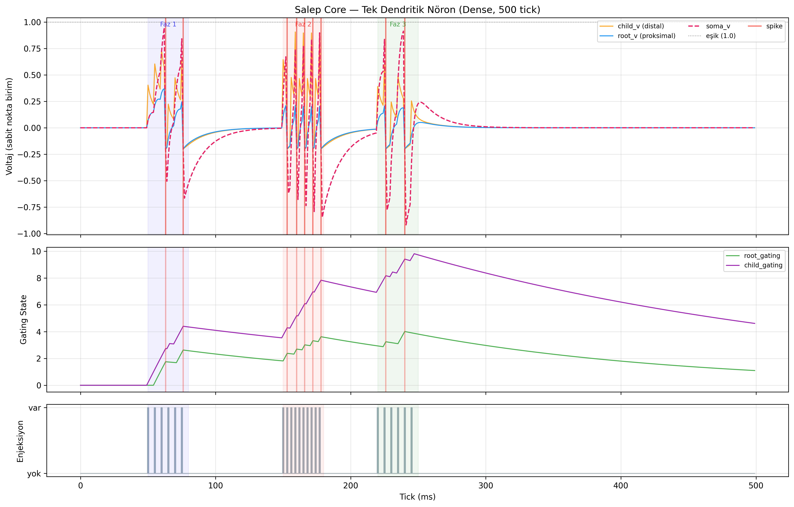
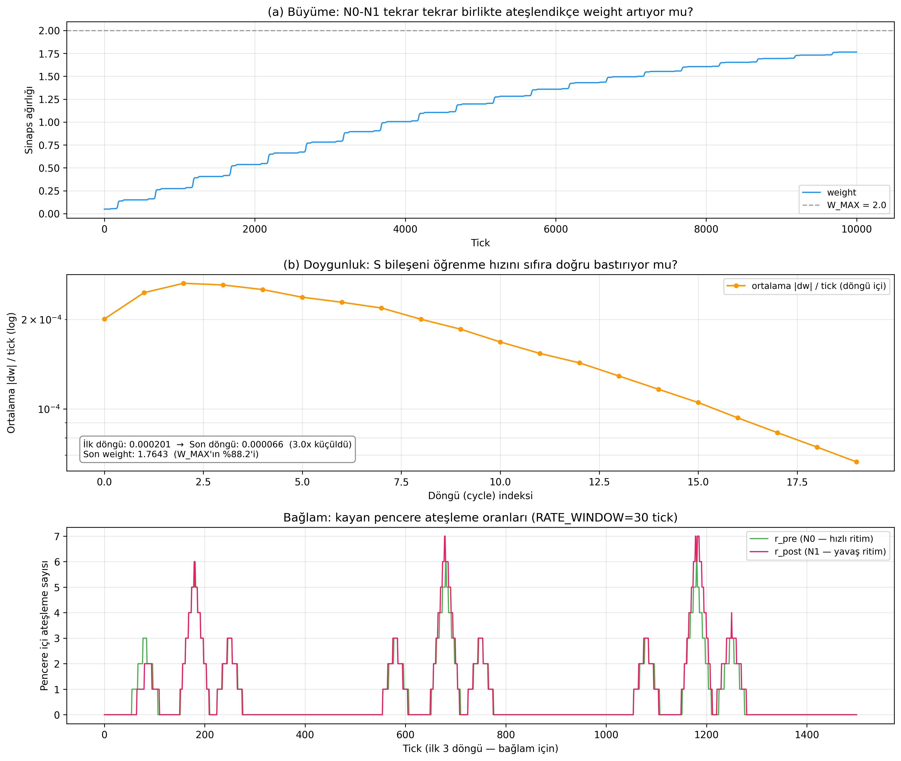

*Şekil 1. Tek nöron membran izi (üst) ve sinaps ağırlığının zaman içindeki büyümesi/doygunluğu (alt).*

---

### Evre 2 — Faz seçiciliği: aynı telde iki ritim (Eylül)

**Soru.** Aynı telden gelen farklı ritimler birbirini bozmadan ayrı nöron popülasyonlarınca işlenebilir mi?

**2a. TDM (zaman bölmeli ayırma).** Dört τ-ayarlı nöron (τ = 4/8/12/16) ve bir birleştirici nöron. Bant-içi doğru ateş oranı ≥ %98,8, rakip bant oranı ≥ 80×. **Sınır:** bu *ardışık pencere* ayrımıdır, aynı anda gelen ritimleri ayırdığını kanıtlamaz; kayıt bu sınırı doğrudan yazdı.

**2b. Nedensellik köprüsü.** İki ritim ve bir hedef nöron: Faz 1 (4'lük ritim → Dal A), Faz 2 (12'lik ritim → Dal B), Faz 3 (ikisi eşzamanlı). Hedef ateşi F3/(F1+F2) = 2,11×; kullanılmayan bantlar için negatif kontrol temiz (ağırlık bit-eşit sabit). **Sınır:** Faz 3 ritimleri aynı telde değil, her biri kendi hattında taşır.

**2c. Q(Δt) taraması.** 12'lik ritim 9 farklı gecikmeyle kaydırıldı. Ön-kayıtlı sınıflandırma eşikleriyle (veri görülmeden sabitlenmiş): eğri **yaklaşık düz** çıktı (dw_toplam yayılımı %4,3; amplifikasyon yayılımı %5,5); çan şeklinde bir pencere ve 4-periyotlu dalgalanma yok; 12-periyot tekrarı bit-eşit. Yorum: öğrenme 30 tick'lik oran sayaçlarıyla yapıldığı için devre *hız-eşzamanlılığı* gibi davranıyor, 10 tick altı spike-zaman hassasiyeti yok. Günlükte açıkça: *"Bu bir başarısızlık değil, devrenin gerçek transfer karakteristiğidir."*

**2d. Kök neden ve PLIR/FDM.** Ardışık-pencere sonucu simultane ayrımı kanıtlamadığı için aynı telde iki ritim (4+12) denendi ve eski ISI kapısının bir kusuru bulundu: kapı, teli vuran **her** darbeyle tazeleniyordu; bu yüzden τ = 12 nöronu, 4'lük darbeyi görüp sürekli sönümleniyordu (Monte Carlo: eski ISI'da bant-12 ateşi 1, PLIR ile 100+). Çözüm olarak ISI hafızasının yalnızca *kabul edilen* darbede güncellendiği **PLIR** ve bant başına 8 üyeli bir popülasyon eklendi.

*Sonuç (iki koşuda aynı SHA-256):* kilit kalitesi R1 için kapsama (0,98; 0,98), mutlak faz merkezi Monte Carlo tahmininden ≤ 0,01 tick sapma, faz kaydırma hatası ≤ 0,03 tick; yavaş bant ateşi PLIR ile 1600, eski ISI kapısıyla 8 (karşıt koşul R9).

*Kalibrasyon dersi.* İlk C++ koşusu Monte Carlo ile fazda uyuşmadı. Suçlu çekirdek değil, Monte Carlo ikizinin difüzyonu *sıralı* yazmış olmasıydı (C++ canlı-c + anlık-komşu çalışır; boş Dal B kökü bir emici gibi davranır). İkiz tick-tick eşlenince tek-nöron probu aynı ateş dizisini ([13, 39]) verdi. Eşik oynatılmadı; metrik ikizden türetildi.

**Sınırlar (günlükte beş madde).** (i) Harmonik çiftte yavaş bant faz takibi yok (ilk-darbe çapası, bilgi-teorik sınır); (ii) seyrek yabancı darbede alt-harmonik sürüklenme; (iii) üç bantta τ = 16 çapası tutmuyor, C++'ta 3. bant yok; (iv) {4,9} yavaş bant kilidi tohum-duyarlı; (v) test ızgarası deterministik (bw = 1 koşulu).

**Karar.** PLIR/FDM çekirdek mekanizma oldu.

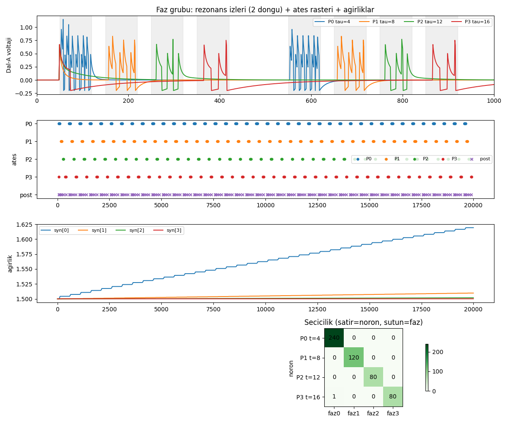
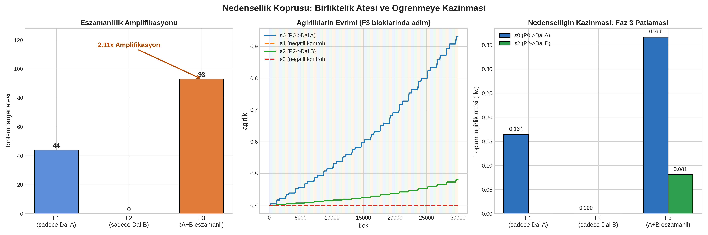
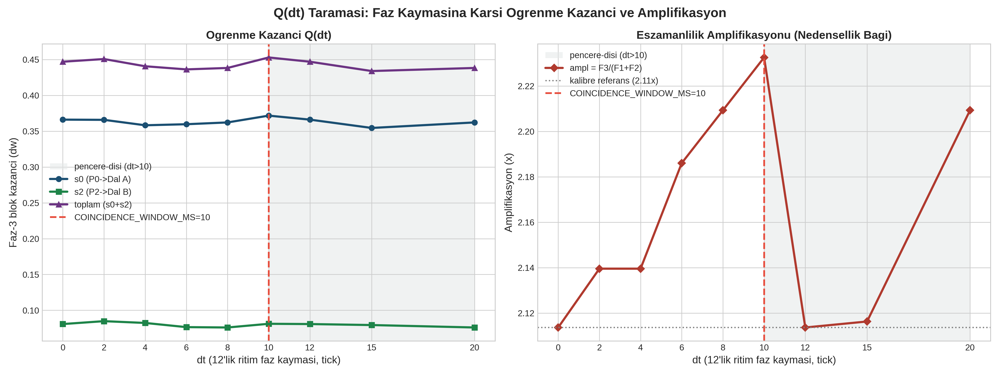
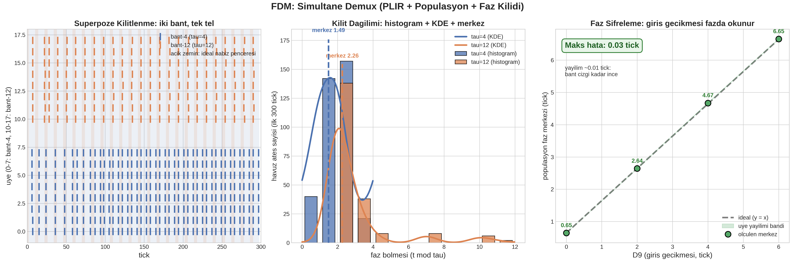

*Şekil 2. Sırasıyla: TDM seçiciliği; nedensellik köprüsü (kazanç ve negatif kontrol); Q(Δt) taraması (yaklaşık düz); simultane FDM kilit ve faz haritası. Bu deneyler herhangi sayıda sinyalin ayrılabileceğini ya da tarlada tanı konabileceğini göstermez.*

---

### Evre 3 — Koşullu öğrenme ve duyusal lob (Eylül)

**Soru.** Bir frekans bandı bir sensörle eşleştirildiğinde, sensör olmadan da bir yanıt (CR) oluşur mu? Birden fazla sensör ve kanalda bu nasıl ölçeklenir?

**3a. Bitki NPU (Pavlov tipi öğrenme).** Koşul = (frekans bandı, sensör) çifti. Bir *negatif kontrol* (EC kanalı: aynı bant, sensör kapalı) vardı. Kalibrasyon önce Monte Carlo'da yapıldı (24 koşu); seçim: `S_b = 1,0; w0 = 0,2; η = 0,2`. C++ sonucu (`OZET: KILIT=OK KAZANIM=OK NEGATIF=OK CR=OK`): kilit kapsama 0,83/0,84; ağırlık kazancı NEM +1,54, SIC +1,80; sensörsüz test yanıtı NEM 62, SIC 117; negatif kontrol EC için 0 ve |Δw| ≈ 0. Başlangıç ağırlığı notu: w0 ≥ 0,3 iken A dalı tek başına ateşleyip "CS tek başına" probunu bozar; bu yüzden 0,2 seçilmiştir. *Monte Carlo tahmini yaklaşıktı* (koşullanma ateşi 415/0/993 karşı 415/0/1020); C++ sayısı esas alınmıştır.

**3b. Mimari kırılma: dual-rail.** Yedi sensör kanalını yedi ayrı frekans bandı olarak tek tele süperpoze etmek denendi ve Evre 2'nin sınırlarına takıldı: her bandın PLIR kilidi ötekinin yabancı darbesiyle sürekli bozulur, kapsama eşiği (≥0,40) tutturulamaz. Karar **dual-rail** oldu: frekans kimliği Rail-F'de (yalnızca {4,12}), kanal kimliği Rail-C sayaçlarında. Banka 9 post'a (7 temel + 2 çapraz) genişletildi; susturulu (dw = 0) kanallar ve yalnızca iki çaprazın (HN←τ4, HS←τ12) öğrendiği dürüstçe kayda geçti.

**3c. Duyusal lob v2 (P1 faz hatları + P2 koşul bankası).** Kapı: `A=B=C=D=OK`. Seçicilik: yem (decoy) nöronların kabul oranı gerçeğin yaklaşık 0,33'ü (yeniden-kilit bedeli; Evre 2'deki alt-harmonik sınırla aynı fizik). Bu aşamada iki ön-yazılı değer Monte Carlo ile **çürütüldü**: önerilen "burst 2" yemleri gerçeğe yaramadan %50 artırıyordu (karar: burst 1), önerilen yem τ'sı yerine τ+1 kullanıldı. Literal "yem kabulü = 0" kapısı yeniden-kilit nedeniyle *imkânsız* bulundu ve oran kapısıyla değiştirildi; bu değişiklik kayda geçti.

**3d. Öz-örgütlenen banka ve stres.** El-atamalı adreslemeye son verildi: etiketsiz bir havuz ortak yolu dinler, kimlik rezonanstan çıkar, etiket ölçümden alınır, yenilik yedek slottan *işe alınır*. 12 slotluk havuzda bir ton bir bant eklendiğinde işe alım τ = 37 (tick 1813, kilit 0,98) ve τ = 45 (tick 3870, kilit 0,92) için gerçekleşti. **Stres deneyinde bir hata yakalandı:** beş eşzamanlı tonda sahipsiz darbe farkları ~75'te kümelendi ve harmonik kontrol (75/3 = 25) busta olmayan bir **τ = 25 "hayalet"** işe aldı. Kök neden: aday testi kat-açıklamasına bakıyor, adayın doğrudan gözlenip gözlenmediğine bakmıyordu. Düzeltme ("doğrudan kanıt şartı": altı farktan ≥ 2'si adayın ±3'ünde olmalı) iki koda eklendi ve eski doğrulanmış çıktının bit-bit aynı kaldığı kanıtlandı. Ayrıca **yanlış ritme yakalanma** bulundu: B-PLIR kilidi bir körlük değil rezonans durumudur; yoğun yolda kilit düşünce yabancı ton nabzı slotu kaçırır. Bu nedenle yoğun fazda kilit oranı kapılanmadı; kilit ispatı seyrek sondada, karar ispatı sıra + pencere ile verildi. Stres kapıları T1–T4 geçti; havuz 12'den 16'ya büyüdü.

**3e. Afferent kablo ve tek adımlık öngörü.** P2 olayları örüntü katmanına bir kabloyla bağlandı; olay yavaş (τ12–60), pre'ler hızlı (τ4–16) olduğundan olay kısa bir patlamaya çevrildi. Tek adımlık öngörüde "bir sonraki P2 kümesi" tahmin edildi. Sonuç (deterministik ×2): hedef kazancı tekil kanaldan büyük, negatif kontrol sıfır, taşma 0, P1 öngörü geri çağırması 210/225 (0,933), P3 öncül süre 8,10 tick. **Sınır:** yoğun-periyodik bu dünyada kesinlik (precision) ölçülemez; Monte Carlo ikizi hedef baskılamada çekirdekten *katı* davranır, bu yüzden sıfırlar değil oran/karşıtlık kapıları esas alınmıştır.

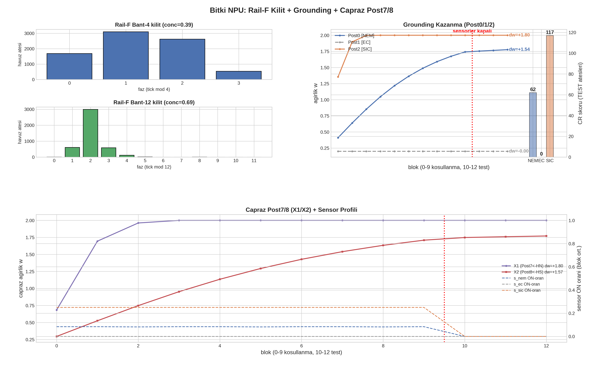
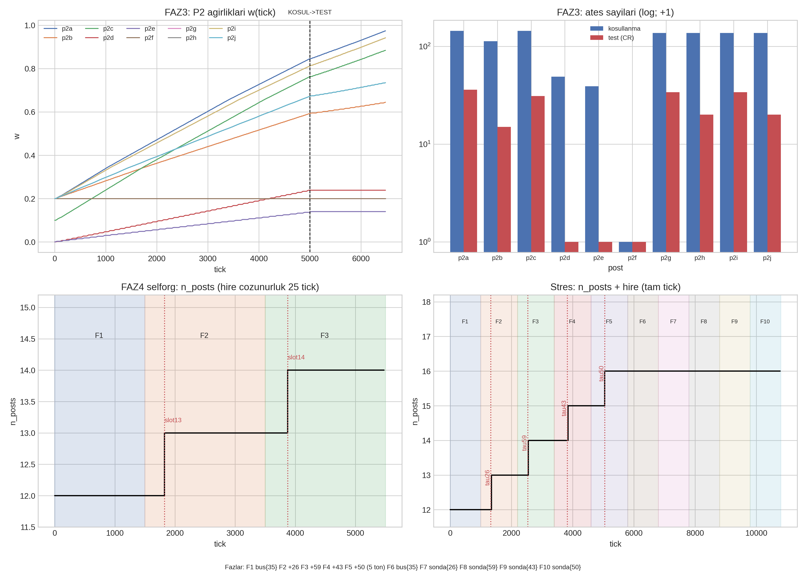
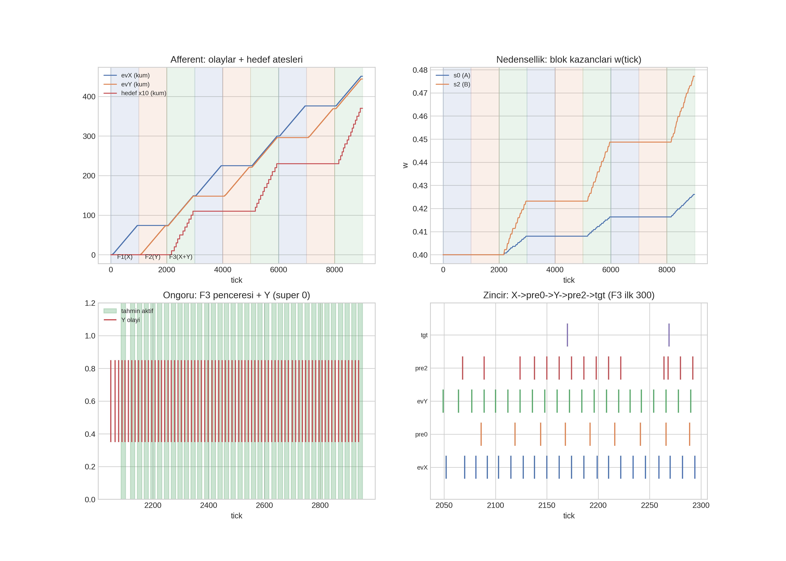

*Şekil 3. Sırasıyla: koşullanmanın kilit/kazanç/CR panelleri; duyusal lob (FAZ3 ağırlıkları, öz-örgütlenme basamakları, stres işe-alımları); afferent kablo ve tek adım öngörü.*

---
### Evre 4 — Dünyanın inşası: simülatör ve web katmanı (Eylül ortası)

**Soru.** Çekirdeği besleyecek, nedensel zincirleri *kendiliğinden* üreten, tekrarlanabilir bir bitki dünyası kurulabilir mi?

**Süreç ve kararlar.**
- **Yeniden yapılanma (kullanıcı onaylı anayasa değişikliği, günlük §9.19).** Daha önceki görselleştirme yolları (Godot, Qt, Streamlit) emekli edildi; simülasyon `twin/` paketinden `sim/` paketine taşındı; **NPU kökü bilerek dokunulmadı**. Ardından NPU'suz, tek başına 365 günlük bir koşucu (`sim/run.py`) yazıldı ve her günde sızıntı assert'i eklendi (K6). Kare şeması **v2** dondurulup kilitlendi.
- **Web katmanı (günlük §9.21).** Starlette/WebSocket sunucusu; simülasyon ve NPU alt-süreçleriyle yalnızca *veri* üzerinden bağlanır (kod import'u yok; AST lint ile denetlenir). Yeni kapılar: sıfır CDN, LAN erişimi, WebSocket sözleşmesi + "en-yeni-kazanır", NPU'suz tam çalışma, izole koşu, 2B silüet ile 3B mesh arasında geometri paritesi. NPU el sıkışması bilinçli olarak *manuel* tutuldu: sayfa açılışı NPU başlatmaz.
- **Sonsuz koşu (günlük §9.22).** Şikâyet: bitki belirli bir günde ölüp orada takılıyordu. Ölçülen kök neden iki katmanlıydı: kök sağlığı yalnız azalıyor ve ölüm yutucu durumdu; popülasyon koşusu ölü bitkiyi atlayınca gün ızgarası deliniyordu. Canlı fizik sayılarına dokunmadan, ölü bitki için doğal sürgün kapısı açıldı. Sonuç (tohum 42, 3000 gün): 3 ölüm + 3 yeniden doğuş (gün 1050/1705/2442), en uzun kesintisiz ölü dönem 170 gün.
- **Gerçek gözlem havası (günlük §9.26).** Kullanıcının bulduğu Aydın Open-Meteo dosyası (366 gün, NaN/boşluk yok) doğrulandı ve sıcaklık/yağış olarak fiziğe bağlandı; ikinci bir dosyadan UV endeksi eklendi ve bir boy-uzaması etkisi (kapalı günde 2× hız, morfolojik; verim hesabına girmez) tanımlandı. Bunun için kare şeması v1'den **v2'ye** geçirildi ve bu, yazılı bir prosedürle (kilit üçlüsü + fıkra) yapıldı.
- **Saatlik gösterim (günlük §9.30).** Fizik günlük ortalama adımla çalışır; bu yüzden bitki "36° veya 41°'yi görmez". Kullanıcı ekranda anlık değer görmek istediğinde, günün gerçek min/maks değerlerine oturan bir kosinüs eğrisi *yalnızca gösterim için* kuruldu (gözlem değil, rekonstrüksiyon; fiziğe girmez). Bu sırada ekranda ağustosta 18° görülünce hata sanıldı; inceleme sonucu 29 Ağustos 2026 gecesinin dosyada gerçekten 18,3° olduğu görüldü (kod değiştirilmedi).
- **Ölüm disiplini (günlük §9.31).** Ölçülen kusur: yağmursuz koşuda yaprak ~78. günde bitiyor, bitki 36 gün kavrulmuş hâlde bekliyor, sonra tuz yanığıyla 136. günde ölüyordu. Düzeltme: kuruma → **uykuya** yatış; DEAD yalnızca gerçek ölüm (kök çürümesi, tuz yanığı, rezervsiz açlık). Üç rejimli (kuraklık / su basması / tuz) bir kapıyla doğrulandı.
- **Döngü kapanışı ve başlangıç zamanı.** Ölümde yeni tohum ve yeniden ekim (canlı katmanda); canlı yayın bitkiyi, ekim mevsimi olan 1 Ekim'de uykuda başlatır (çekirdek donuk kaldı).

**Dürüst düzeltmeler (örnekler).** Mevsim sınırı ilk sürümde astronomik alınıp 13 Aralık "Sonbahar" gösterince kullanıcı yakaladı ve meteorolojik sınır (1 Mar/1 Haz/1 Eyl/1 Ara) kullanıldı. Güneşin ekrandaki yayında iki ayrı hata (azimut işaret değeri `0`'ın gece x'i kenara sabitlemesi; doğrusal ara-değerleme) bulundu ve görsel katmanda düzeltildi. Bunlar fizik değil gösterim hatalarıdır.

**Sınır.** Dünya bir **model**dir: fizyoloji parametreleri tarla ölçümü değildir (§6.2).

---

### Evre 5 — Su fiziğinin dokuz adımda inceltilmesi (Eylül ortası)

**Soru.** Toprak suyu, yalnızca mm cinsinden bir sayaç değil, fiziksel bir bütçe olarak modellenebilir mi (kapasite, drenaj, bitki alımı, saat-altı bütünleme)?

Kullanıcı dokuz adımlık bir sırayı onayladı ve her adım *yalnız bir şey* değiştirdi; varsayılan (legacy) yol bit-bit korundu ve yeni fizik opt-in `fiziksel-v1` ön ayarında yaşadı.

| Adım | İçerik | Kanıt (özet) |
|---|---|---|
| 1 | Bekleyen müdahale kuyruğu "en-yeni-kazanır" yapıldı (`+=` → `=`) | Hata önce ölçüldü (5×10 mm basış 50 mm biriktiriyordu), sonra düzeltildi |
| 2 | mm → hacimsel su içeriği (VWC) dönüşümü | 10 mm → +4,39 (el hesabı +4,4); legacy yol değişmedi |
| 3 | Kapasite tanımları θs/θFC/θWP (48/34/18, *DOĞRULANMADI*) | Tutarsız tanımlar hata verir (sessiz düşüş yok) |
| 4 | Drenaj θFC referanslı + taşma çıkışı | 12×60 mm sulamada legacy 1. günde 100'e çivilenirken v1 45,48'de dengelenir |
| 5 | Su defteri (giren − çıkan − depolanan) | En kötü artık ≈ 1e-14 (kapalı) |
| 6 | Bitki alımı + eşik uyumu | Alım θWP'ye kadar sınırlı; su-basması eşiği göreli (82 → 42,4) taşındı |
| 7 | Saat-altı (24 alt-adım) bütünleme | Deterministik; defter kapalı |
| 8 | Sensör gürültüsü (yalnız gözlem katmanında) | Tohumlu; iç haller temiz örnekle bit-eşit |
| 9 | SNN arayüz hazırlığı | **Kod değişikliği yok**; kapalı döngü *bağlanmadı* |

**Dürüst notlar.** İkinci adımda yeni bir alan parametre listesinin *ortasına* eklenince rastgele sayı sırası kayıp kanonik çıktı bozuldu; alan sona taşındı ve "yeni alanlar hep en sona" kuralı kodda yazıldı. Dördüncü adımda doğrusallığın kırılması (40 mm artışı +15,75, 4×10 mm +17,56 değil) beklenen bir doygunluk eğrisi olarak kaydedildi. Dokuzuncu adımda sim → lob geri beslemesi bilerek bağlanmadı: bu, açık kullanıcı onayı gerektiren bir adımdır.

---

### Evre 6 — Modeli kırmaya çalışmak: pertürbasyon bataryası, olay motoru, çıkarım ve dondurma (Eylül ortası)

**Doktrin (günlük §9.45).** Altyapı çalışıyordu; ancak bitki modelinin gerçeğe uygunluğu *doğrulanmamıştı*. Bu yüzden sıradaki iş yeni özellik değil, **modeli kırmaya çalışmak** oldu: hipotezler önceden yazılır, sonuçlar sonra okunur, post-hoc eşik oynatma yasaktır.

**6a. Pertürbasyon bataryası.** 11 kontrollü koşul (kontrol, ısı, derin sulama, kuraklık, kurtarma, kumlu/killi toprak, büyük sulama…) ve 8 ön-kayıtlı hipotez (H1–H8); 8/8 geçti. Bir hipotez (H6) ilk yazımda *düştü*; sebep modelde değil karşılaştırma ikizinin elma–armut kurulmasıydı, düzeltme kodda notlu. Bataryanın açıkça kaydettiği boşluklar: bağıl nem/VPD, CO₂, ışık ve ayrı kök bölgesi modelde yoktu; bir "nem düğmesi" testi **boşluk (GEP)** olarak kayıtlıdır, uydurulmadı.

**6b. Atmosfer ve tuzluluk zincirinin eklenmesi.** Batarya boşluklarını izleyen turlarda: bağıl nem/VPD zinciri (H9–H11, 11/11 geçti), kapalı mikroklima nem kovası (H12–H15; bu turda H14'ün ön-kayıtlı barı post-hoc çekildi, bkz. §5.4), tuzluluk kütle korunumu (H16–H19, 19/19; bitki tuz alımı yok, bu açık borç).

**6c. Stokastik olay motoru.** Tohumlu tehlike çekişleri ve gizli durumlar; olay kümesi kapalı (uzaylı yok); kaskadlar fizikten doğar (H20–H24, 24/24). Aynı gübre dört farklı "kader" üretti: kurak-sıcak koşuda stres en yüksek (0,118), aşırı yağış + kötü drenajda toprak en ıslak (nem 49,7).

**6d. Çıkarım Faz-1: 10.000 yörünge.** Soru "kaç değişken" değil, "hangi bilgi geri çıkıyor" oldu. Üç keşif hipotezi (D1–D3) önden yazıldı. Sonuç: D1 (EC × VPD etkileşimi) **+0,262**, %95 güven aralığı [+0,25; +0,27]; stres nemliden kuru rejime monoton arttı (0,27 → 0,66); D2 ve D3 de keşif eşiğini geçti (+15,6 ve +3,3). *Dürüst hikâye:* ilk 10.000 koşuda D1 **null** çıkmıştı (+0,0056); sebep modelde değil taban iklim hatasıydı (sıcaklık fonksiyonu Ocak soğuğu üretiyor, VPD yayılımı sıkışıyordu). Düzeltildi, eski null hükümsüz sayıldı ve gerekçesi yazıldı. Bu bir *nedensel* iddia değildir; çıkış, ileride çıkarım motorunun girdisidir.

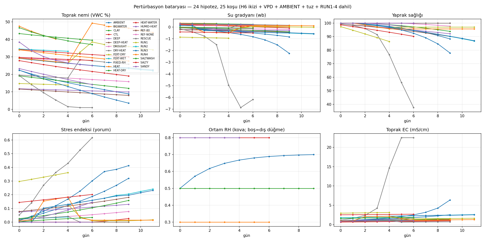
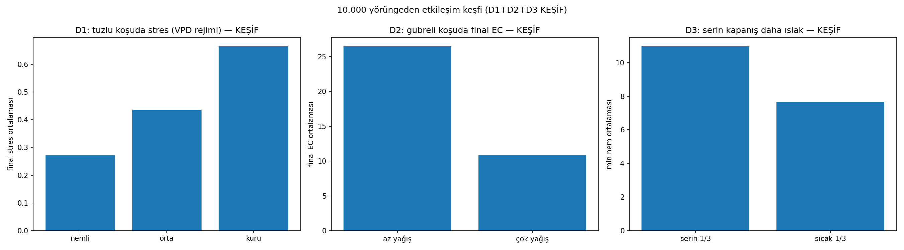

*Şekil 4. Pertürbasyon bataryası (koşul başına nem, EC, yaprak sağlığı…) ve çıkarım Faz-1 etkileşim görseli.*

**6e. Doğrulama ve dondurma (günlük §9.51).** *Yeni fizik yok, model manipülasyonu yok.* 10 sınıf + saldırgan senaryo + toparlanma testi (13 kapı, eşikler önceden kodda). 13/13 geçti; ilk geçişte düşen dört kapının hepsi **senaryo/test kodu hatasıydı**, fizik değil. Bir test (TEST9b) bilinen bir sınırı kilitledi: çökelme lavabosu olmadığı için EC=130 gibi aşırı tuzda EC<50 barı kırılır. Ardından 8 kaynak dosya SHA-256 ile **donduruldu** (günlük §9.51 sonunda tam liste). 10.000 yörüngelik topluluk: 2871 tarife, 963 ölüm, 901 sağlıklı; ölüm erişilebilirdir, "cennet" senaryo sağlıklıdır.

**6f. Çok döngülü gerçekleştirme (günlük §9.53).** "Her bitki yeni bir hayat yaşasın, iklimi de farklı gerçekleşsin": hiyerarşik tohumlar, Ege yıl tipleri, art arda nesiller. Üç ek kapı (TEST11–13) ve G39 geçti.

**Borç kütüğü (günlük §9.52).** Kullanıcı sınıflandırmasıyla kayda geçen açık borçlar: çökelme lavabosunun yokluğu bilinen sınır olarak tutuluyor; nadir olaylar için stratified örnekleme sonraya; pH/ışık/rüzgâr bilerek eklenmedi (sonsuz genişleme döngüsüne girmemek için). Olgunluk tablosunda deterministik fizik, hava/VPD, su/ET, EC, olay motoru, topluluk ve 10k altyapı 🟢; patojen, don ve pH 🟡/🔴; ışık, rüzgâr ve **saha kalibrasyonu 🔴**.

---
### Evre 7 — Bitki-sürücülü lob ve TEST B (Eylül sonu)

**Soru.** Fizik → elektro → duyusal → afferent zinciri, 250 günlük bir stres yörüngesini temsil edebilir mi?

**7a. Elektro katman ve bitki-sürücülü harness (günlük §9.57).** Duyusal lobun P1 girişi sabit bir sentetik trenden, simülatörün zar potansiyeli türevi darbelerine bağlandı; Dal B sensörlerden aynı faz kuralıyla beslendi. Sonuç, kazanç taramasından bağımsız olarak: **5 farklı koşul etiketi** üretildi, ancak koşullu yanıt **yoktu** (test ateşi 0). Nedenler: bitki sürücüsü seyrek (6500 tick'te 531 darbe; sabit trende ~2167) ve kuraklıkta nem sensörü eşiğin altına inip Dal B'yi sessizleştiriyor; ağırlıklar oynamadı. Kazanç taramaları (0,7/4 → 2/4 → 4/8) toplamları değiştirmedi.

**7b. Elektro katman karakterizasyonu (§9.58).** "Önce katmanın ne kadar zengin olduğunu bilelim": 20 koşul × 29 gün yerleşme + 30. gün ölçüm. **20 koşulda 16 ayrı imza**; durum uzayı büyük ölçüde temsil edilmektedir. Dört belgeli körlük: yaprak/kök hasar ayrımı yok, yağmur şiddeti kodlanmaz (yalnız başlangıcı), "baskı/baskın" özdeş, 30 °C eşik altında sessiz.

**7c. TEST B (§9.59).** 250 günlük kademeli ark (normal → kuraklık → şiddetli + tuz → ara → yaz → sulama → toparlanma → test; 22+3 blok). Önceden tanımlı kapılar: B1 (sürüş > 1500) 1981 spike ile, B2 (şiddetli > 8× normal) **14×**, B3 (toparlanma düşüşü), B4 (afferent > 200) 293 ateş/7 koşul, B6 (Δw > 0,02) p2f/p2g +0,055 ile **geçti**. **B5 (sensörsüz koşullu yanıt) geçmedi: `CR_YOK`**, test fazında ateş 0. Zincir tanısı, kaybın iki kapıda olduğunu gösterdi: PLIR-A kilidi çoğu seyrek darbeyi eliyor (şiddetlide bitki 625 darbe → P1 78 ateş ≈ %12; testte 202 → 37 ≈ %18) ve sağ kalan darbeler sızıntı katmanında toplanamıyor (w = 0,45'te bile A tek başına ateşleyemez). Lob **B-sürücülü, A-kapılıdır**.

**Karar (kullanıcı).** Kapalı çevrime *geçilmez*; B şişirilmez. A-tek başına koşullu yanıt beklenmez; kapalı çevrim önce association (bağlam) katmanından kurulacaktır.

**7d. A-only sözleşmesi (§9.60).** Yoğun sürüş + w0 = 0,5'te A yolu kapasite ispatı verir (koşullanma ateşi 700, test ateşi 165: CR **var**); ancak *seyrek* sürüşte hiçbir ağırlıkta ateşleme olmaz (0) ve banka ağırlığında yoğun sürüş de ateşletmez ("tavuk–yumurta": ateş yoksa Δw yok; ilk ateşler için B gerekli). Hüküm: **A→soma yolu mimari olarak doğru, zamansal kalıcılık (persistence) yetersizdir.**

**7e. Association (§9.61–9.62).** Afferent kayıt, her ateşin bağlamıyla yazıldı (300 kayıt: B bağlamı 291, saf-B 191, A geçmişi 103). Gün imzaları üzerinde ağırlıklı Jaccard benzerliği (0,5/0,3/0,2) + LOO 1-NN ile **163/165 (%98,8)**: true 105/106, decoy 4/4, mixed 54/55. **Uyarı:** etiket ve benzerlik aynı temsilden türediği için bu, temsilin *iç tutarlılığını* ölçer; dünya sınıflaması değildir (§5.5, §9).

**7f. Kalıcılık kanıtları (§9.63–9.64).** FDM süpürmesi: sızıntı sabiti (1…320), çakışma penceresi (4…80) ve kapılama hafızası (4…800) eksenlerinin **hepsinde** çıktı bit-bit aynı idi; yani süreklilik makinesi bu rejimde sonuca katılmıyor, ateşleme aynı-tick kombinasyoneldir. PLIR karakterizasyonu: 1981 darbenin 812'si kabul (hat 0: 624 taze + 171 rezonans), 1113'ü ret; kabulden 303'ü ateşe dönüşür (**A-yakalama %15,3**); reddin tek sebebi periyot uyumsuzluğudur (refrakter yok). Kayıp iki kademede: periyot filtresi (%58) + soma entegrasyonu (%63). Çapraz doğrulama: gerçek C++ motorunda kabulde 0 uyumsuzluk.

**7g. Koşul süpürmesi (§9.65).** Aynı PLIR-A ile normal/kuraklık/şiddetli/sulama/toparlanma/yaz pencerelerinde her koşul ayrı imza üretti (P1 0…78; P2 17…74; etiket 2…6; şiddetli/normal P1 oranı ~10×). Kuraklık P1'siz temsil edildi (19 olayın 19'u saf-B). Çift-sürüş doğrulandı (A-destekli 117 + saf-B 131).

**Sınır.** Hepsi tek yörünge (tohum 1) ve tek bitki üzerinde; ısı şoku bu çekirdekte düşmedi (stokastik).

---

### Evre 8 — Temsil ne taşıyor? Çıkarım ve öğrenme kuralı karşılaştırmaları (Eylül sonu)

Bu evre, projenin bilimsel olarak en çok şey öğrettiği dönemdir: donmuş artefaktlar *yalnızca okunarak* (motor çalıştırılmadan) temsil titizlikle ölçüldü, sonra basit çıkarım yöntemleri ve öğrenme kuralları aynı protokolde karşılaştırıldı.

**8a. Temsil karakterizasyonu (§9.66).** 12.500 tick'lik ham kayıt gün imzalarına dönüştürüldü: **165 ateşli günde 67 farklı tam imza** ve 7 afferent etiketi. Altı koşulun *tam* imzaları 6/6 birbirinden ayrı; bölge içi benzerlik 0,520, bölgeler arası 0,277. Bulgu: kaba dörtlü istatistik sulama ile toparlanmayı ayırmaz (ikisi de sulama sonrası nemli rejim), temporal temsil ayırır. Ama **tek gün** örtüşür (gün-tekili LOO saflığı 0,473): koşul kimliği pencere toplamındadır.

**8b. Zamansal pencere testi (§9.67).** Tek gün mü, kısa bir dizi mi? Pencere uzunluğu k ∈ {1, 3, 5, 10, 20} gün için LOO doğruluğu: **0,473 → 0,542 → 0,516 → 0,474 → 0,105**. Zirve k = 3–5; k = 20'de çöküş iki sebepten: kısa sınıfların uygun komşusu kalmıyor (yapısal) ve gerçek doygunluk var (her şey en zengin çanta olan yaz sınıfına çekiliyor). Sonuç: sıra-duyarsız birleşim uzun pencerede bilgiyi *yıkar*; çıkarım girdisi sıra-koruyan olmalı.

**8c. Çıkarım referansı (Baseline-1, §9.68–9.69).** Öğrenmesiz, parametresiz *en-yakın-sıra* (k = 3): **97/175 = 0,554**. Kritik bulgu: **kuraklık → normal 28/28**; kuraklık hiçbir zaman kendisi olarak tanınmıyor, istisnasız normale emiliyor. Aynı yöntem k = 5'te 68/165 = 0,412'ye düşer. "Sessiz günlerin seyreltmesi" şüphesi ayrı bir probda sınandı ve **çürütüldü** (0,560; kuraklık → normal hâlâ 28/28).

**8d. Öğrenme kuralı karşılaştırmaları (§9.71–9.80).** Soru: "kuadratik öğrenme, temsilin bilgisini daha iyi kullanıyor mu?" Aynı protokol, aynı 175 pencere:

| Yöntem | LOO doğruluk | Not |
|---|---|---|
| Baseline-1 (öğrenmesiz, k = 3) | **0,554** | referans |
| Hız yedeği (yalnız hat sayıları) | 0,446 | temporal temsil +0,108 üstün |
| Kuadratik çevrimiçi öğrenme | 0,400 | referansı **geçemedi**; 5 tohumda std = 0 → sıra torpusu değil, sabit nokta |
| Kuadratik + satır normalizasyonu | 0,366 | daha kötü; yozlaşma ağırlık dağılımında değil, ikili bigram temsilinde |
| Kuadratik + LTD ailesi (zayıf/orta/güçlü) | 0,326 / 0,337 / 0,371 | monoton değil; hepsi kontrolün altında |
| Karıştırma (shuffle) sıfır hipotezi | 0,531 | zamanlama, etiket çeşitliliğini değiştirir (7→9) ama kuraklık→normal 28/28 sürer |

Mekanizma: denetimsiz potansiyasyon, koşullar arasında *ortak olan sık* bigramları güçlendirir; ayırt edici seyrek geçişler boğulur. LTD sabit noktayı kırar (sıra bağımlılığı doğar) ama daha iyi ayrıma götürmez. *"Hikâye (LTD iddiası yok): saf kuadratik potansiyasyon bu temsil üzerinde 0,400'e düşer."* Günlük bu sonucu şöyle de yazar: "kendi alt-küme hipotezimiz de deneyle çöktü; sonuç daha bilimsel."

**8e. Hijyen düzeltmesi (§9.77).** Karar kuralı, eşitlik denetimiyle yeniden yazıldı. *Kritik düzeltme:* önceki günlük kayıtlarındaki **"kuraklık emilimi" bir mekanizma değil, eşitlik ve sıra yanlılığıdır**. Referansta 51, kuadratikte 88 sorgu eşitlik içeriyordu (78'i altı yönlü). Eşitlik alfabetik sıraya göre bozulursa kuraklık 0/28'den 24/28'e, normal 24/25'ten 8/25'e kayar. Yani temsil kuraklık ile normali **ayırt edemiyor** ve ilk bulunan karar çalıyor. Araştırma hattı alt-küme hipotezinden *ayırt edilemezlik + yanlılık* sorusuna döndü.

**8f. Tanı kolları.**
- **Temsil tavanı (§9.81).** 175 pencerede 123 farklı dizi imzası; 118'i saf; ağırlıklı saflık **0,920**; sabit metriklerin en iyisi 0,554 (tam eşleşme 0,578, yalnız 64 pencerede). Farkın büyük kısmı çıkarım/metrik darboğazı; ama 34 pencere normal×kuraklık arasında *birebir aynı imzayı paylaşır*: bu, metrikten bağımsız, sert bir ayırt-edilemezlik sınırıdır.
- **Geri çağırma (§9.82).** Nadir-saf imzaları çoğunluk çekimi olmadan kullanmak 0,70–0,80'e çıkarmadı: öncelik-nötr kural donmuş kuralla özdeş (0,554), nadirlik ağırlığı 0,537 (hata yer değiştirir, toplam aynı), dengeli ağırlık 0,046 (ölçek uyumsuzluğu). Darboğaz saf öncelik dengesizliği değil.
- **Metrik sınırı (§9.83).** Altı geometri (hamming, uniform, rotasyon-maks, sayım-kosinüs…) 0,503–0,554 bandında; faz hizalaması ve büyüklük bilgisi bir şeyi değiştirmedi. Sorun temsilin *nasıl organize olduğunda*: aynı küme bileşenleri sınıflar arasında paylaşılıyor.
- **Adli iz (§9.84).** Üç normal/kuraklık çifti kademe kademe izlendi: elektrik farklı, ama PLIR farklı alt kümeleri geçirip P1'i eşdeğer sessizliğe indirgiyor; A/B bağlamı birebir aynı; P2 aynı. Sıkışma dağıtıktır; mekanizma belgelendi, **düzeltilmedi**.
- **Sinerji (§9.75).** Kaba düzeyde yedeklilik (I(A;Y|post) = 0,216 < I(A;Y) = 0,397; permütasyon p = 1,000), ince düzeyde her iki kanal da gerekli (post çıkarılınca −0,112, A çıkarılınca −0,041). *"Post A'nın anlamını değiştirir"* cümlesi çözünürlüğe bağlıdır.
- **+0,108'in anatomisi (§9.74).** Kanal sökümü: yalnız post 0,520, yalnız B hatları 0,457, yalnız A 0,303, post + A en iyi 0,560. Avantajın büyük payı *post kimliğinden* (+0,074), kalanı A sürekliliğinden (+0,034) gelir; B hatları nötr.
- **Ortaya çıkış (emergence) probları (§9.73).** Shuffle sıfırı, hız vekili ve B kapalı koşulu: 3–5 günlük imza davranışı **B olmadan ortaya çıkmıyor** (P2 kaydı 0); A-yolu zamanlama duyarsızdır (P1a ateşi 286 → 285). Dilimizde bunlar "kolektif davranış *adayı*"dır, kanıt değil.

**Hüküm (Evre 8).** Temsil imza düzeyinde ~%92 saf; ancak mevcut hiçbir sabit metrik, sınıflar arası güvenilir bir düzen çıkaramıyor (bant genişliği ~0,05). Kuadratik öğrenme bu rejimde çıkarımı iyileştirmedi. Ayırt-edilemezlik (kuraklık ≈ normal) temsilin yapısal bir özelliğidir; "metrik biraz kötü" açıklaması yetersizdir. Bu bulgular sonraki mimariyi (örüntü lobu, Evre 9) şekillendirmiştir.

---
### Evre 9 — Örüntü lobu (Eylül ortası – 23 Eylül)

**Motivasyon.** Evre 8, duyusal lobun çıktısının (yani "ne zaman, hangi koşulda, hangi sırayla ateşlendi" bilgisinin) yeterince zengin ama bir *sınıflandırma* görevinde zayıf kullanıldığını gösterdi. Bu nedenle ikinci bir yapı tasarlandı: afferent olay akışını (`post`, `tau`, zaman) alan, **hangi örüntünün ne zaman ve hangi ilişkiyle** geldiğini kendi iç durumunda tutan bir **örüntü lobu** (Pattern Lobe). Bu lobun amacı etiketli bir doğruluk üretmek değil, *temsil mekanizmasını* kurmak ve karakterize etmektir; bu yüzden çoğu test determinizm, sınır ve davranış karakterizasyonudur (doğruluk kapısı yoktur; denetim raporunda da açıkça belirtilmiştir).

**9a. Mimari sürümler (§9.86–9.91).** Lob tek adımda değil, art arda sürümlerle ilerledi (v3d → v3e → v4c). Her sürümde aynı disiplin işletildi: önce önceden-kayıtlı spesifikasyon (`PATTERN_V3_STRESS_SPEC.md`, `PATTERN_V4_PLAN.md`, `STIMULUS_SNR_SPEC.md`), sonra 12 grup / 39 vaka'lık stres bataryası, determinizm (bit-eşit tekrar) ve çökme testi. Ölçülen dersler:

- **v3d (12/12 geçti).** Geri çağırma 0,122 → 0,230 (G1), 0,161 → 0,438 (G2); ancak "soğuk dünya sessizliği" sürdü ve kuraklık-ailesi kurulamadı.
- **Bellek okuması (§9.87).** Bellekteki sekiz voltaj kolonundan *sekizi de* bir yazım-zamanı artefaktı çıktı (ateşten sonra yazılıyor, voltajlar `V_RESET` değerinde); tek bilgi taşıyıcı `eff_g` (gating birikimi) idi. Yeni okuma kapısı hiçbir okumayla %40 eşiğini geçemedi → "A kanıtlanamadı" hükmü yazıldı.
- **Uyaran merdiveni (§9.88).** Girdiye "ne kadar sinyal giriyor" sorusu da ölçüldü: şiddetli kuraklık kablo sayısını 76 → 169'a çıkarıyor; ancak 5 sınıflı ailede doğruluk 0,797 (hedef 0,90) **geçemedi**; ayrımın bir kısmı yaşam-öyküsü yapısından gelebilir (dürüst sınır olarak yazıldı).
- **v3e (§9.89).** Tam görev matrisi (K1–K3 + soma). Plastisite fiilen kapandı (taban wkdev 0,0032; v3d'de 0,104) ve G8 sağlamlığı 0,817 → 0,615'e düştü: bu, bilerek yazılmış bir *gerileme kaydıdır*; sürüm yine de "çalışır" bulunduğu için taşıyıcı olarak kullanıldı.
- **v4c / REV3 (§9.90–9.91).** Dal başına K4, 58 düğüm; 41 koşuluk tam batarya çökmesiz ve determinist. Şartlı kabul sonrası eski sürümlerin 17 dosyası silindi (v3e gövdesi *kelimesi kelimesine* v4c'ye gömüldü, 345/345 kod satırı diff-sıfır). Açık gerilim kayda geçti: enerji geniş (ortak mod 0,024; matris %71 dolu), zayıf örüntü desteği ile genel uyarılabilirlik pilotla ayrılamadı.

**9b. Dört sorulu yapı (K1–K4).** Lob dört kompartman taşır: K1 *ne* geldi, K2 *ne zaman*, K3 *geçmişte ne vardı* (tarihçe), K4 *ilişkisel* (hangi iki girdi birlikte geldi); toplam 29 birim, iki aşamalı soma (F1 donmuş çekirdek + K4 katkısı, üst sınırlı `S4max = 0,25`). Burada "K4" bir sınıflandırıcı değil, *eş-oluşumu (coincidence) kendi elektriksel durumuna entegre eden paralel kompartman*dır.

**9c. REV4: gerçek K4 ve ilişkisel yol kanıtı (§9.95–9.97).** REV4'te nicemlenmiş imza (q[3], −3…+3), kademeli kapı ve spike-kapılı max seçimi uygulandı; K4 ateşi kendi başına somaya yansıyabiliyor. TEST-B pilotunda B/J/R/P/D/M/N/S kapılarının hepsi geçti. **Önemli bulgu:** pilotta K4 spike'ı 0'dı (92 ateşin tamamı yerel K4 entegrasyonundan); ilişkisel yolun "TEST-B'de hiç işlemediği" açıkça kaydedildi. Bunun üzerine kullanıcı karar verdi: önce **tek bir kontrollü deney** ("relational pathway proof") — ikiz kablolu A/B ve farklı imzalı C birimi. Sonuç: r_AB = 0,875 (sabit nokta tavanı), r_AC = 0,06, karşılıklı argmax 1,00/1,00, K4 spike 1925, sessizlikte r 0,875 → 0,0001; yani **zincir mekanik olarak çalışıyor** (coincidence → benzerlik → r → argmax → rel → K4 → soma). 99 senaryolu × 4 koşullu tam batarya (`fails=yok`, çift-koşu SHA determinizmi geçti) ardından REV4 "nihai örüntü lobu" olarak kabul edildi (§9.97); bulgular arasında C-offset taramasında 11-tick kaymada beklenmedik yüksek bağlanma (adapter zaman kayması şüphesi; kod değiştirilmedi, araştırma notu) da vardır.

**9d. Gözlem probları (§9.99–9.105): "yapı ne yapar?" — ayar yok, skor yok.** Gözlem disiplini: mimari/parametre değişmez, yeni skor icat edilmez, beklenmeyen sonuç hata sayılmaz. Bulgular:

- Bitki rejiminde K4 spike'ı **sıfır** (9 senaryoda); ilişki yolu sessiz, soma yalnız eşik-altı K4 tabanından beslenir.
- Bağlanabilir çift kümesi 8 senaryoda **birebir aynı** (Jaccard 1,0; 1176 çift): yapısal bir iskelet; sürüş yalnız *şiddeti* değiştirir (0,068–0,222).
- Yoğunluk merdiveni (§9.100): spike hiçbir basamakta açılmaz; genlik K4'ü bastırır (F1 tonikleşip eşleşik reset yapar). Zamansal dağılım (§9.101): ilişki şiddeti *hacme* değil *zamanlamaya* bağlı (2× sıkışık düzende ortalama 0,110 → 0,328).
- Alfabe haritası (§9.105): küme = bileşim (AB = BA aynı 21 birim), vurgu = sıra; rejim sırası *sessiz → ilişki → S4-soma → spike → F1-tonik*; doğal seyrek sürüş K4 spike'ını hiç açmaz.
- **40.000 günlük koşu (§9.103).** 2 milyon tick, 55.341 olay: açılıştaki 42 günlük geçişten sonra **39.958 gün tek dinamik rejim** (haftalık Jaccard medyanı 0,926). Yorum: dondurulmuş ağırlıklarla lob kendi uzun ölçekli durumunu *üretmez*, sürücüyü izler. Bu, "yeni davranış kendiliğinden doğuyor" iddiasının *çürütüldüğü* bir kayıttır.
- Doğal FP karşılaştırması (§9.104): eş-hacimli ama farklı yoğunlaşmış haftalarda ateş sayısı ve birim sayısı değişir (örn. 3 → 11 ateş), rejim değişmez (J ≥ 0,877); bir kıyas dilimleyici artefaktı nedeniyle geçersiz sayılıp çıkarıldı.

**9e. REV-LEARN: iz ve erişilebilirlik (§9.106–9.109).** Öğrenme kuralının çekirdeği (dw = η·G·Q·S) aynen korunarak iki mekanizma eklendi: (i) potansiyasyonda **kalıcı iz** `T` (T ← T + μ(1−T); μ = 1/8) ve w ← w + dw(1+T); (ii) kullanılmayan sinaps `T·W_MAX` tabanına gevşer (klasik zayıflama yok). Dondurulmuş mimari (§9.102) bu iş için *kullanıcı emriyle* delindi ve bu, günlükte açıkça yazıldı. Karakterizasyon (A–D): güçlü ilk adım (0,90) zayıf adımdan (0,017) ~53× büyük; iz derinliği *maruziyet sayısını* izler (T = 1−(1−μ)ⁿ, doğrulandı); aynı desenin yeniden öğrenilmesi 91 tick yerine 37–61 tick sürer ve bu tasarruf boşluktan bağımsızdır (1000 = 10000 bit-eşit) → izden gelir. `k4plastic` (K4 açık + η = 0,30) taban çizgisi olarak donduruldu (§9.108): A→sil→A %78 ani dönüş, A→B→A iz 102/102, **proliferasyon yok** (27 = 27 birim), 20k tick koşuda plato (ortalama T 0,58). Açık kayıt: bellek 4096 tavanı, platonun tek desen ailesi için ölçülmüş olması. 21 Eylül'de **nihai mimari taban çizgisi** ilan edildi (§9.109), 23 Eylül'de dört dosya SHA-256 ile mühürlendi (§9.114).

---

### Evre 10 — Canlı zincir ve kalıcılık (21 Eylül – 28 Eylül)

**Amaç.** Bütün parçaların aynı anda, canlı çalışan tek bir "zincir" olarak bağlanması: simülatör → duyusal lob → koşullu afferent olaylar → örüntü lobu → web paneli.

**10a. Zincir (§9.110).** Yayıncı (`sim/serve.py`) her sim gününde yedi sensörü kalıcı bir duyusal lob sürecine verir; P2 bitleri `(tick, post, tau)` afferent olayına çevrilir; örüntü lobu bu olaylarla beslenir. Çekirdek `*.h` dosyaları değişmedi, kareler (şema v2) dokunulmadı; ikili yoksa zincir kapanır, yayıncı çalışır. Doğrulama: 13/13 OK; kanonik 300 olaylı akışta `mem = 231`, `k4_kfires = 146`.

**10b. Kalıcı lob (E-1, §9.111).** İlk sürümde her pencere ağırlıksız başlıyordu (dürüst sınır olarak yazılmıştı); `--stream` modu ile lob **tek sefer** başlatılır, ağırlık/iz/ilişki matrisleri (`w`, `T`, `r`) süreç boyunca yaşar. Doğrulama: J-bit-identical (kanonik hash, W = 522), stream ≡ batch bayt-bayt, T monoton, A–B–A düzeninde iz korunur, WebSocket kopması süreçleri etkilemez.

**10c. Taşıma / rapor ayrımı (§9.112).** Ölçüm: duyusal lob 0,20 olay/sn üretir; 300 olaylık pencerenin dolması ~1472 sn sürer, işlenmesi 0,01 sn. Yani gecikmenin tamamı *eşikteydi*; besleme eşiksiz yapıldı (her satır anında lobun içine), eşik yalnız rapor kadansı kaldı. Bu değişiklik tek bir Python dosyasındadır; C++ tarafı aynen kaldı.

**10d. Kontrol noktası (PLST, §9.113).** Yalnız *öğrenilmiş durum* (w[522], T[522], r[58][58]; toplam 17.668 bayt) sabit genişlikli, CRC32'li, sürümlü bir formatta saklanır (JSON/pickle/double yok); bozuk dosya reddedilir ve temiz başlangıca düşer (sessiz yükleme yok). Testler: LOAD/STATE bit-eşit; yeniden başlatma sonrası T monoton ve A2 fazında 88 ateş; yüklenmiş lob 26 ateş, taze lob 16 ateş. Dürüst sınırlar: üretim zinciri η = 0 ile çalışır (ağırlık öğrenmesi donuk, r ilişkisel öğrenmesi aktif); devam etmede dinamik durum (voltaj/gating) sıfırdan başlar, yörünge <%1 sapar.

**10e. Dondurma ve panel (§9.114–9.116).** 23 Eylül'de örüntü lobunun dört dosyası SHA-256 ile mühürlendi: lobu çağıran (harness, taşıyıcı, rapor) değişebilir, lob değişmez. Web panelinde (`signal.js`) sinyal şeması canlı olay akışına bağlandı; 28 Eylül'de bir kullanıcı raporu üzerine bitki yolunun panelde görünmediği tespit edildi. Kök neden iki katmanlıydı (zincir `p1` bitlerini düşürüyordu; P1→P2 sürüşü çizilmiyordu), *motor ve lob değil yalnızca telemetri/çizim* hatalıydı; düzeltme dondurulmuş dosyalara dokunmadan yapıldı ve yeni bir kapı (G38) eklendi. Dürüst sınır: T satırı 25 tick'te bir örneklendiğinden panel ara atımları göstermez.

---

### Evre 11 — Bağımsız değerlendirme ve iç denetim (Ekim 2026)

Projenin önceki evrelerinde "tutarlı sonuç" üretmek mümkündü, ancak **kendi geliştirdiğimiz testlerle kendimizi doğrulamak** yetersizdir. Bu nedenle Ekim'de iki ayrı değerlendirme yapıldı.

**11a. Bağımsız değerlendirme paketi (`salep_core/bench/`, 15 Ekim).** Kriterler çalıştırmadan önce yazıldı ve dondurulmuştur (`TEST_PLAN.md`); eşikler yalnızca ayrı kalibrasyon tohumlarından (1000–1009) türetildi; çekirdek (`src/`) **hiç değiştirilmedi** (9/9 regresyon). Karşılaştırma: aynı veri üzerinde sistemin skoru **S** ile dört basit referans yöntem (gecikme eş-oluşumu, otokorelasyon, Goertzel, ISI histogramı). Beş ana bulgu, olduğu gibi:

1. **Demux'ta S basit yöntemlerle başabaş ya da geride.** Temiz dünyada tau4: S 0,942 / referanslar 1,000; tau12: S 0,799 / 0,800–1,000. Fark ölçüldü: S, 4|12 alt-harmonik kabulü nedeniyle 12-only ile 4-only'yi ayıramıyor (alt-küme AUC 0,505 ≈ şans).
2. **Seyrek nedensellikte S tamamen sessiz.** 12/12 hücrede precision = recall = 0; periyodik şablon dünyasında sadakat doğrulandığı için bu bir *port hatası değil, seyrekliğin sonucudur*.
3. **PLIR her yerde faydalı değil.** PLIR kapatılınca tau4 AUC'si 0,942 → 1,000'e *çıktı*; popülasyon büyüklüğü (8 → 1) sonucu değiştirmedi; coincidence bonusu bu görevde bit-bit etkisizdi.
4. **Genelleme şaşırtıcı iyi, gürültü tau4'e yarıyor.** Kalibre edilmemiş 9 tau'da ayarsız AUC ≈ 1,0; ekstra darbe gürültüsü S-tau4'ü 0,942 → 0,999'a çıkardı (hipotez: gürültü, yavaş yabancıların FRESH yakalamasını bozuyor; test edilmedi).
5. **Gerçek veride kimse ayrıştıramadı.** DesRosiers ve ark. veri setinden 36 *Ocimum* kaydı (n = 483 pencere), zayıf pre/post etiketleriyle: havuzlanmış AUC S 0,493, varyans 0,455, HF-enerji 0,412 → şans düzeyi. Bu, çekirdeğe karşı bir hüküm değil, **bir ölçüm sınırı kaydıdır** (etiketler gürültülü: literatürde yanıt oranı ~%60, gecikme 3–6 s).

Önceden tanımlı kapıların bir kısmı **geçmedi** (D1, D2, C1) ve raporda *olduğu gibi* kaldı; D2'nin cetvel kusuru kabul edildi ama kriter sonradan gevşetilmedi. Donanım maliyeti ölçüldü (nöron durumu gerçekte ~50 B; FDM 2×8 ağı ~21,7 KB; ~177 çarpma/tick); sentez aracı olmadığı için tüm donanım sayıları "kâğıt üstü" etiketlidir.

**11b. İç denetim raporu (`DENETIM_RAPORU_2026-10-14.md`).** Zincirin her halkası kod üzerinden izlendi; sonuçlar:

- **Gizli etiket sızması bulunamadı** (dünya etiketleri simülatör girdisine ve NPU'ya girmez); ancak **döngüsel etiket vardır**: 163/165 sonucu, temsilden türetilen etiketin aynı temsille test edilmesidir (temsilin iç tutarlılığı).
- **Aynı yörünge sızması yapısaldır:** tüm doğruluk testleri tek TEST B yörüngesi (tohum 1, tek bitki, 250 gün) üzerinde LOO'dur; eğitim/test bağımsız değildir.
- **Senaryo ezberi riski YÜKSEK:** tek betik, sabit gübre/sulama günleri; senaryo dışı geçerlilik test edilmemiştir.
- **Uçtan uca bağımsız test YOKTUR.** Mevcut zincir testleri tesisat ve determinizm testidir (koşul doğruluğu ölçmez). Eksik olan: görülmemiş bir bitki yörüngesi (farklı tohum/senaryo/yıl) → tüm zincir → dünya koşulu tahmini, önceden kayıtlı bir metrikle.
- Örüntü lobunun dünya-koşulu doğruluğuna katkısı **ölçülmemiştir** (yalnız determinizm).

**Proje durumu (28 Ekim 2026).** Mekanizmalar (faz seçici kilitleme, FDM, kuadratik öğrenme + iz, ilişkisel K4, kalıcılık, canlı zincir) *mühendislik düzeyinde çalışır ve deterministiktir*; bilimsel düzeyde ise hiçbir işlevsel üstünlük iddiası **kanıtlanmış değildir**. Bir sonraki adım, denetim raporunun önerdiği önceden-kayıtlı çok-tohumlu ve senaryo-dışı (held-out) bir deneydir (§10).

---
## 8. Bulguların toplu değerlendirmesi

Bu bölüm, §7'deki evreleri tek tabloda toplar. Her satırın etiketi, §5.6'daki ölçüt sözlüğüne göre verilmiştir: **KANITLANDI** (kendi tanımlı kapısı ve çalıştırılmış testi ile), **KISMEN** (koşullu/sınırlı kapsamda), **HİPOTEZ** (mantıklı ama ölçülmemiş), **TEST EDİLMEDİ**, **GÖZLENMEDİ** (denendi, etki görülmedi).

### 8.1 Mekanizma düzeyi (sentetik sinyallerde)

| # | Bulgu | Sayısal ifade | Durum |
|---|---|---|---|
| M1 | Fixed-point çekirdek deterministik ve tekrarlanabilir | Kanonik çıktı SHA-256 sabit; bit-eşit tekrar | KANITLANDI (sentetik) |
| M2 | Faz-kilitli aralık rezonatörü (PLIR) aynı telde iki ritmi ayırır | FDM kilit/faz hatası ≤ 0,03 tick | KANITLANDI (sentetik) |
| M3 | Kuadratik kural nedensel sırayı ayırt eder | Q(Δt) eğrisi ve nedensellik testleri | KANITLANDI (sentetik) |
| M4 | Koşullu refleks (CR) mekanizması kurulabilir | Yoğun sürüşte koşullama 700 / test 165 ateş | KISMEN (yalnız yoğun sürüş; seyrek sürüşte 0) |
| M5 | Kalıcı iz + taban gevşemesi yeniden öğrenmeyi hızlandırır | 91 → 37–61 tick; boşluktan bağımsız | KANITLANDI (sentetik) |
| M6 | İlişkisel K4 yolu mekanik olarak çalışır | r_AB 0,875; K4 spike 1925 | KANITLANDI (kontrollü deney) |
| M7 | w/T/r kontrol noktası bit-aynen taşınır | 17.668 B; LOAD ↔ STATE bit-eşit | KANITLANDI |

### 8.2 Temsil ve çıkarım düzeyi (TEST B yörüngesi)

| # | Bulgu | Sayısal ifade | Durum |
|---|---|---|---|
| T1 | Altı koşul altı ayrı tam imza üretir | 6/6 ayrı; 165 günde 67 imza | KANITLANDI (aynı yörünge) |
| T2 | Association katmanı imzaları iç tutarlılıkla sınıflar | 163/165 (%98,8) | KISMEN (etiket döngüsel) |
| T3 | Sıra-koruyan çıkarım referansı | 97/175 = 0,554 (k = 3) | KISMEN (şans ≈ 1/6; kuraklık → normal 28/28) |
| T4 | Kuadratik öğrenme çıkarımı iyileştirir | 0,400 (referansın altında) | **GÖZLENMEDİ** |
| T5 | LTD ve satır normalizasyonu düzeltir | 0,326–0,371 | **GÖZLENMEDİ** |
| T6 | Kuraklık ile normal ayırt edilebilir | 34 pencere birebir aynı imza | **Ayırt edilemez** (yapısal) |
| T7 | Sensörsüz koşullu yanıt (B5) | Test fazı ateşi 0 | **BAŞARISIZ** (CR_YOK) |
| T8 | Zamansal temsil hız vekilini geçer | 0,554 vs 0,446 (+0,108) | KANITLANDI (aynı yörünge) |

### 8.3 Bağımsız değerlendirme

| # | Bulgu | Sayısal ifade | Durum |
|---|---|---|---|
| B1 | Demux'ta S basit yöntemleri geçer | tau4 0,942 vs 1,000; tau12 0,799 vs 0,800–1,000 | **GÖZLENMEDİ** (S eşit/geride) |
| B2 | Seyrek nedensellikte S çalışır | 12/12 hücrede precision = recall = 0 | **BAŞARISIZ** |
| B3 | Gerçek bitki verisinde ayrışma | havuz AUC: S 0,493; n = 483 | **GÖZLENMEDİ** (şans düzeyi) |
| B4 | Kalibre dışı tau'larda genelleme | ayarsız AUC ≈ 1,0 | KANITLANDI (sentetik dünya) |
| B5 | Uçtan uca bağımsız test | — | **TEST EDİLMEDİ** |

**Genel hüküm.** Projenin gösterdiği şey, *belirli mekanizmaların donanım-dostu bir hesap modeli olarak çalıştığı* ve *kendi başarısızlıklarını ayrıntılı kataloglayan bir araştırma disiplininin* mümkün olduğudur. Projenin göstermediği şey, bu sistemin bitki stresini gerçek veride, bağımsız olarak, basit yöntemlerden daha iyi tanıdığıdır.

---

## 9. Sınırlar ve geçerlilik tehditleri

Bu bölüm, bir hakem raporunun "threats to validity" bölümüne karşılık gelir. Her sınır, yukarıdaki deneylerden gelen kayıtlara bağlanmıştır.

1. **Tek yörünge, tek tohum.** Doğruluk sayıları (163/165, 0,554, 0,400…) tek bir TEST B yörüngesi (tohum 1, tek bitki, 250 gün) üzerindedir. Tohum duyarlılığı ölçülmemiştir.
2. **Eğitim–test bağımsızlığı yok.** Tüm çıkarım testleri aynı yörünge içinde leave-one-out'tur; ağırlık yörüngesi bütün katlarda ortaktır (yapısal sızıntı).
3. **Döngüsel etiket.** 163/165, banka etiketinin (true/decoy/mixed) temsilden türetilip aynı temsille test edilmesidir; dünya koşulunu ölçmez.
4. **Senaryo ezberi riski yüksektir.** Tek betik, sabit gübre/sulama günleri; senaryo dışında geçerlilik bilinmiyor.
5. **Uçtan uca bağımsız test yoktur.** Zincir testleri tesisat/determinizm testleridir.
6. **Sentetik elektrofizyoloji.** Elektrik katmanı bir taklittir (dinlenim −120 mV, hız kodlaması, patlama kuralları). Gerçek bitki elektrot kaydıyla karşılaştırma yoktur; fizyoloji parametrelerinin bir kısmı model seçimidir (bazıları kodda `TODO: DOĞRULANMADI`).
7. **Gerçek veri sınırları.** Yalnız DesRosiers ve ark. veri setinden *Ocimum* kayıtları; zayıf etiket; farklı bitki türü (salep değil).
8. **Hava verisi.** Gerçek Aydın Open-Meteo gözlemleri yalnız canlı web zinciri ve belirli kapılarda kullanılır; TEST B zinciri sentetik dünya sürücüsü ile çalışır.
9. **Sessizlik.** 250 günün 85'i sessiz ve test fazının 30 günü skor dışıdır; gerçek kullanımda "sessizlik" de bir karar olmalıdır.
10. **Seyreklik.** Bitki sürücüsü seyrek olduğunda A yolu ateşlenmiyor (A-yakalama %15,3); kalıcılık donanımı (FDM) bu rejimde sonuca katılmıyor (bit-eşit).
11. **Donanım iddiaları kâğıt üstündedir.** Sentez aracı yoktu; bit genişliği önerileri tek iş yükünden türetilmiştir.
12. **Kapalı çevrim yok.** NPU → simülatör geri beslemesi bağlanmamıştır (açık onay gerektirir).
13. **Yapay zekâ ortak yazarlığı.** Geliştirme büyük ölçüde AI destekli yapılmıştır (bkz. §13); sonuçların bağımsız yeniden üretimi için kodun dışarıdan çalıştırılması önemlidir.
14. **Disiplin sınırı.** Önceden-kayıt disiplini, yazarın kendi kayıtlarına dayanır; bağımsız bir zaman damgalı ön-kayıt (ör. OSF) yoktur. Tek ifşa edilmiş post-hoc istisna H14'tür (§5.4).

---

## 10. Gelecek çalışmalar

Önceliklendirilmiş yol haritası — denetim raporunun önerileri ve §9'daki sınırlardan türetilmiştir:

1. **Çok tohumlu tekrar (öncelik 1).** Aynı TEST B protokolünü ≥ 5 farklı tohumda koşup assoc ve çıkarım skorlarının dağılımını raporlamak. *Kabul ölçütü önceden yazılacak.*
2. **Held-out senaryo.** Gübre/sulama günlerini kaydırılmış, daha önce görülmemiş senaryoda tüm zinciri değerlendirmek; skor düşüşünü ölçmek.
3. **Sessiz günleri de skora almak.** "Karar vermeme" de bir çıktı olarak ayrı bir metrikle ölçülmeli.
4. **Kuraklık ≈ normal ayırt edilemezliği.** Sensör/P1 kanalından kuraklığa özgü bir bilgi eklemek (ör. nem sensörü yolunun B dalını sessizleştirmeyen bir yapı) ve bunun ayrımı değiştirip değiştirmediğini ön-kayıtlı olarak test etmek.
5. **Gerçek veride etiketli deney.** Daha net etiketli bir bitki elektrofizyolojisi veri seti veya kendi kayıt düzeneği; S ile basit referansların aynı protokolde karşılaştırılması.
6. **Donanım yolu.** Sentez aracı ile (ör. açık kaynak HLS/FPGA zinciri) gerçek kaynak ve gecikme ölçümü.
7. **Kapalı çevrim.** Yalnız 1–2 tamamlandıktan sonra, açık onayla.
8. **Bağımsız zaman damgalı ön-kayıt.** Yukarıdaki deneyler için OSF/Zenodo üzerinde.

---

## 11. Tekrarlanabilirlik, kurulum ve doğrulama

**Gereksinimler.** `g++` (C++17), Python 3.10, `pip` ve `salep_core/requirements.txt` (sürümleri sabitlenmiş: numpy, pandas, matplotlib, starlette, uvicorn, websockets, rich). Web arayüzünün bir kapısı için `node` gerekir. Ayrıntılı adımlar [QUICKSTART.md](QUICKSTART.md) ve [INCELEME_REHBERI.md](INCELEME_REHBERI.md) içindedir; her komutun yanında `[KOŞULDU]` / `[KODDAN]` / `[KOŞULMADI]` etiketi bulunur.

**Önemli uyarı.** Deneyler çıktılarını çalışılan dizine yazar ve kayıtlı sonuç dosyalarının üzerine yazabilir. Bu yüzden depoyu *kopyalayarak* çalışın:

```bash
cp -a plant-neuromorphic-computing /tmp/incele && cd /tmp/incele/salep_core
```

**İlk deney (tek nöron).**

```bash
mkdir -p /tmp/ilksurus && cd /tmp/ilksurus
g++ -std=c++17 -O2 -I<PAKET>/salep_core/src <PAKET>/salep_core/src/main.cpp -o npu_sim
./npu_sim        # Beklenen: "Simülasyon tamamlandı: 500 tick, 6 ateşleme"
sha256sum neuron_trace.csv
# 8e91337c32f7a60e848651fe9def6b35ee86db137ceb1f61fe56da3256ba62d5
```

**Determinizm.** Python tarafındaki rastgelelik kaynakları tohumludur (simülatör, elektro katmanı, sensör gürültüsü), C++ çekirdeğinin davranışını belirleyen bir rastgele sayı üreteci kullanılmaz; aynı tohumda sonuçlar bit-eşittir. Birçok doğrulama betiği (`validate_*.py`, 40 adet) bu bit-eşitliği ve kayıtlı SHA-256 değerlerini kontrol eder.

**Bağımsız değerlendirme paketini koşmak.** `bash salep_core/bench/run_all.sh` (tahmini süre ~2 saat; aşamalar tek tek koşuldu, temiz sıfırdan tam koşu yapılmadı — bkz. `bench/REPORT.md`).

**Web arayüzü.** `python -m web.server --port 8001 --pub-port 41793` (ayrıntı QUICKSTART §3).

---

## 12. Depo haritası

```text
plant-neuromorphic-computing/
├── README.md                    ← bu belge (akademik anlatı)
├── QUICKSTART.md                ← adım adım kurulum ve ilk deney
├── INCELEME_REHBERI.md          ← 10–15 dakikalık inceleme turu
├── DENEYLER_VE_ANALIZLER.md     ← deney kataloğu ve kanıt etiketleri
├── RESEARCH_HISTORY.md          ← kronolojik araştırma tarihçesi
├── DOSYA_LISTESI.txt            ← dosya envanteri
├── LICENSE, CITATION.cff        ← lisans ve atıf bilgisi
└── salep_core/
    ├── CLAUDE.md                ← geliştirme günlüğü ve "anayasa" (§0–§9.116)
    ├── ARCHITECTURE.md          ← mimari belge
    ├── DENETIM_RAPORU_2026-10-14.md ← iç denetim
    ├── LEARN_BASELINE.md, LEARN_CHAR.md ← öğrenme kuralı taban çizgisi/karakterizasyonu
    ├── src/                     ← C++17 sabit-noktalı çekirdek (*.h) ve deney programları (main_*.cpp)
    ├── encoder/                 ← afferent kodlama
    ├── sim/                     ← Python bitki simülatörü, elektro katman, canlı zincir
    ├── web/                     ← Starlette web sunucusu, panel (JS), kapı testleri
    ├── pattern/                 ← örüntü lobu analiz/okuma betikleri
    ├── bench/                   ← bağımsız değerlendirme (TEST_PLAN, REPORT, ham sonuçlar)
    ├── weather_v3/              ← Aydın hava verisi (Open-Meteo)
    ├── stress_out*, f0_baseline ← stres bataryası ve regresyon çıktıları
    ├── validate_*.py            ← doğrulama betikleri (40 adet)
    └── *.csv, *.png             ← deney çıktıları ve şekiller
```

**CLAUDE.md hakkında.** Bu dosya, geliştirme sırasında AI yardımcısına verilen kalıcı kurallar ve bütün deneylerin kronolojik kaydını (≈3.000 satır) içerir. Adı, aracın beklediği bir sözleşmedir; bir akademisyen için bu dosya *laboratuvar defteridir* ve §7'deki her atıf (`§9.xx`) bu defterdeki numaralara karşılık gelir.

---

## 13. Yapay zekâ kullanımı beyanı

Bu proje büyük ölçüde bir yapay zekâ kodlama asistanının (Anthropic Claude) yardımıyla geliştirilmiştir. Yazar (Metehan Cafer Kılıç) araştırma sorularını, mimari kararları, her kapı ve dondurmanın onayını ve deney yönlendirmesini belirlemiş; kodun ve belgelerin önemli bir bölümü AI ile birlikte üretilmiştir. Bağımsız değerlendirme paketinin (`bench/`) harness, üreteç, analiz ve şekil kodları da AI yardımıyla yazılmış; çekirdek (`src/`) bu pakette değiştirilmemiştir. Bu README de AI yardımıyla taslaklanmış, yazar tarafından gözden geçirilmek üzere sunulmuştur. Akademik çalışmalarda AI kullanımı bildirimi gerektiren kurum ve dergi kurallarına uyum için bu beyan bilerek açık tutulmuştur. Sayısal sonuçların doğruluğu için güvenilecek şey AI'ın anlatımı değil, deterministik yeniden üretimdir (§11).

---

## 14. Lisans, atıf ve veri kaynakları

**Lisans.** Kaynak kod [MIT Lisansı](LICENSE) altındadır. Belgeler ve ürettiğimiz veri çıktıları (CSV, şekiller) aksi belirtilmedikçe CC BY 4.0 koşullarıyla paylaşılır (ayrıntı `LICENSE` dosyasında).

**Atıf.** Bu çalışmaya atıf için bkz. [CITATION.cff](CITATION.cff):

> Kılıç, M. C. (2026). *Salep Sibernetiği: Bitki elektrofizyolojisinden zamansal nöromorfik hesaplamaya.* GitHub: coauple/plant-neuromorphic-computing. [DOI: Zenodo kaydı sonrası eklenecek]

**Üçüncü taraf veriler.**

- Hava verisi: Open-Meteo (Zippenfenig, 2023), CC BY 4.0, Aydın için günlük sıcaklık, yağış ve UV.
- Gerçek bitki elektrofizyolojisi: DesRosiers ve ark. (2024), "A library of electrophysiological responses in plants", figshare, DOI 10.6084/m9.figshare.25425920.v2, CC BY 4.0. Bu veri bu depoda *çoğaltılmamıştır*; indirme adresi `bench/REAL_DATA_SEARCH.md` içindedir.

---
